# PRISME — MONTRES RECTANGULAIRES UNIQUEMENT

## Référence : grand écran 2,86″ · 640 × 480 en paysage (4:3) · Android complet 7.1+ / API 25+

> **PAS POUR LES MONTRES RONDES OU CARRÉES. Cette version est conçue pour le format rectangulaire de la DM100. Les autres tailles et résolutions rectangulaires ne sont pas validées.**

<table>
<tr><td align="center" valign="top"></td><td align="center" valign="top"></td></tr>
</table>

**DM100 Domiwear / Domino — modèle de référence testé ; deux vues du même modèle**

Photos produit externes : annonce DM100. Elles illustrent le matériel, pas PRISME. [Source](https://www.ebay.nl/itm/185939246016) · [Specifications](https://www.domino-china.com/news/19.html)

[Français](docs/README.fr.md) · [English](docs/README.en.md) · [Deutsch](docs/README.de.md) · [中文](docs/README.zh.md) · [Türkçe](docs/README.tr.md) · [Русский](docs/README.ru.md) · [العربية](docs/README.ar.md)

**Un bureau personnalisable pour les montres sous Android complet**, avec 22 compositions, un centre de contrôle et des outils quotidiens. Hors ligne, sans compte, publicité ni télémétrie.

**[⬇ Télécharger l’APK](https://github.com/s00r1/PRISME/releases/latest/download/PRISME.apk)** · [Control Center](#control-center) · [Volume](#floating-volume) · [22 styles](#styles-showcase)

<table>
<tr><td align="center" valign="top"><b>Control Center</b> <a href="assets/localized/fr/screenshots/control-center-ios.png">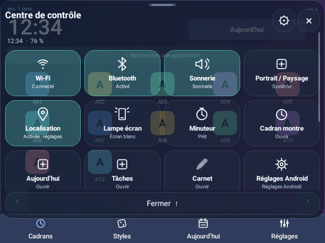</a></td><td align="center" valign="top"><b>Volume</b> <a href="assets/localized/fr/screenshots/volume-live-circle-open.png">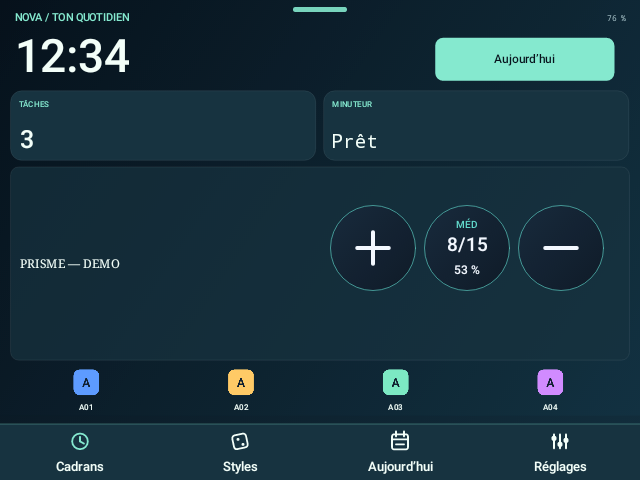</a></td></tr>
</table>

## Télécharger

**[Télécharger PRISME.apk — prêt à installer](https://github.com/s00r1/PRISME/releases/latest/download/PRISME.apk)** · [Versions et sommes de contrôle](https://github.com/s00r1/PRISME/releases)

1. La montre doit utiliser **Android complet 7.1 ou plus, API 25 minimum**, et accepter les APK Android ordinaires.
2. Téléchargez `PRISME.apk` dans son navigateur puis ouvrez-le avec l’installateur Android. Autorisez cette source d’installation si nécessaire.
3. Lancez PRISME ; choisissez-le comme accueil si le firmware le permet, ou ouvrez-le comme une application normale.
4. La superposition est nécessaire pour la pastille de volume et l’orientation globale. Certains boutons peuvent demander une autorisation ou ouvrir un réglage Android.
5. Choisissez la langue dans **Réglages → Style → Langue / Language**. Installez les mises à jour officielles par-dessus la version existante.

Depuis un ordinateur : `adb install -r PRISME.apk`. Installer PRISME ne nécessite ni root, ni changement de firmware, ni modification des services Google.

## Ce que contient PRISME

- **22 styles distincts** : calendrier, bureau, galerie, console, arcade, constellation, répertoire typographique, mosaïque, bulles, instruments, carnet et interface minimaliste.
- Navigation permanente : cadran d’origine, Styles, Aujourd’hui, Réglages. Un appui long sur Aujourd’hui ouvre cinq raccourcis personnalisables.
- **Centre de contrôle iOS ou Android** : boutons, ordre, couleurs, transparence, dimensions, position et gestes réglables.
- **Portrait / Paysage** : appui court pour tourner, appui long pour les orientations inversées et le retour Système. La notification propose aussi des commandes depuis une autre application. Fonction testée sur DM100 ; les autres firmwares peuvent la limiter.
- **Pastille de volume intégrée** : styles, formes, taille, opacité, position, déploiement et atténuation au repos.
- Recherche des applications et réglages, favoris, récents, espaces et noms personnalisés.
- Aujourd’hui, carnet à sauvegarde automatique, tâches, minuteur avec alarme Android, chronomètre avec tours et horloge de table.
- Zoom global, marges, textes, icônes, couleurs, profils et sauvegardes de sécurité locales.
- **Sept langues** : français, anglais, allemand, chinois simplifié, turc, russe, arabe, avec présentation de droite à gauche.

<!-- PRISME-VISUAL-SHOWCASE -->

## Le centre de contrôle, à votre façon

Deux présentations, iOS et Android. Choisissez vos raccourcis, leur ordre, la transparence, les couleurs, les dimensions, la position et les gestes. Appui court sur Portrait / Paysage pour pivoter ; appui long pour les options.

<table>
<tr><td align="center" valign="top"><b>iOS</b> </td><td align="center" valign="top"><b>Android</b> <a href="assets/localized/fr/screenshots/control-center-android.png">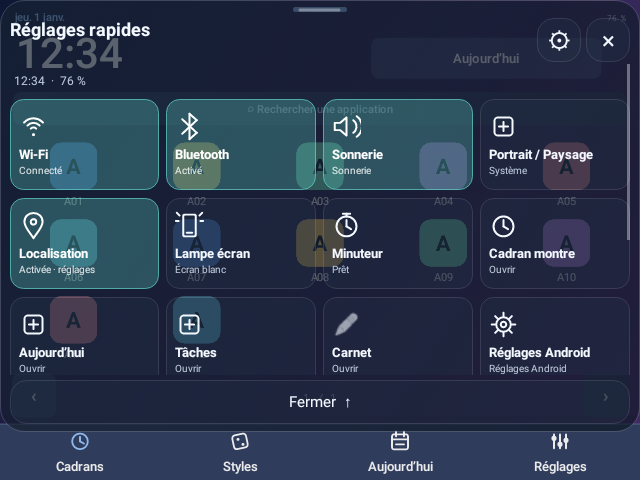</a></td></tr>
</table>

Voir les options de personnalisation

<table>
<tr><td align="center" valign="top"><b>Center Options Appearance</b> <a href="assets/localized/fr/screenshots/center-options-appearance.png">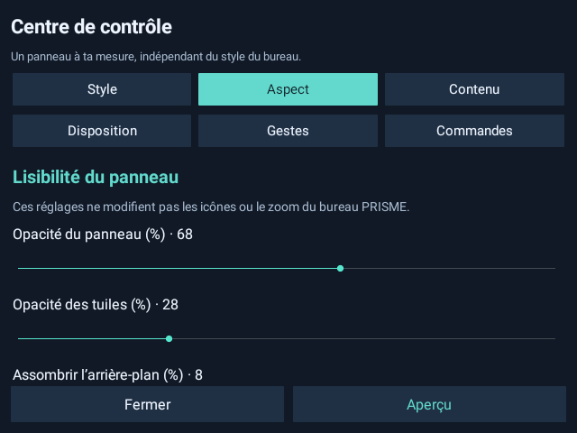</a></td><td align="center" valign="top"><b>Center Options Content</b> <a href="assets/localized/fr/screenshots/center-options-content.png">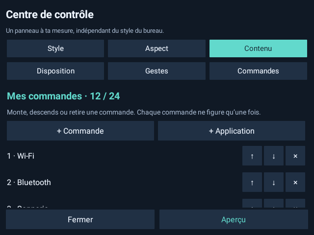</a></td><td align="center" valign="top"><b>Center Options Gestures</b> <a href="assets/localized/fr/screenshots/center-options-gestures.png">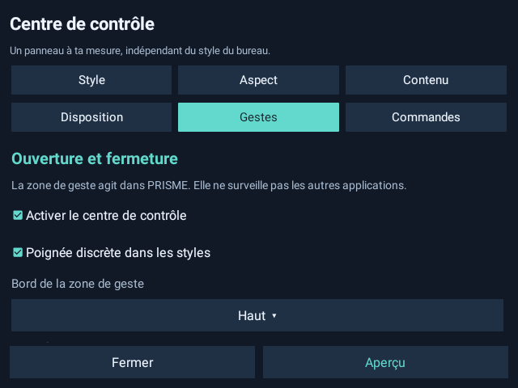</a></td></tr>
<tr><td align="center" valign="top"><b>Center Options Layout</b> <a href="assets/localized/fr/screenshots/center-options-layout.png">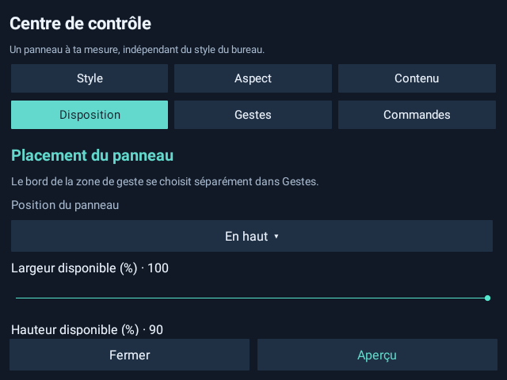</a></td><td align="center" valign="top"><b>Center Ios Transparent</b> <a href="assets/localized/fr/screenshots/center-ios-transparent.png">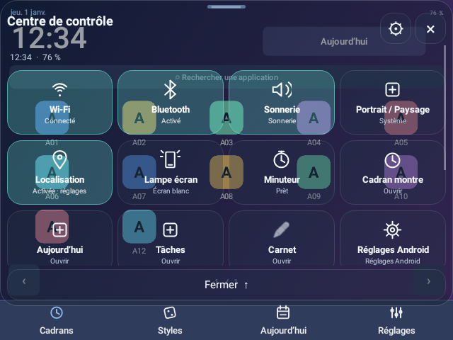</a></td><td align="center" valign="top"><b>Center Ios Opaque</b> <a href="assets/localized/fr/screenshots/center-ios-opaque.png">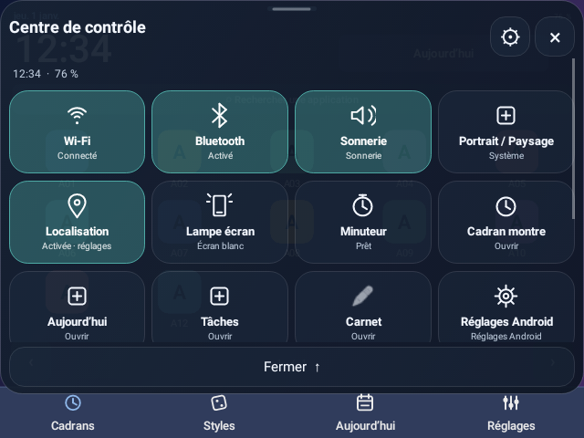</a></td></tr>
</table>

## La pastille de volume : visible, déployable, personnalisable

Un petit bouton flottant peut se déployer en commandes + et −. Formes, styles, taille, position et opacité se règlent séparément. Voici le vrai composant rendu sur Android, en gros plan puis dans le bureau.

<table>
<tr><td align="center" valign="top"><b>Cercle fermé</b> 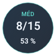</td><td align="center" valign="top"><b>Cercle déployé</b> 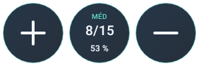</td><td align="center" valign="top"><b>Android</b> </td><td align="center" valign="top"><b>Néon</b> 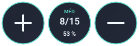</td></tr>
<tr><td align="center" valign="top"><b>Minimal</b> 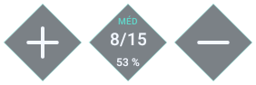</td><td align="center" valign="top"><b>Titane</b> </td><td align="center" valign="top"><b>Clair</b> 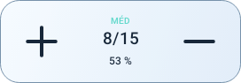</td><td align="center" valign="top"></td></tr>
</table>

<table>
<tr><td align="center" valign="top"><b>Cercle déployé</b> </td><td align="center" valign="top"><b>Android</b> <a href="assets/localized/fr/screenshots/volume-live-android.png">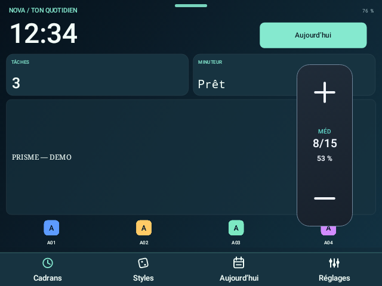</a></td></tr>
</table>

Voir les options de personnalisation

<table>
<tr><td align="center" valign="top"><b>Volume Options Style</b> <a href="assets/localized/fr/screenshots/volume-options-style.png">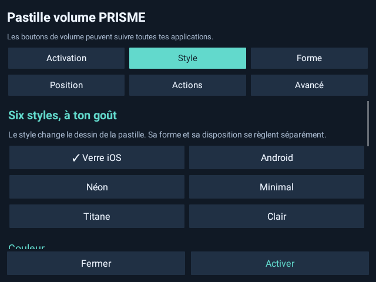</a></td><td align="center" valign="top"><b>Volume Options Shape</b> <a href="assets/localized/fr/screenshots/volume-options-shape.png">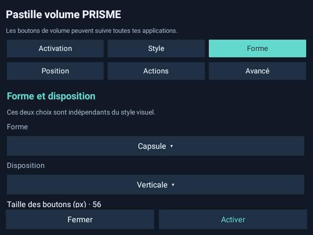</a></td></tr>
<tr><td align="center" valign="top"><b>Volume Options Position</b> <a href="assets/localized/fr/screenshots/volume-options-position.png">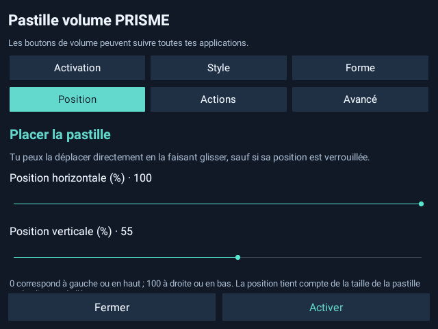</a></td><td align="center" valign="top"><b>Volume Options Advanced</b> <a href="assets/localized/fr/screenshots/volume-options-advanced.png">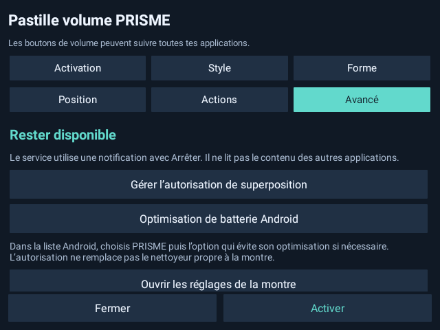</a></td></tr>
</table>

## Des styles vraiment différents

Calendrier, terminal, arcade, constellation, typographie, bulles ou tableau quotidien : les dispositions changent réellement. Touchez une image pour l’agrandir.

Les noms Apple, Samsung, Garmin ou autres présents dans les styles sont des inspirations visuelles, pas des modèles de montres compatibles.

<table>
<tr><td align="center" valign="top"><b>Prisme Touch</b> <a href="assets/localized/fr/styles/style_00.png">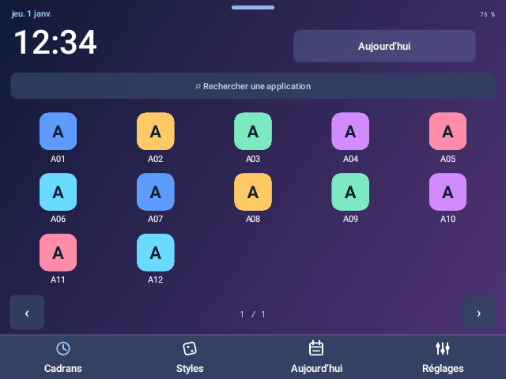</a></td><td align="center" valign="top"><b>Tablette</b> <a href="assets/localized/fr/styles/style_01.png">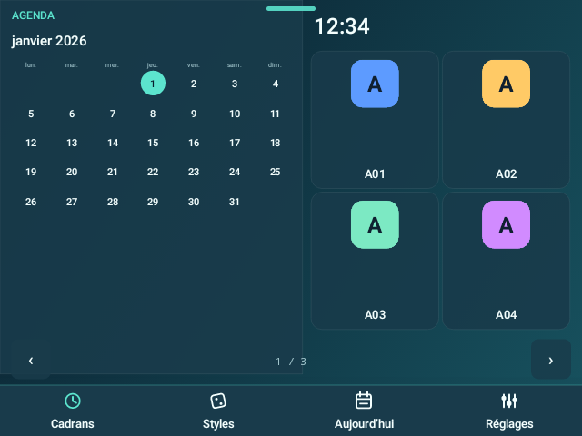</a></td><td align="center" valign="top"><b>Ghost Terminal</b> <a href="assets/localized/fr/styles/style_05.png">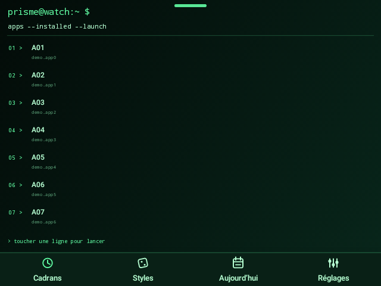</a></td></tr>
<tr><td align="center" valign="top"><b>Arcade 1986</b> <a href="assets/localized/fr/styles/style_06.png">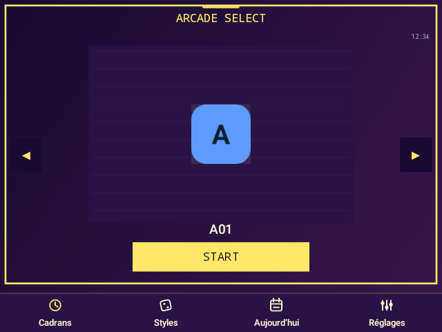</a></td><td align="center" valign="top"><b>Orbit</b> <a href="assets/localized/fr/styles/style_08.png">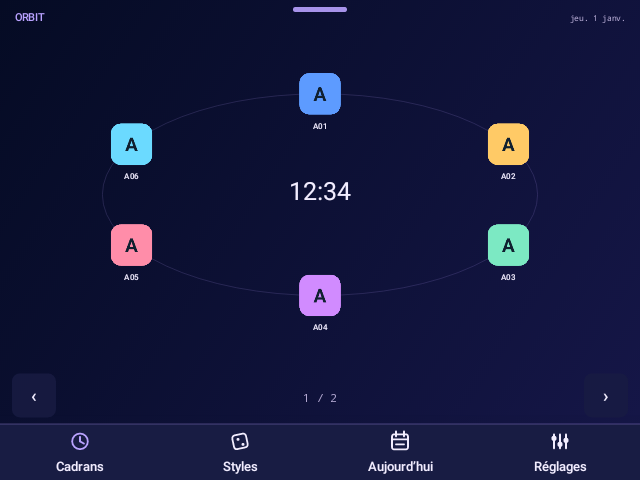</a></td><td align="center" valign="top"><b>Papier</b> <a href="assets/localized/fr/styles/style_09.png">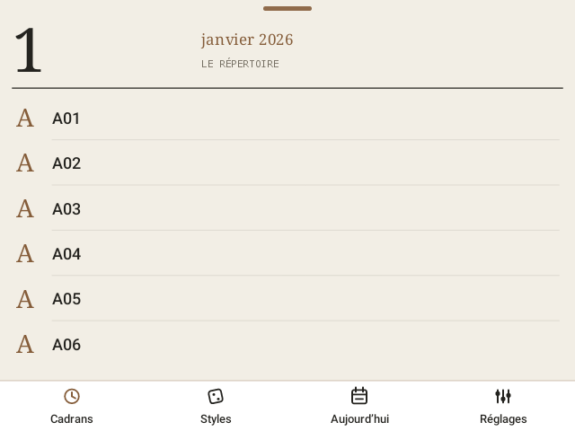</a></td></tr>
<tr><td align="center" valign="top"><b>Samsung Galaxy</b> <a href="assets/localized/fr/styles/style_13.png">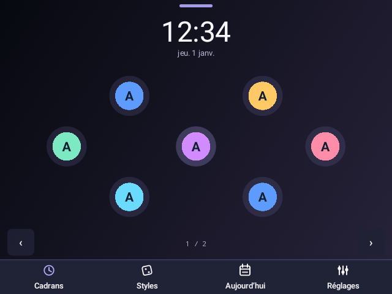</a></td><td align="center" valign="top"><b>Nova</b> <a href="assets/localized/fr/styles/style_20.png">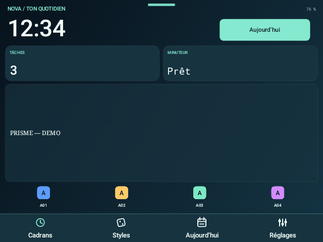</a></td><td align="center" valign="top"><b>Silence</b> <a href="assets/localized/fr/styles/style_21.png">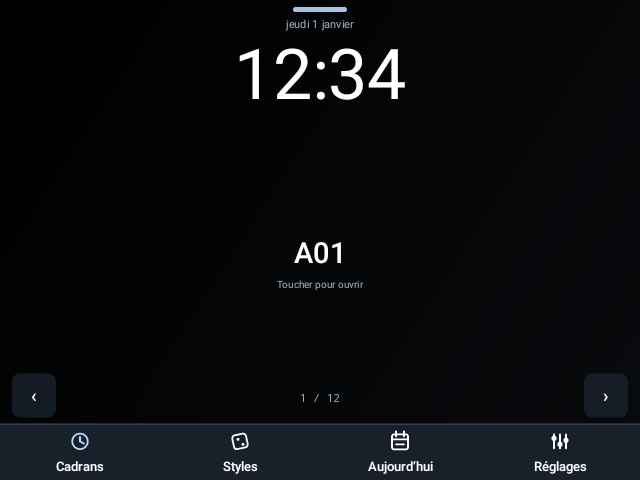</a></td></tr>
</table>

Afficher les 22 styles

<table>
<tr><td align="center" valign="top"><b>Prisme Touch</b> </td><td align="center" valign="top"><b>Tablette</b> </td><td align="center" valign="top"><b>Bureau Windows</b> <a href="assets/localized/fr/styles/style_02.png">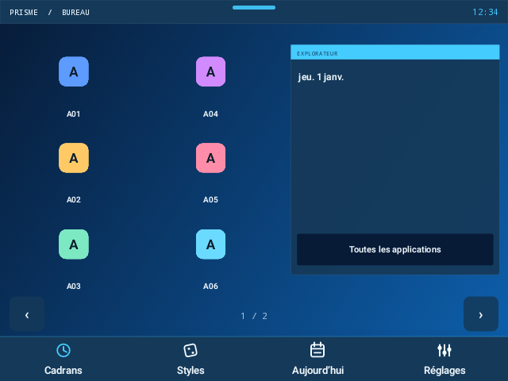</a></td></tr>
<tr><td align="center" valign="top"><b>Dock macOS</b> <a href="assets/localized/fr/styles/style_03.png">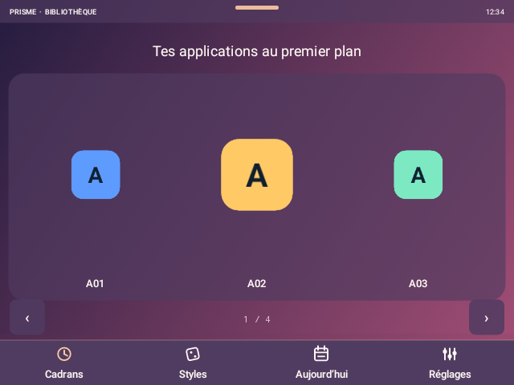</a></td><td align="center" valign="top"><b>Kali Workbench</b> <a href="assets/localized/fr/styles/style_04.png">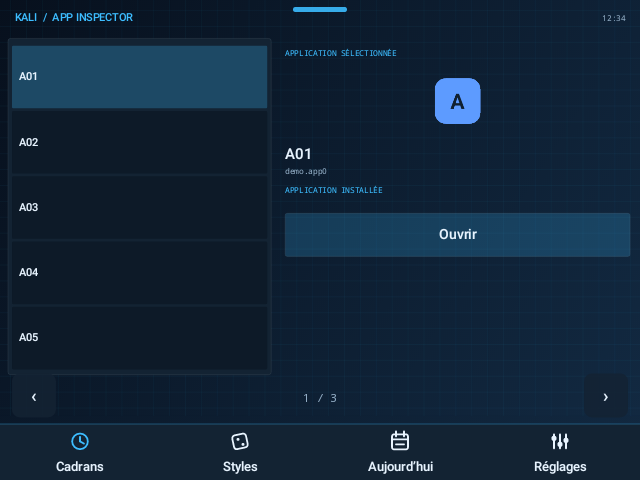</a></td><td align="center" valign="top"><b>Ghost Terminal</b> </td></tr>
<tr><td align="center" valign="top"><b>Arcade 1986</b> </td><td align="center" valign="top"><b>Meca Cockpit</b> <a href="assets/localized/fr/styles/style_07.png">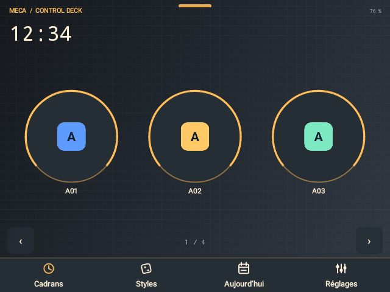</a></td><td align="center" valign="top"><b>Orbit</b> </td></tr>
<tr><td align="center" valign="top"><b>Papier</b> </td><td align="center" valign="top"><b>Aurora</b> <a href="assets/localized/fr/styles/style_10.png">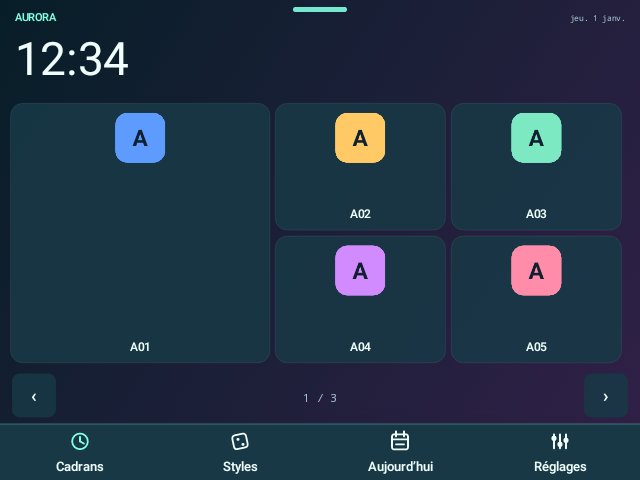</a></td><td align="center" valign="top"><b>LCD Studio</b> <a href="assets/localized/fr/styles/style_11.png">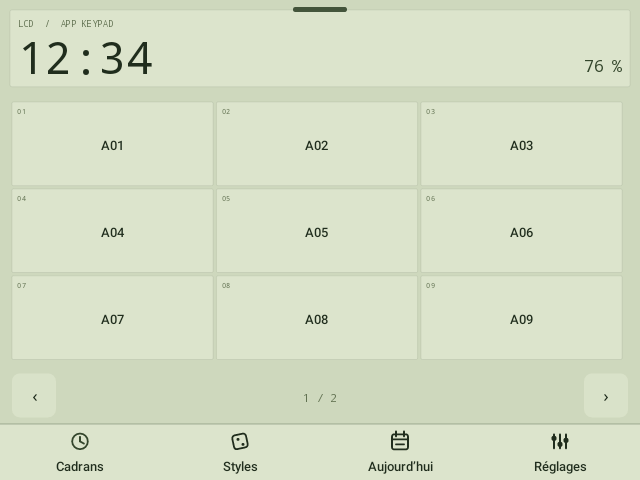</a></td></tr>
<tr><td align="center" valign="top"><b>Apple Ultra</b> <a href="assets/localized/fr/styles/style_12.png">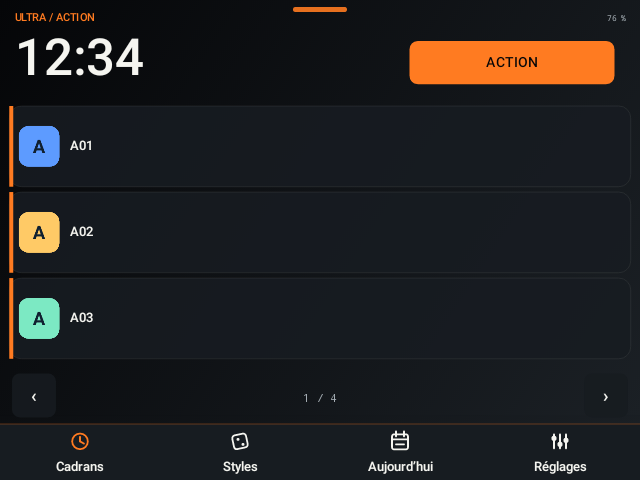</a></td><td align="center" valign="top"><b>Samsung Galaxy</b> </td><td align="center" valign="top"><b>Garmin MARQ</b> <a href="assets/localized/fr/styles/style_14.png">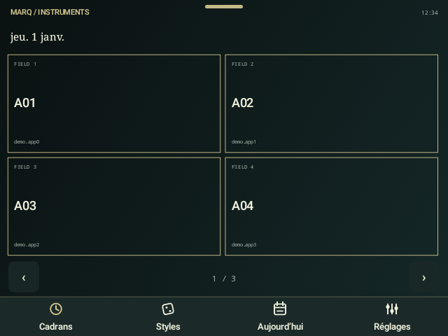</a></td></tr>
<tr><td align="center" valign="top"><b>TAG Racing</b> <a href="assets/localized/fr/styles/style_15.png">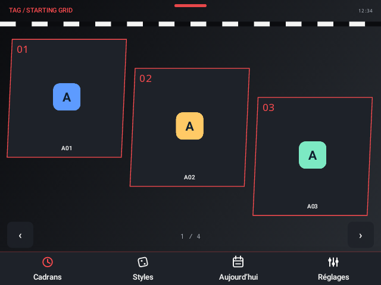</a></td><td align="center" valign="top"><b>Hublot Fusion</b> <a href="assets/localized/fr/styles/style_16.png">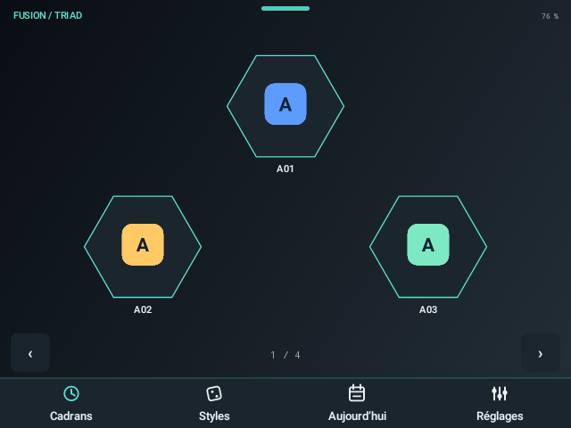</a></td><td align="center" valign="top"><b>Tambour Light</b> <a href="assets/localized/fr/styles/style_17.png">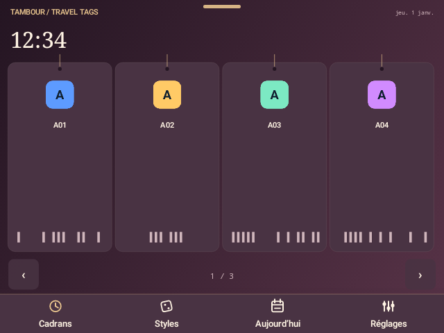</a></td></tr>
<tr><td align="center" valign="top"><b>Montblanc Summit</b> <a href="assets/localized/fr/styles/style_18.png">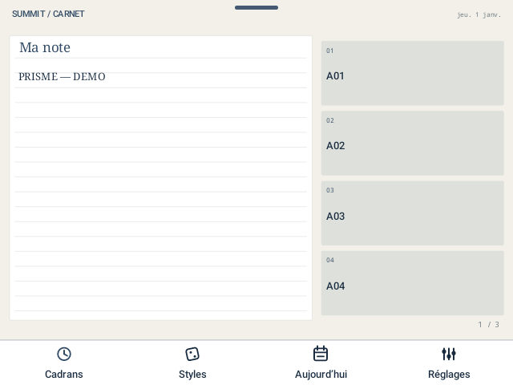</a></td><td align="center" valign="top"><b>Ultimate Design</b> <a href="assets/localized/fr/styles/style_19.png">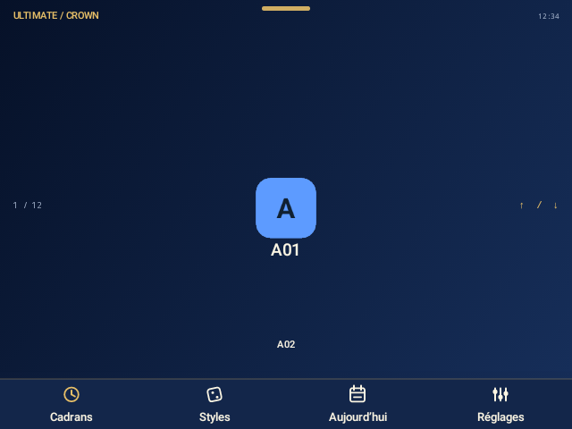</a></td><td align="center" valign="top"><b>Nova</b> </td></tr>
<tr><td align="center" valign="top"><b>Silence</b> </td><td align="center" valign="top"></td><td align="center" valign="top"></td></tr>
</table>

## Les outils du quotidien

<table>
<tr><td align="center" valign="top"><b>Today</b> <a href="assets/localized/fr/screenshots/today.png">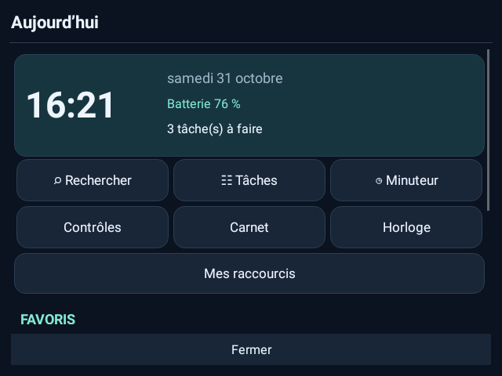</a></td><td align="center" valign="top"><b>Notes</b> <a href="assets/localized/fr/screenshots/notes.png">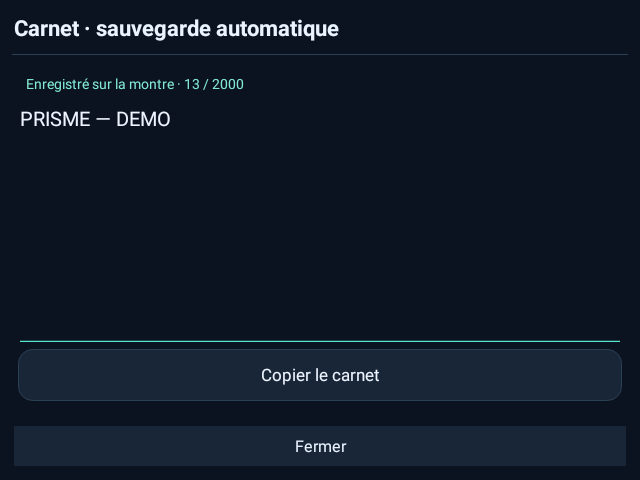</a></td></tr>
<tr><td align="center" valign="top"><b>Checklist</b> <a href="assets/localized/fr/screenshots/checklist.png">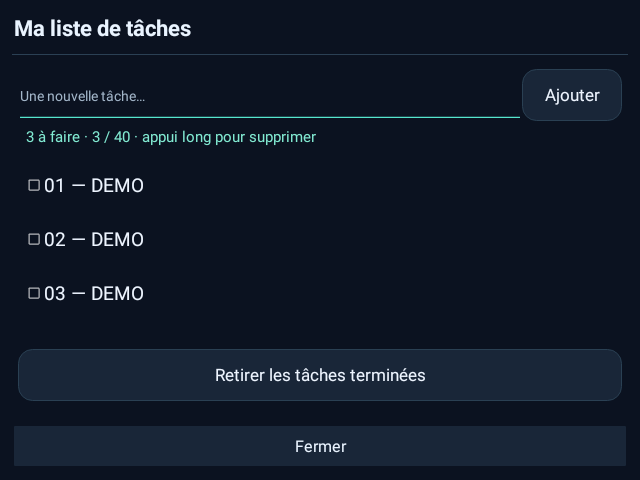</a></td><td align="center" valign="top"><b>Timer</b> <a href="assets/localized/fr/screenshots/timer.png">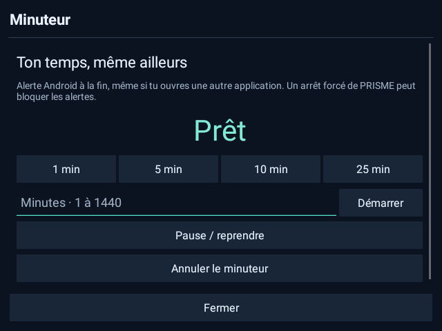</a></td></tr>
</table>

## Des réglages organisés par catégories

<table>
<tr><td align="center" valign="top"><b>Settings Style</b> <a href="assets/localized/fr/screenshots/settings-style.png">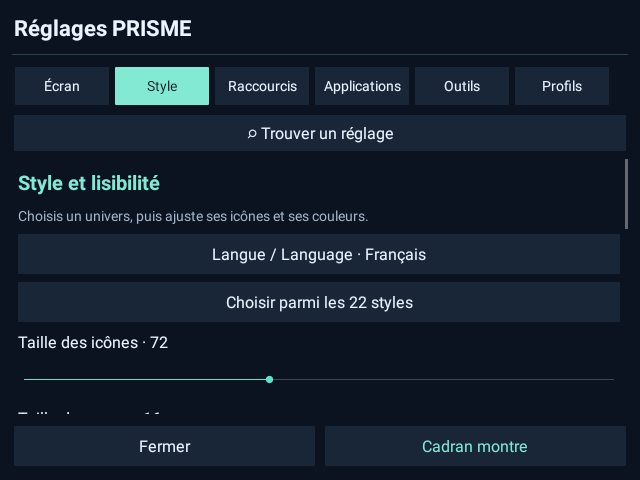</a></td><td align="center" valign="top"><b>Settings Shortcuts</b> <a href="assets/localized/fr/screenshots/settings-shortcuts.png">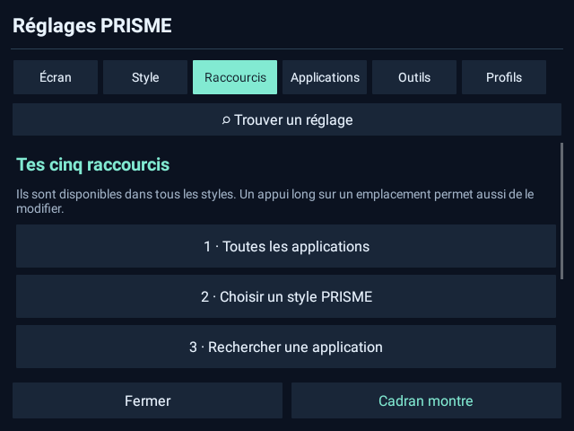</a></td><td align="center" valign="top"><b>Settings Tools</b> <a href="assets/localized/fr/screenshots/settings-tools.png">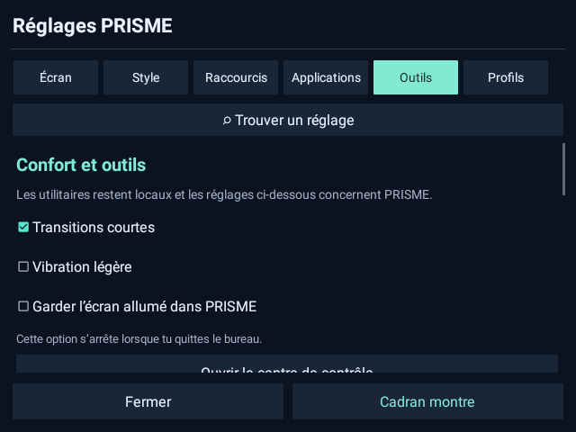</a></td></tr>
</table>

Toutes les captures de PRISME utilisent une application de démonstration isolée, des icônes génériques et des contenus fictifs ; aucun compte ou catalogue personnel n’est montré.

<!-- /PRISME-VISUAL-SHOWCASE -->

## Montres

| Montre ou famille | Statut |
|---|---|
| Domiwear / Domino DM100, Android 7.1.1 | **Testée sur appareil**, référence 640 × 480 en paysage |
| Autres variantes DM100 | À vérifier : un nom similaire ne garantit pas le même firmware |
| Autres montres rectangulaires au format de référence 2,86″ / 640 × 480 | Non validées ; essai séparé nécessaire |

Les modèles non testés sont des **candidats, pas une liste certifiée**. Vérifiez le véritable système, son niveau API et l’installation d’APK sur la montre. Ce projet n’est pas un cadran Wear OS : Pixel Watch et Galaxy Watch Wear OS ne sont pas validées. watchOS, Tizen et les systèmes propriétaires sans APK Android sont hors cible. [Critères et sources](docs/COMPATIBILITY.md).

## Voir PRISME

[Menus et options](docs/SCREENSHOTS.md) · [Les 22 styles](docs/STYLES.md)

Les images utilisent les vraies interfaces d’une version de démonstration séparée, avec données et icônes fictives. Elles ne montrent aucun compte ni catalogue personnel d’applications.

## Confidentialité et limites

L’application ne déclare pas la permission Internet. Notes, tâches, favoris et historique des lancements depuis PRISME restent dans son stockage local ; les exports choisis par l’utilisateur peuvent les contenir. Le dépôt n’inclut aucune clé privée, sauvegarde utilisateur, capture de compte, identifiant de montre ou journal personnel.

La gestion de batterie constructeur peut arrêter le minuteur et les services flottants. Les commandes musicales nécessitent un lecteur actif. Les traductions secondaires peuvent être affinées. Les bandes physiques latérales signalées sur une DM100 restent **sans réparation confirmée** ; PRISME ne prétend pas modifier la dalle ou réparer son pilote. L’affichage sur d’autres écrans n’est pas garanti.

## Sources et contribution

Java, ressources, catalogues de langues, tests et compagnon Imou optionnel sont fournis. [Compiler et tester](docs/BUILD.md) · [Permissions et données](docs/PRIVACY.md) · [Signaler une compatibilité](https://github.com/s00r1/PRISME/issues/new/choose).

Code original sous licence MIT : utilisation, modification et redistribution autorisées avec conservation de la notice. Les marques citées dans les styles décrivent une inspiration visuelle, sans affiliation.

[◈ PRISME — Website / Site web](https://s00r1.github.io/PRISME/) · [Community / Testers](https://github.com/s00r1/PRISME/discussions/1)
