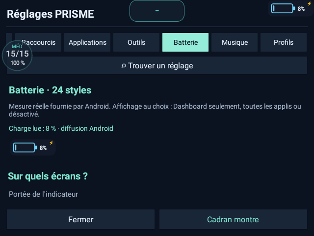
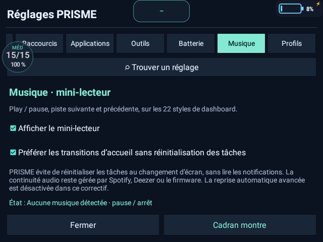

# Audit PRISME — 5 novembre 2026

## Périmètre et version

Base GitHub : `4f8cd1cbb568c7dc058fd5799a7582d26cddc35b`, branche main de s00r1/PRISME. Code et montre : 5.4.1 / versionCode 20. APK public : Release v5.4. Cet audit apporte un correctif local signé de 5.4.1, sans créer de nouvelle Release ni prétendre valider toutes les fonctions.

## Corrections

- Réglages : défilement automatique vers l’onglet sélectionné. Avant : Musique n’occupait que 15 pixels visibles (x=613–628), Profils était hors champ. Après mise à jour sur la DM100 : Musique x=429–527, Profils x=529–627.
- Galerie : seule la dernière demande de langue peut modifier les images ; les réponses HTTP en erreur et les données invalides affichent un message permettant de réessayer. La fenêtre de zoom peut changer d’image sans être ouverte deux fois.
- Compilation GitHub : déclenchement sur les ressources et build.ps1, ainsi que sur les pull requests pertinentes.
- Tests : ajout des préférences Batterie/Musique et des scénarios d’échec/concurrence de la galerie dans l’intégration continue.
- Documentation : distinction explicite entre source 5.4.1 et Release publique 5.4, captures réelles des nouveaux réglages et lien depuis les sept README traduits.

## Vérifications effectuées

- Compilation complète avec JDK 25, SDK Android 37, bytecode Java 8 et DEX min-api 25 : succès. Cela ne constitue pas un audit exhaustif des API accessibles sous Android 7.
- Cinq suites Java existantes : 65 495 assertions ; nouvelles préférences : 104 assertions ; total : **65 599**, succès.
- Test JavaScript isolé : chargement initial, fenêtre de zoom, langues concurrentes, erreur HTTP, données invalides, reprise : succès. Ce test emploie un DOM simulé, pas un navigateur graphique.
- 451 références d’images de galerie vérifiées sur disque ; liens locaux des huit README vérifiés.
- Site public : HTTP 200 avant intervention.
- APK corrigé : signature vérifiée avec apksigner, certificat SHA-256 identique à l’APK installé ; mise à jour `adb install -r` réussie sans désinstallation.
- Montre DM100 réelle : lancement, réglages Musique/Batterie/Profils, visibilité de l’onglet actif, retour accueil et relancement. Aucun enregistrement PRISME dans le tampon de crash consulté.

## Captures réelles

Ces écrans proviennent de la montre USB, après installation du correctif. Ils ne contiennent ni notes, ni comptes, ni liste d’applications personnelles. La galerie historique reste une galerie de démonstration.

## Limites et essais restant à faire

Pas de lecteur musical actif pendant cet audit : lecture/pause, pistes, continuité en arrière-plan et interactions Spotify/Deezer ne sont pas validées ici. Pas de mesure électrique indépendante de la batterie, de redémarrage, d’essai prolongé d’autonomie, de contrôle exhaustif des 22 styles, des sept langues ou des appareils autres que cette DM100. Les suites de géométrie sont des tests de modèles, pas des essais matériels sur 378 écrans. La certification Play Protect n’est pas établie par la signature ni par l’installation USB.

Le minuteur, les sauvegardes/restaurations utilisateur, les interactions avec les applications tierces et tous les compagnons n’ont pas fait l’objet d’une nouvelle validation matérielle complète. Les données utilisateur n’ont pas été effacées.
