# PRISME — للساعات المستطيلة فقط

## المرجع: شاشة كبيرة 2.86 بوصة · عرض أفقي 640 × 480 بنسبة 4:3 · Android الكامل 7.1+ / API 25+

> **ليس للساعات الدائرية أو المربعة. يستهدف هذا الإصدار الشكل المستطيل لـ DM100. الأحجام والدقات المستطيلة الأخرى غير معتمدة بعد.**

<table>
<tr><td align="center" valign="top"></td><td align="center" valign="top"></td></tr>
</table>

**Domiwear / Domino DM100 — الطراز المرجعي المختبَر، صورتان للطراز نفسه**

صور منتجات خارجية من صفحة DM100، لعرض الجهاز وليست صوراً لـ PRISME. [Source](https://www.ebay.nl/itm/185939246016) · [Specifications](https://www.domino-china.com/news/19.html)

[Français](README.fr.md) · [English](README.en.md) · [Deutsch](README.de.md) · [中文](README.zh.md) · [Türkçe](README.tr.md) · [Русский](README.ru.md) · [العربية](README.ar.md)

**شاشة رئيسية قابلة للتخصيص للساعات التي تعمل بنظام Android الكامل.** تعمل دون اتصال، ولا تحتاج إلى حساب ولا تحتوي على إعلانات أو تتبّع.

**[⬇ تنزيل APK](https://github.com/s00r1/PRISME/releases/latest/download/PRISME.apk)** · [Control Center](#control-center) · [Volume](#floating-volume) · [22 styles](#styles-showcase)

<table>
<tr><td align="center" valign="top"><b>Control Center</b> <a href="../assets/localized/ar/screenshots/control-center-ios.png">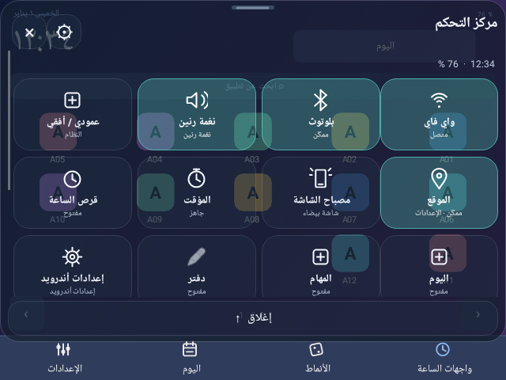</a></td><td align="center" valign="top"><b>Volume</b> <a href="../assets/localized/ar/screenshots/volume-live-circle-open.png">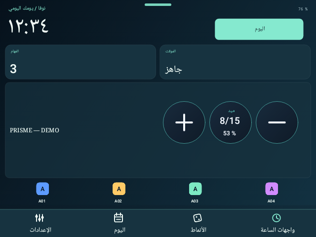</a></td></tr>
</table>

## التثبيت

**[تنزيل PRISME.apk الجاهز للتثبيت](https://github.com/s00r1/PRISME/releases/latest/download/PRISME.apk)** · [الإصدارات وبصمات التحقق](https://github.com/s00r1/PRISME/releases)

تحتاج الساعة إلى **Android الكامل 7.1 أو أحدث، بحد أدنى API 25** وإمكانية تثبيت ملفات Android APK العادية. نزّل الملف من متصفح الساعة وافتحه بمثبّت Android، واسمح بمصدر التثبيت عند الطلب. افتح PRISME واختره كشاشة رئيسية إذا سمح النظام، أو شغّله كتطبيق عادي. زر الصوت العائم والاتجاه العام يحتاجان إلى إذن الظهور فوق التطبيقات. اختر اللغة من **الإعدادات ← المظهر ← اللغة**. ثبّت التحديثات الرسمية فوق النسخة الموجودة.

من الكمبيوتر: `adb install -r PRISME.apk`. لا يتطلب التثبيت root أو تغيير البرنامج الثابت أو خدمات Google.

## المزايا

- **22 تصميماً مختلفاً**: تقويم، سطح مكتب، معرض، طرفية، ألعاب كلاسيكية، كوكبة، دليل نصي، فسيفساء، خلايا، عدادات، دفتر ملاحظات وشاشة مبسطة.
- تنقل دائم إلى واجهة الساعة الأصلية والأنماط واليوم والإعدادات. الضغط المطوّل على «اليوم» يفتح خمسة اختصارات قابلة للتخصيص.
- **مركز تحكم بأسلوب iOS أو Android** مع تخصيص الأزرار وترتيبها والألوان والشفافية والحجم والموقع والإيماءات. بعض الأوامر تفتح إعداد Android المقابل.
- **عمودي / أفقي**: لمسة للتدوير، وضغطة طويلة للاتجاهات المعكوسة ووضع النظام. تتوفر أوامر أيضاً في الإشعار أثناء استخدام تطبيق آخر. اختُبرت على DM100 وقد تقيّدها أنظمة أخرى.
- **صوت عائم** بأنماط وأشكال وحجم وعتامة وموقع قابل للتعديل، وأزرار قابلة للتوسيع وتلاشي أثناء الخمول.
- بحث في التطبيقات والإعدادات، ومفضلة وتطبيقات أخيرة ومساحات عمل وأسماء مخصصة.
- اليوم، وملاحظات تُحفظ تلقائياً، ومهام، ومؤقت بتنبيه Android، وساعة إيقاف بجولات وساعة مكتبية.
- مقياس عام وهوامش وأحجام نصوص وأيقونات وألوان وملفات إعداد ونسخ محلية.
- **الفرنسية والإنجليزية والألمانية والصينية المبسطة والتركية والروسية والعربية**، مع دعم العرض من اليمين إلى اليسار.

<!-- PRISME-VISUAL-SHOWCASE -->

## مركز التحكم بالطريقة التي تفضلها

واجهة iOS أو Android مع تخصيص الاختصارات والترتيب والشفافية والألوان والحجم والموقع والإيماءات. المس عمودي / أفقي للتدوير واضغط مطولاً للخيارات.

<table>
<tr><td align="center" valign="top"><b>iOS</b> </td><td align="center" valign="top"><b>Android</b> <a href="../assets/localized/ar/screenshots/control-center-android.png">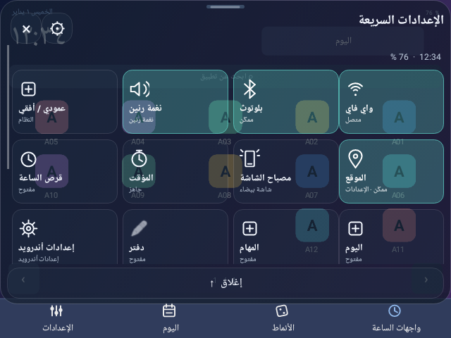</a></td></tr>
</table>

عرض خيارات التخصيص

<table>
<tr><td align="center" valign="top"><b>Center Options Appearance</b> <a href="../assets/localized/ar/screenshots/center-options-appearance.png">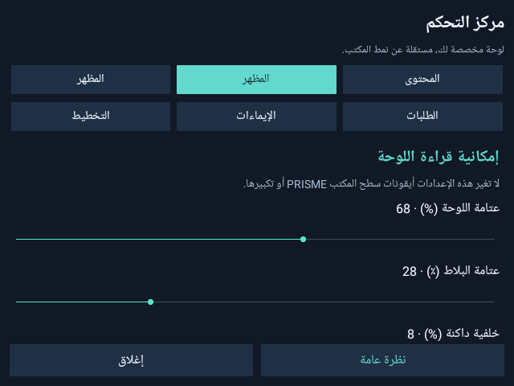</a></td><td align="center" valign="top"><b>Center Options Content</b> <a href="../assets/localized/ar/screenshots/center-options-content.png">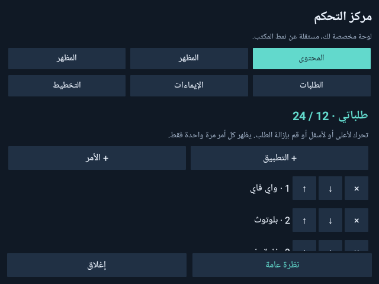</a></td><td align="center" valign="top"><b>Center Options Gestures</b> <a href="../assets/localized/ar/screenshots/center-options-gestures.png">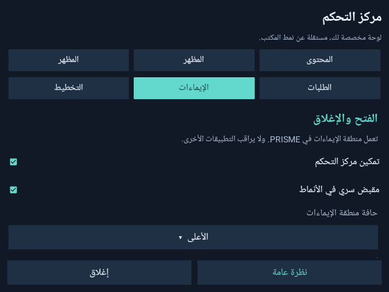</a></td></tr>
<tr><td align="center" valign="top"><b>Center Options Layout</b> <a href="../assets/localized/ar/screenshots/center-options-layout.png">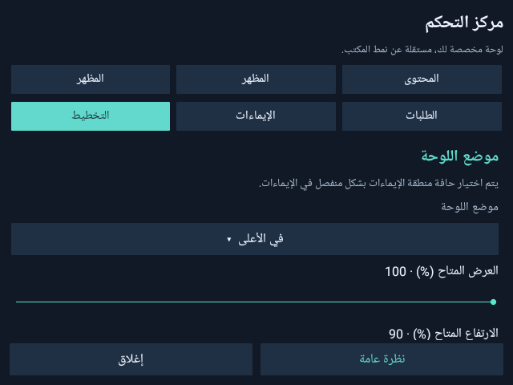</a></td><td align="center" valign="top"><b>Center Ios Transparent</b> <a href="../assets/localized/ar/screenshots/center-ios-transparent.png">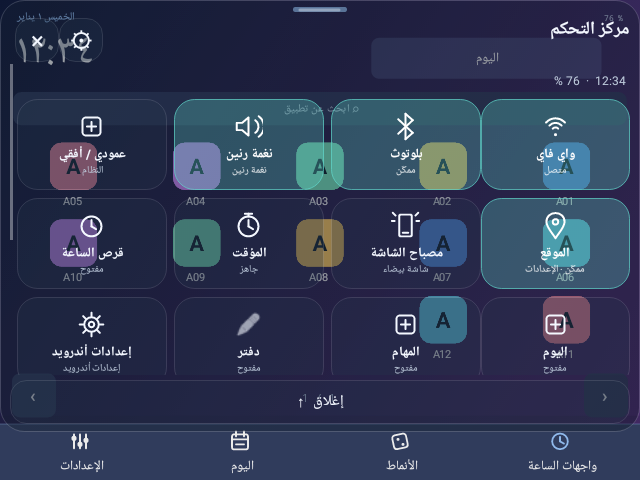</a></td><td align="center" valign="top"><b>Center Ios Opaque</b> <a href="../assets/localized/ar/screenshots/center-ios-opaque.png">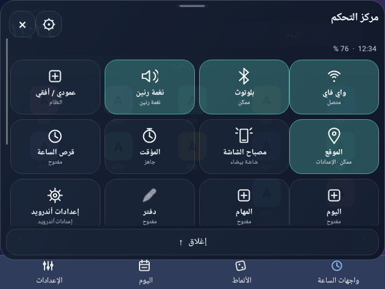</a></td></tr>
</table>

## صوت عائم صغير وقابل للتوسيع والتخصيص

يمكن توسيع الزر إلى + و−. الشكل والنمط والحجم والموقع والعتامة إعدادات مستقلة. هذه مكونات Android الحقيقية، عن قرب وعلى الشاشة الرئيسية.

<table>
<tr><td align="center" valign="top"><b>دائرة مغلقة</b> 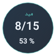</td><td align="center" valign="top"><b>دائرة موسعة</b> 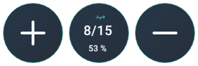</td><td align="center" valign="top"><b>Android</b> </td><td align="center" valign="top"><b>نيون</b> 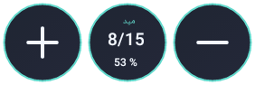</td></tr>
<tr><td align="center" valign="top"><b>بسيط</b> 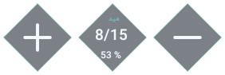</td><td align="center" valign="top"><b>تيتانيوم</b> </td><td align="center" valign="top"><b>فاتح</b> 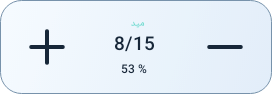</td><td align="center" valign="top"></td></tr>
</table>

<table>
<tr><td align="center" valign="top"><b>دائرة موسعة</b> </td><td align="center" valign="top"><b>Android</b> <a href="../assets/localized/ar/screenshots/volume-live-android.png">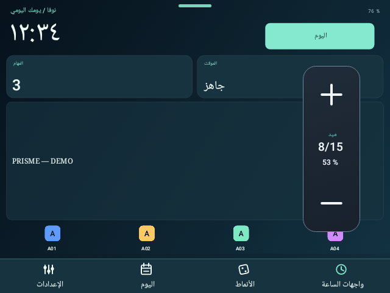</a></td></tr>
</table>

عرض خيارات التخصيص

<table>
<tr><td align="center" valign="top"><b>Volume Options Style</b> <a href="../assets/localized/ar/screenshots/volume-options-style.png">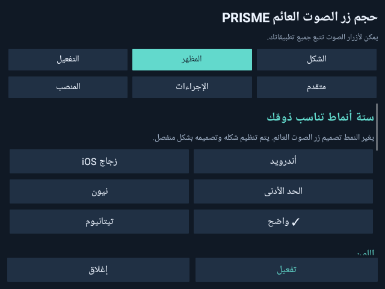</a></td><td align="center" valign="top"><b>Volume Options Shape</b> <a href="../assets/localized/ar/screenshots/volume-options-shape.png">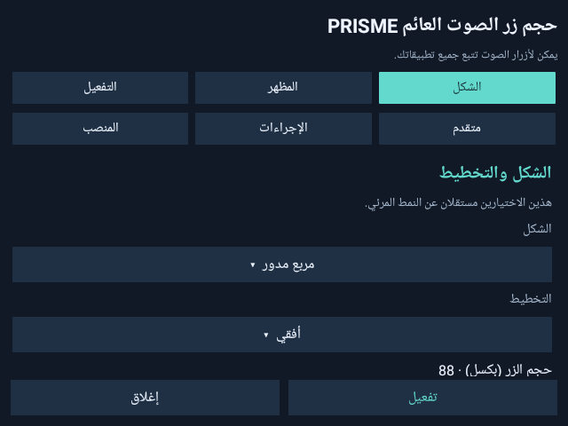</a></td></tr>
<tr><td align="center" valign="top"><b>Volume Options Position</b> <a href="../assets/localized/ar/screenshots/volume-options-position.png">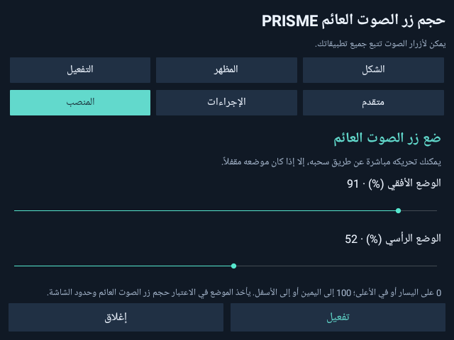</a></td><td align="center" valign="top"><b>Volume Options Advanced</b> <a href="../assets/localized/ar/screenshots/volume-options-advanced.png">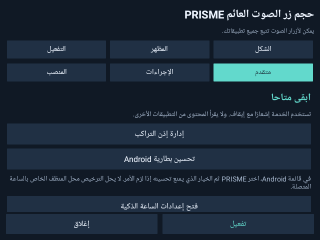</a></td></tr>
</table>

## أنماط مختلفة فعلاً

تقويم وطرفية وألعاب كلاسيكية وكوكبة ودليل نصي وخلايا ولوحة يومية بتخطيطات مختلفة. افتح الصور بالحجم الكامل.

أسماء Apple وSamsung وGarmin في الأنماط تعني الإلهام البصري وليست طرازات ساعات متوافقة.

<table>
<tr><td align="center" valign="top"><b>Prisme Touch</b> <a href="../assets/localized/ar/styles/style_00.png">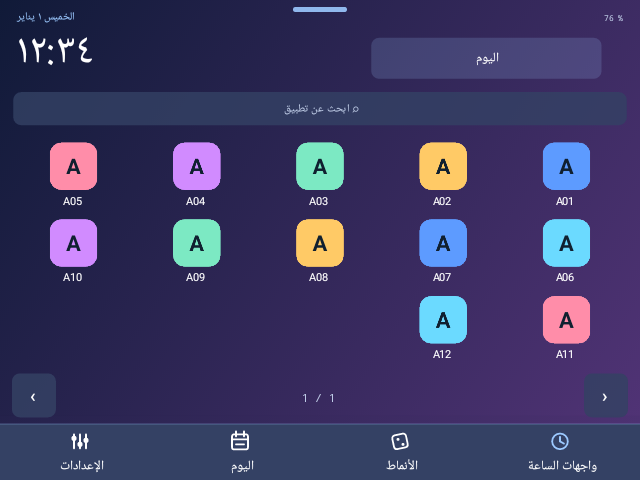</a></td><td align="center" valign="top"><b>Tablette</b> <a href="../assets/localized/ar/styles/style_01.png">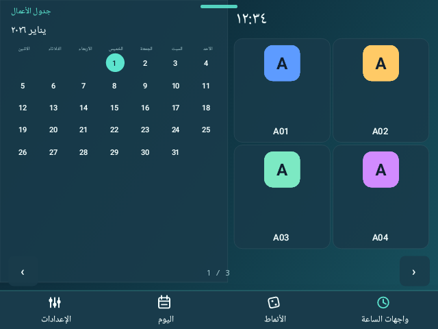</a></td><td align="center" valign="top"><b>Ghost Terminal</b> <a href="../assets/localized/ar/styles/style_05.png">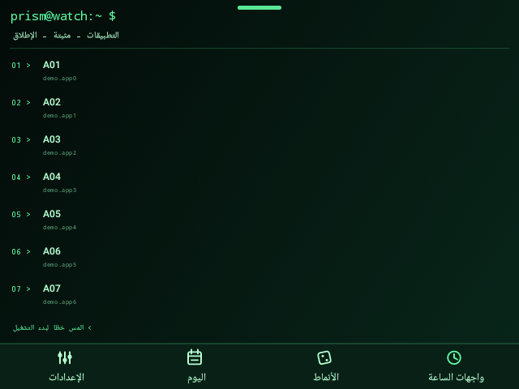</a></td></tr>
<tr><td align="center" valign="top"><b>Arcade 1986</b> <a href="../assets/localized/ar/styles/style_06.png">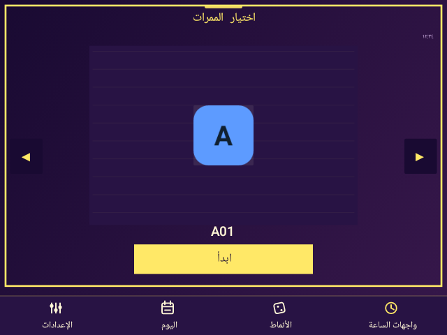</a></td><td align="center" valign="top"><b>Orbit</b> <a href="../assets/localized/ar/styles/style_08.png">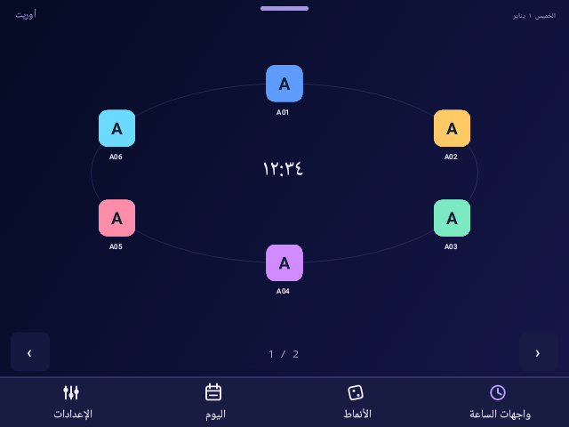</a></td><td align="center" valign="top"><b>Papier</b> <a href="../assets/localized/ar/styles/style_09.png">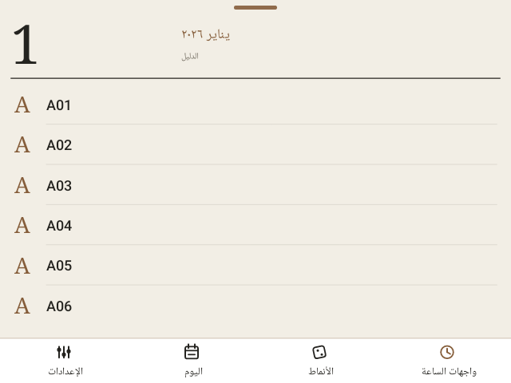</a></td></tr>
<tr><td align="center" valign="top"><b>Samsung Galaxy</b> <a href="../assets/localized/ar/styles/style_13.png">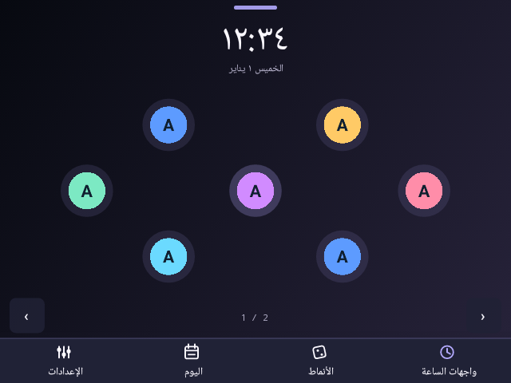</a></td><td align="center" valign="top"><b>Nova</b> <a href="../assets/localized/ar/styles/style_20.png">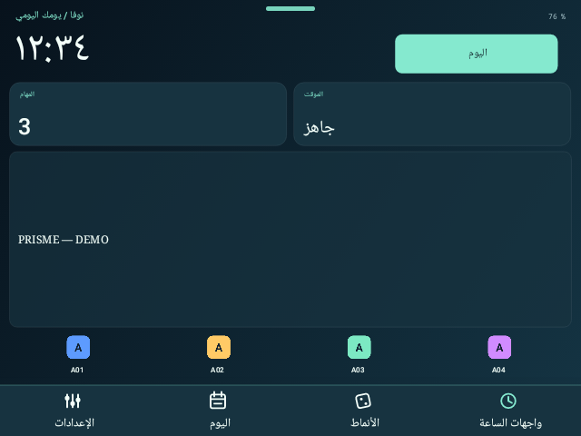</a></td><td align="center" valign="top"><b>Silence</b> <a href="../assets/localized/ar/styles/style_21.png">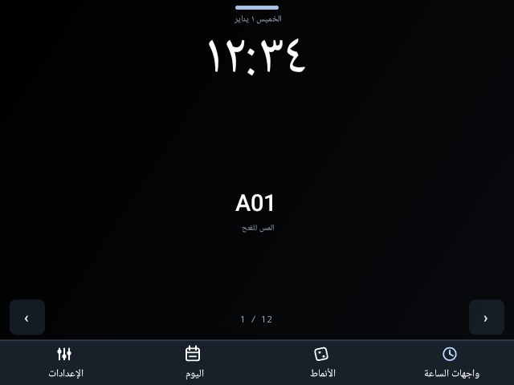</a></td></tr>
</table>

عرض الأنماط الـ22

<table>
<tr><td align="center" valign="top"><b>Prisme Touch</b> </td><td align="center" valign="top"><b>Tablette</b> </td><td align="center" valign="top"><b>Bureau Windows</b> <a href="../assets/localized/ar/styles/style_02.png">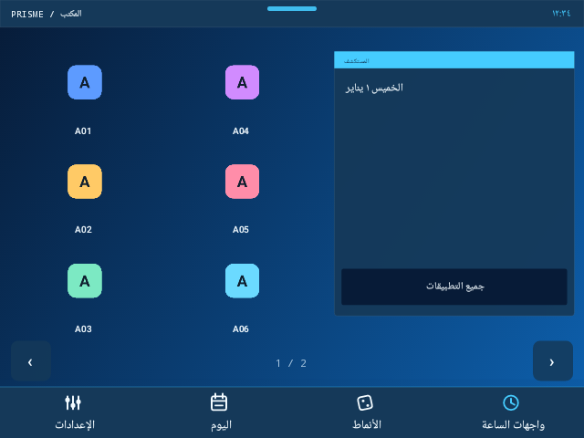</a></td></tr>
<tr><td align="center" valign="top"><b>Dock macOS</b> <a href="../assets/localized/ar/styles/style_03.png">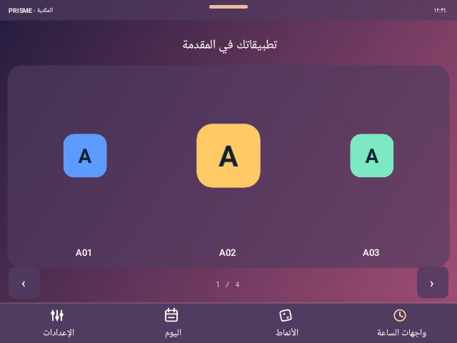</a></td><td align="center" valign="top"><b>Kali Workbench</b> <a href="../assets/localized/ar/styles/style_04.png">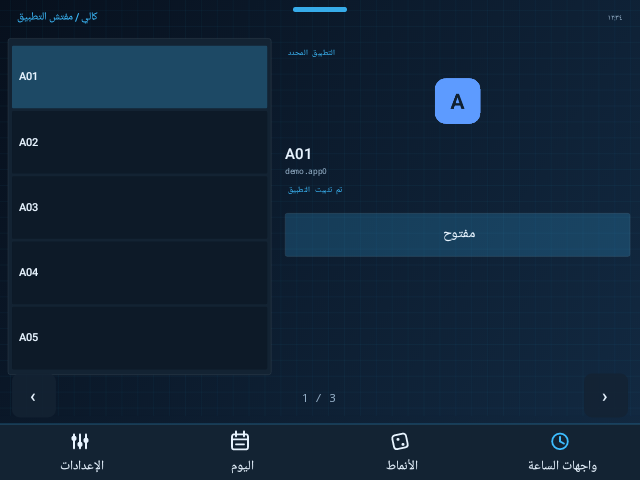</a></td><td align="center" valign="top"><b>Ghost Terminal</b> </td></tr>
<tr><td align="center" valign="top"><b>Arcade 1986</b> </td><td align="center" valign="top"><b>Meca Cockpit</b> <a href="../assets/localized/ar/styles/style_07.png">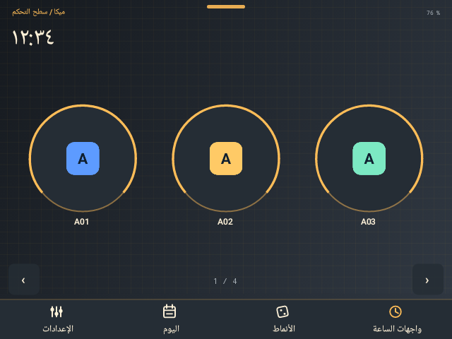</a></td><td align="center" valign="top"><b>Orbit</b> </td></tr>
<tr><td align="center" valign="top"><b>Papier</b> </td><td align="center" valign="top"><b>Aurora</b> <a href="../assets/localized/ar/styles/style_10.png">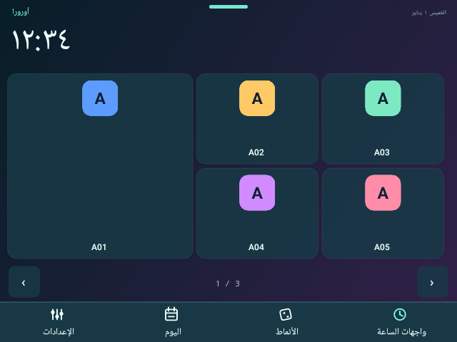</a></td><td align="center" valign="top"><b>LCD Studio</b> <a href="../assets/localized/ar/styles/style_11.png">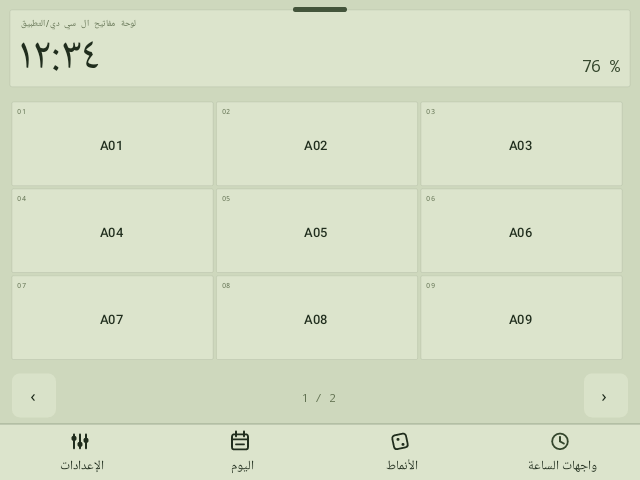</a></td></tr>
<tr><td align="center" valign="top"><b>Apple Ultra</b> <a href="../assets/localized/ar/styles/style_12.png">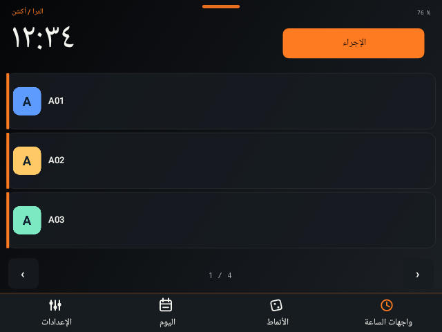</a></td><td align="center" valign="top"><b>Samsung Galaxy</b> </td><td align="center" valign="top"><b>Garmin MARQ</b> <a href="../assets/localized/ar/styles/style_14.png">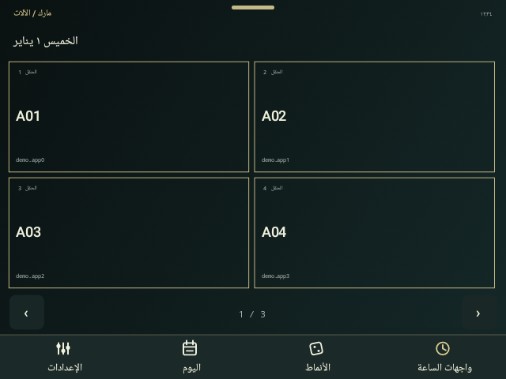</a></td></tr>
<tr><td align="center" valign="top"><b>TAG Racing</b> <a href="../assets/localized/ar/styles/style_15.png">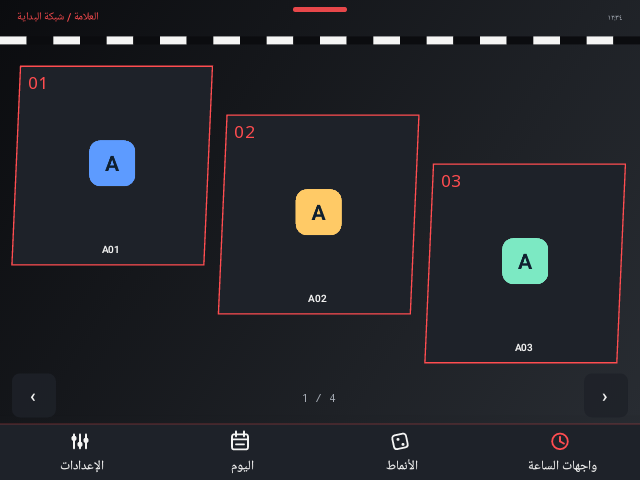</a></td><td align="center" valign="top"><b>Hublot Fusion</b> <a href="../assets/localized/ar/styles/style_16.png">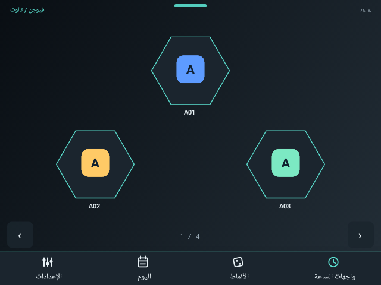</a></td><td align="center" valign="top"><b>Tambour Light</b> <a href="../assets/localized/ar/styles/style_17.png">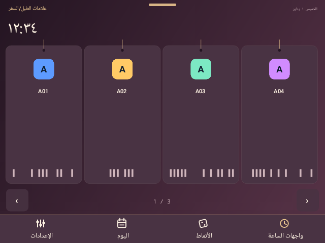</a></td></tr>
<tr><td align="center" valign="top"><b>Montblanc Summit</b> <a href="../assets/localized/ar/styles/style_18.png">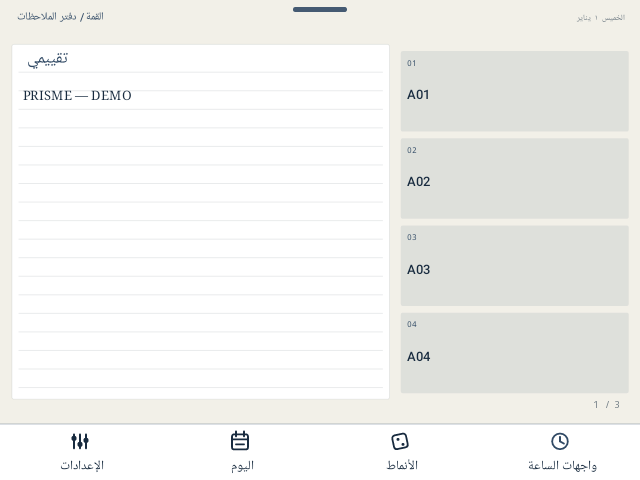</a></td><td align="center" valign="top"><b>Ultimate Design</b> <a href="../assets/localized/ar/styles/style_19.png">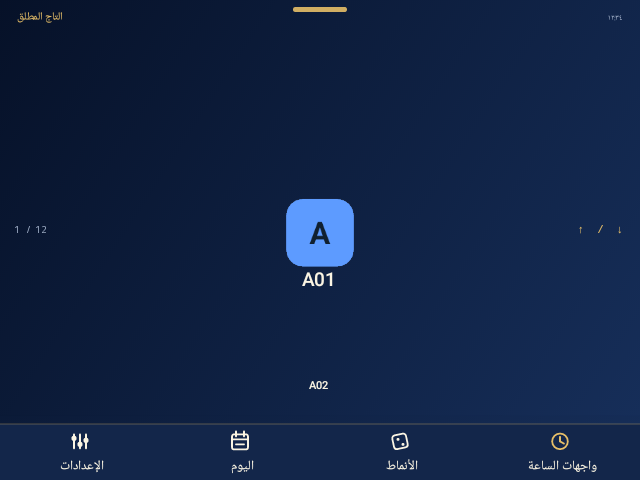</a></td><td align="center" valign="top"><b>Nova</b> </td></tr>
<tr><td align="center" valign="top"><b>Silence</b> </td><td align="center" valign="top"></td><td align="center" valign="top"></td></tr>
</table>

## أدوات يومية

<table>
<tr><td align="center" valign="top"><b>Today</b> <a href="../assets/localized/ar/screenshots/today.png">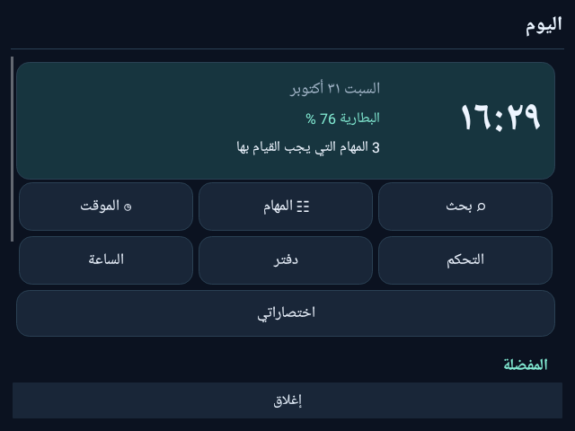</a></td><td align="center" valign="top"><b>Notes</b> <a href="../assets/localized/ar/screenshots/notes.png">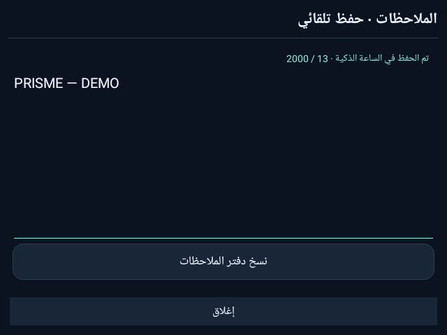</a></td></tr>
<tr><td align="center" valign="top"><b>Checklist</b> <a href="../assets/localized/ar/screenshots/checklist.png">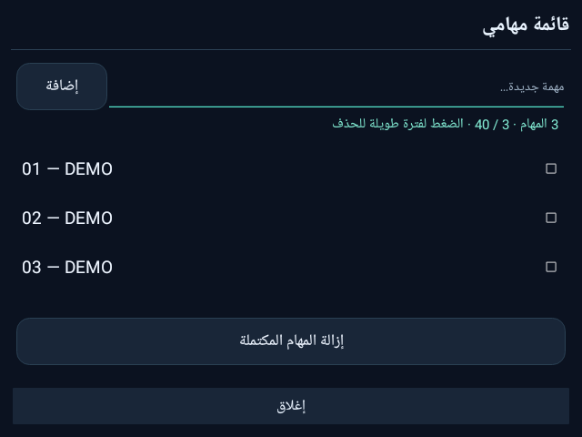</a></td><td align="center" valign="top"><b>Timer</b> <a href="../assets/localized/ar/screenshots/timer.png">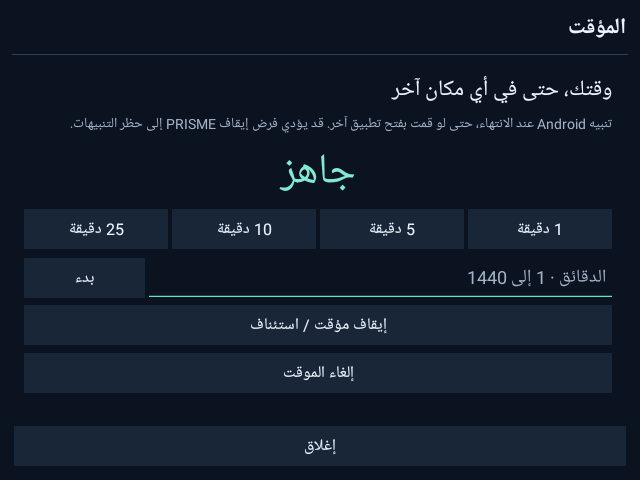</a></td></tr>
</table>

## إعدادات مرتبة حسب الفئات

<table>
<tr><td align="center" valign="top"><b>Settings Style</b> </td><td align="center" valign="top"><b>Settings Shortcuts</b> <a href="../assets/localized/ar/screenshots/settings-shortcuts.png">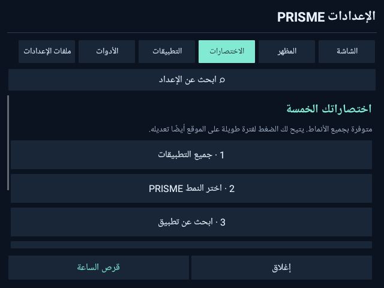</a></td><td align="center" valign="top"><b>Settings Tools</b> <a href="../assets/localized/ar/screenshots/settings-tools.png">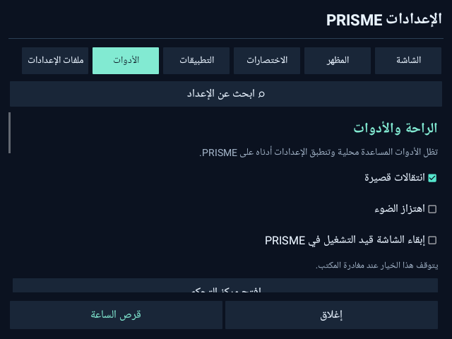</a></td></tr>
</table>

جميع صور PRISME من تطبيق عرض منفصل بأيقونات عامة وبيانات خيالية، دون حسابات أو قائمة تطبيقات شخصية.

<!-- /PRISME-VISUAL-SHOWCASE -->

## الساعات

| الطراز أو الفئة | الحالة |
|---|---|
| Domiwear / Domino DM100 بنظام Android 7.1.1 | **اختُبرت على جهاز فعلي**، والمرجع الأفقي 640 × 480 |
| طرازات DM100 الأخرى | تحتاج إلى تحقق مستقل؛ الاسم لا يثبت تطابق النظام |
| ساعات مستطيلة أخرى بقياس 2.86 بوصة / 640 × 480 | غير معتمدة؛ تحتاج إلى اختبار منفصل |

الأسماء غير المختبرة هي **قائمة مرشحين وليست قائمة توافق معتمدة**. تحقق من النظام الحقيقي ومستوى API وتثبيت APK. هذا ليس ملف واجهة Wear OS. لم تُعتمد Pixel Watch أو Galaxy Watch بنظام Wear OS. أنظمة watchOS وTizen والأنظمة المغلقة التي لا تثبّت Android APK خارج الهدف. [المتطلبات والمصادر](COMPATIBILITY.md).

## الصور والخصوصية والقيود

[القوائم والخيارات](SCREENSHOTS.md) · [الأنماط الـ22](STYLES.md)

تعرض الصور الواجهات الحقيقية لنسخة تجريبية منفصلة ببيانات خيالية وأيقونات عامة، دون حساب مستخدم أو قائمة تطبيقاته الشخصية. لا يوجد إذن Internet. تبقى الملاحظات والمهام والمفضلة وسجل التشغيل من PRISME محلياً؛ وقد تتضمنها الملفات التي يختار المستخدم تصديرها. لا تُنشر مفاتيح خاصة أو نسخ مستخدمين أو معرّفات ساعات أو سجلات شخصية.

قد يوقف توفير الطاقة المؤقت والخدمات العائمة. تحتاج الموسيقى إلى مشغّل نشط. يمكن تحسين الترجمات. المناطق السوداء الجانبية المُبلغ عنها على DM100 **ليس لها إصلاح مؤكد**. لا يغيّر PRISME اللوحة أو برنامج تشغيلها، ولا يضمن العرض على كل شاشة.

تتوفر مصادر Java والموارد واللغات والاختبارات ومساعد Imou الاختياري. [البناء والاختبار](BUILD.md) · [الأذونات](PRIVACY.md) · [الإبلاغ عن التوافق](https://github.com/s00r1/PRISME/issues/new/choose). الشفرة الأصلية مرخصة بـ MIT؛ يُسمح بالاستخدام والتعديل وإعادة التوزيع مع الاحتفاظ بإشعار الترخيص. أسماء العلامات تشير إلى إلهام بصري دون علاقة رسمية بتلك العلامات.

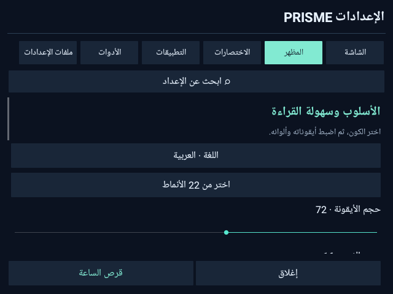

[◈ PRISME — Website / Site web](https://s00r1.github.io/PRISME/) · [Community / Testers](https://github.com/s00r1/PRISME/discussions/1)
