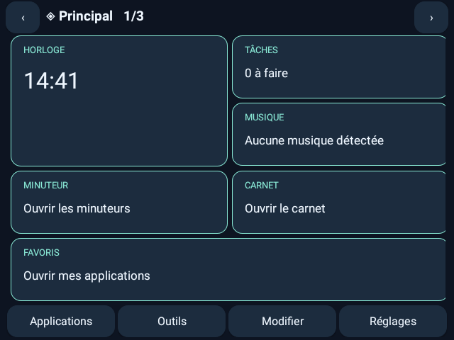
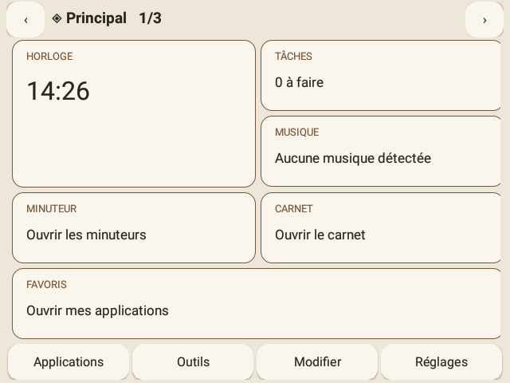
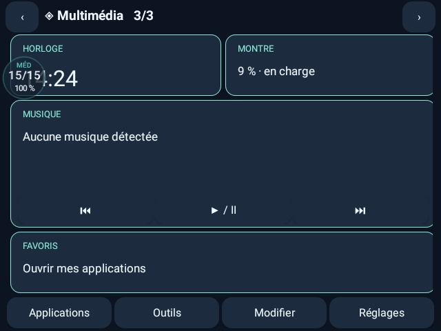
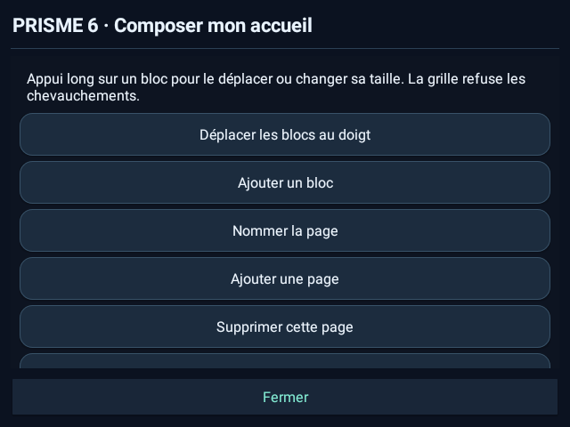

<div dir="rtl">

# PRISME 6

واجهة رئيسية قابلة للتخصيص لساعة DM100 والساعات المستطيلة الكبيرة التي تعمل بنظام Android الكامل. يبقى نمط المكتب المختار من بين 22 نمطاً هو الأساسي، وتُفتح البطاقات الجديدة اختيارياً.

[Français](README.fr.md) · [English](README.en.md) · [Deutsch](README.de.md) · [中文](README.zh.md) · [Türkçe](README.tr.md) · [Русский](README.ru.md) · [العربية](README.ar.md)

> الإصدار الحالي: **6.0.0 · versionCode 24 · Android كامل 7.1 / API 25 على الأقل**. الجهاز المرجعي DM100 بنظام Android 7.1.1 ودقة أفقية 640 × 480. الساعات الدائرية والمربعة وWear OS وwatchOS وTizen ليست أهدافاً معتمدة بالاختبار. لا حاجة إلى root أو تبديل البرنامج الثابت.

## التنزيل

| التنزيل | PRISME 6 |
| --- | --- |
| [PRISME-6.0.0.apk](https://github.com/s00r1/PRISME/releases/download/v6.0.0/PRISME-6.0.0.apk) | تطبيق Android موقع للساعة، يُثبّت فوق PRISME الحالي. |
| [PRISME-PC-Studio-6.0.0.zip](https://github.com/s00r1/PRISME/releases/download/v6.0.0/PRISME-PC-Studio-6.0.0.zip) | محررات كمبيوتر كاملة دون اتصال؛ فك الأرشيف وافتح index.html. |
| [PRISME-6.0.0-sources.zip](https://github.com/s00r1/PRISME/releases/download/v6.0.0/PRISME-6.0.0-sources.zip) | مصادر التطبيق والمحررات والاختبارات والوثائق. |
| [SHA256SUMS.txt](https://github.com/s00r1/PRISME/releases/download/v6.0.0/SHA256SUMS.txt) | قيم التحقق من ملفات الإصدار. |

[PRISME · Web](https://s00r1.github.io/PRISME/) · [PC Studio · Web](https://s00r1.github.io/PRISME/home-studio.html) · [GitHub · v6.0.0](https://github.com/s00r1/PRISME/releases/tag/v6.0.0)

## صور V6 الحقيقية

| PRISME 6 | PRISME 6 |
| --- | --- |
|  |  |
|  |  |

صور حقيقية لواجهة V6 على DM100 باللغة الفرنسية. يستخدم معرض الأنماط الكلاسيكية بيانات عرض خيالية، وليس قائمة تطبيقات شخصية.

## المكتب والصفحات والمظهر

**الأنماط الكلاسيكية الـ22 محفوظة ويظل النمط المختار معروضاً افتراضياً.** يفتح زر «22 styles» في الإعدادات اختيار الأنماط مباشرة. البطاقات لوحة اختيارية في الأدوات؛ يعيد زر «Bureau» وزر رجوع Android المكتب المختار. اختيار نمط يغلق البطاقات ويعرض النمط فوراً.

تتوفر ثلاث صفحات مبدئية، وبحد أقصى **خمس صفحات وثماني بطاقات لكل صفحة على شبكة 4 × 4**. الأنواع: الساعة، المهام، المؤقت، الموسيقى، الملاحظات، المفضلة وحالة الجهاز. يمكن تحريك البطاقات وتغيير حجمها، ويُرفض التداخل والخروج من الحدود. الضغط المطول يفتح الموضع والأبعاد؛ يوفر المحرر السحب وخطوة واحدة للتراجع والإعادة.

ست لوحات ألوان: الغرافيت والزجاج والورق والأجهزة والنيون والبسيط، مع خيار نص كبير. ألوان البطاقات مستقلة عن نمط المكتب. تشترك الصفحات في الملاحظات والمهام نفسها، ولا تعرض بطاقات البداية نص الملاحظات.

## عناصر مصغرة للأنماط الـ22

إلى جانب صفحات البطاقات الاختيارية، توجد منطقة عناصر مصغرة مشتركة بين **الأنماط الكلاسيكية الـ22**. يتضمن الكتالوج **13 نوعاً**: الطقس، الساعة، الموسيقى، البطارية، المهام، دفتر الملاحظات، المؤقتات، التقويم، الساعة العالمية، النظام، التركيز، الاختصارات وساعة الإيقاف. يظهر الطقس والموسيقى والمهام افتراضياً. يمكن الإضافة والإزالة والإخفاء وإعادة الترتيب، حتى 16 عنصراً. إزالة عنصر أو إخفاؤه لا يغير نمط المكتب المختار.

من **الإعدادات ← Widgets** أو بالضغط المطول على العنصر، يمكن ضبط المظهر والكثافة ولون التمييز والشفافية والزوايا وحجم النص والعنوان الخاص والأنماط التي يظهر فيها. توجد ستة مظاهر: طابع المكتب والزجاج والبطاقة الممتلئة والإطار والبسيط والنيون. تدعم الساعة العرض بالعقارب، وتتيح الساعة العالمية اختيار المنطقة الزمنية. تظهر المنطقة يميناً أو يساراً أفقياً وتصبح شريطاً علوياً رأسياً، مع مساحة مستقلة للمكتب. يمكن إخفاء المنطقة كلها والتراجع عن آخر تعديل وإعادته.

### طقس Open-Meteo الاختياري

اتصال الطقس **معطل افتراضياً**. فعّله في إعدادات الطقس ثم ابحث عن المدينة واخترها يدوياً؛ لا حاجة إلى GPS أو إذن الموقع. يتلقى Open-Meteo عنوان IP ونص البحث أو إحداثيات المدينة المختارة. تعرض التفاصيل الحرارة والمحسوسة والرطوبة والرياح والساعات القادمة وخمسة أيام. يمكن اختيار Celsius/Fahrenheit وفترة التحديث أثناء ظهور التطبيق. تعرض البيانات المخزنة محلياً وقت التحديث وتقادمها، ولا ينتج انقطاع الشبكة قياسات وهمية. إيقاف اتصال الطقس يوقف الطلبات ويحفظ الذاكرة المؤقتة. [مصدر البيانات: Open-Meteo](https://open-meteo.com/).

### مركزا تحكم مختلفان فعلاً

**iOS:** أول أربعة أوامر مختارة في وحدة بأزرار دائرية، مع مشغل صغير ومنظمي سطوع وصوت رأسيين. **Android:** ساعة كبيرة وبلاطات Material عريضة بعمودين ومنظمات أفقية ومشغل بعرض المنطقة. يتكيف التخطيط مع المساحة الضيقة. تُحفظ الأوامر المختارة وترتيبها والضغط المطول، ويمكن إخفاء المشغل والمنظمات بشكل منفصل. تأتي الحالات من Android وتفتح الوظائف المحمية إعدادات النظام. يبقى الإغلاق ورجوع Android والإيماءات المختارة متاحاً.

## الأدوات اليومية

| PRISME | الأدوات اليومية |
| --- | --- |
| المؤقتات المسماة | ثمانية عدادات مستقلة مع إيقاف مؤقت واستئناف وإعادة بدء وحذف؛ المدة الأولية 1–1440 دقيقة. |
| الموسيقى | أزرار وسائط بسيطة أو عنوان وفنان واختيار جلسة تشغيل اختيارياً. |
| الحساب والتحويل | أربع عمليات عشرية؛ تحويل الطول والكتلة والحرارة والمدة دون شبكة. |
| الملاحظات والمهام | حفظ تلقائي محلي وقائمة مهام وبحث ووصول عبر البطاقات. |
| أدوات الوقت | ساعة إيقاف بجولات ومؤقت تركيز وساعة مكتب. |
| مركز التحكم | مظهرا iOS وAndroid وترتيب وألوان وأحجام وإيماءات وتدوير؛ بعض الأزرار تفتح إعدادات Android. |
| الصوت والبطارية | صوت عائم؛ 24 عرضاً للبطارية و12 لوحة ألوان وتشخيص قراءات النظام. |
| Studio / Sense / Dock / Doctor | عناصر كلاسيكية وقواعد محلية للوقت والشحن ولوحة عائمة اختيارية وتشخيص محلي. |

## التثبيت والتحديث من V5

1. صدّر الإعدادات الحالية من الإعدادات ← الملفات الشخصية واحتفظ بالأصل.
2. نزّل PRISME-6.0.0.apk الموقع وثبته فوق PRISME. لا يتطلب التحديث المعتاد إزالة التطبيق.
3. شهادة التوقيع الأصلية محفوظة، وتبقى الملاحظات والمهام والإعدادات.
4. اختر PRISME كتطبيق رئيسي إذا سمح النظام، أو افتحه كتطبيق عادي.
5. امنح أذونات العناصر العائمة عند الحاجة بشكل منفصل. لا يتطلب المكتب والبطاقات وصولاً إلى الإشعارات.

```text
adb install -r PRISME-6.0.0.apk
```

تُقبل ملفات JSON القديمة. يستخدم تصدير V6 **المخطط 7**، وهو رقم تنسيق الملف وليس تطبيق PRISME 7. احتفظ بتصدير V5 للعودة؛ قد يرفض Android تثبيت versionCode أقل، ولا يحذف التطبيق بياناتك تلقائياً للرجوع.

## محرر الكمبيوتر: التصميم والنقل

1. افتح المحرر على الويب أو فك ZIP بالكامل وافتح index.html. يتوفر LANCER-EDITEUR.cmd لنظام Windows.
2. حمّل تصدير JSON كاملاً من PRISME؛ دون ملف حقيقي تتوفر معاينة فقط.
3. اختر عناصر الأنماط الـ22 أو صفحات الشبكة الاختيارية. اضبط ترتيب العناصر ومظهرها أو موضع البطاقات وحجمها وألوانها والنص الكبير؛ يُرفض التداخل في الشبكة.
4. صدّر PRISME-6-Studio.json وانقله إلى الساعة عبر USB.
5. من الإعدادات ← الملفات الشخصية ← استيراد إعدادات، افتح منتقي ملفات Android واختر الملف وأكد.

تُعالج البيانات في ذاكرة المتصفح ولا تُرفع إلى خادم. تبقى أقسام الملف الأخرى ولا يتغير وضع المكتب النشط. افتح البطاقات اختيارياً من الأدوات. معاينة الطقس على الكمبيوتر مثال موضح؛ تُختار المدينة وموافقة الشبكة على الساعة، ويمكن نقل الوحدة وفترة التحديث. يواصل classic-studio.html تحرير الأنماط الكلاسيكية الـ22 وعناصرها الأربعة السابقة. واجهة الكمبيوتر والدليل التفصيلي بالفرنسية حالياً. لا يلزم خادم أو حساب أو أدوات تطوير.

## الأذونات والخصوصية والاسترداد

لا إعلانات أو حساب أو قياس استخدام. يعلن PRISME 6 إذن **INTERNET** للطقس الاختياري، لكن طلبات الطقس معطلة افتراضياً. لا تُرسل الملاحظات أو المهام أو المفضلة أو بيانات الملف الأخرى إلى المزود. تبقى موافقة الشبكة والمدينة والإحداثيات محلياً على الساعة ولا تُستورد من قالب. تصدير JSON العادي نص غير مشفر وقد يحتوي ملاحظات ومهام ومفضلة شخصية؛ لا تنشره.

الوصول الموسيقي الموسع معطل افتراضياً. يطلب Android إذن إشعارات حساساً؛ يستخدم PRISME جلسات الوسائط دون قراءة نصوص الرسائل أو حفظها. للعناصر العائمة وإعدادات النظام وعدم الإزعاج أذونات منفصلة.

توجد نقاط الاسترداد التلقائية في تخزين التطبيق الخاص مع الاحتفاظ بعشر نقاط. توفر الأدوات نسخ AES-256-GCM قابلة للتصدير بكلمة مرور من عشرة محارف على الأقل، ولا يوجد استرداد عن بعد دونها. يُتحقق من الملف قبل الكتابة ويحمي سجل الاسترداد الاستيراد المنقطع. لا تُستورد المؤقتات النشطة أو أذونات Android أو تفعيل البطاقات من قالب. بعد ثلاثة أعطال متتالية غير معالجة، يتيح وضع الاسترداد إعادة المحاولة أو المكتب الكلاسيكي مع إيقاف العناصر العائمة.

## الاختبارات والحدود المعروفة

يتضمن تقرير V6 السابق **67,407 تحققاً في Java** و**1,775 تحققاً لنموذج الكمبيوتر** واختبارات المعرض ومسارات في Edge، و**16 تحققاً على DM100** للترحيل ورفض الاستيراد غير الصحيح والاسترداد والتشفير والتنبيه وجلسة وسائط مصطنعة. اختُبرت الصفحات والسحب والألوان ووضع الاسترداد اليدوي باللمس. يوضح [تقرير التحقق](V6-VALIDATION.md) حالة فحوص العناصر والطقس ومركزي التحكم الجديدة؛ لا تثبت الأرقام السابقة وحدها اختبار كل المسارات الجديدة.

عدد حالات النموذج لا يعني عدد أجهزة فعلية مماثلاً. لا يُدعى اعتماد ساعات أخرى أو عمر بطارية طويل أو جميع المشغلات أو Play Protect. يتحكم Android والبرنامج الثابت في الخلفية والتنبيهات والتدوير. تُحفظ اللغات السبع السابقة؛ تبقى بعض رسائل V6 المفصلة بالفرنسية.

## الوثائق والدعم

عند الإبلاغ اذكر الطراز وAndroid API وإصدار PRISME والاتجاه والخطوات الدقيقة. لا تنشر حسابات أو أرقاماً تسلسلية أو صادرات شخصية أو سجلات خاماً. الترخيص MIT؛ أسماء العلامات في الأنماط لا تعني ارتباطاً أو اعتماد أجهزة تلك العلامات.

[V6 · FR](V6-GUIDE.md) · [PC Studio · FR](PC-STUDIO.md) · [English guide](README.en.md) · [Compatibility](COMPATIBILITY.md) · [22 styles](STYLES.md) · [Privacy](PRIVACY.md) · [Validation](V6-VALIDATION.md) · [Build](BUILD.md) · [MIT](../LICENSE) · [Issues](https://github.com/s00r1/PRISME/issues/new/choose)

</div>
