# PRISME — NUR FÜR RECHTECKIGE UHREN

## Referenz: großes 2,86″-Display · 640 × 480 quer (4:3) · vollständiges Android 7.1+ / API 25+

> **NICHT FÜR RUNDE ODER QUADRATISCHE UHREN. Diese Version richtet sich an das rechteckige DM100-Format. Andere rechteckige Größen und Auflösungen sind nicht validiert.**

## 🌐 [OFFIZIELLE PRISME-WEBSITE ÖFFNEN](https://s00r1.github.io/PRISME/)

**https://s00r1.github.io/PRISME/**

<table>
<tr><td align="center" valign="top"></td><td align="center" valign="top"></td></tr>
</table>

**Domiwear / Domino DM100 — getestetes Referenzmodell; zwei Ansichten desselben Modells**

Externe Produktfotos: DM100-Angebot. Sie zeigen die Hardware, nicht PRISME. [Source](https://www.ebay.nl/itm/185939246016) · [Specifications](https://www.domino-china.com/news/19.html)

[Français](README.fr.md) · [English](README.en.md) · [Deutsch](README.de.md) · [中文](README.zh.md) · [Türkçe](README.tr.md) · [Русский](README.ru.md) · [العربية](README.ar.md)

**Ein anpassbarer Startbildschirm für Uhren mit vollständigem Android.** Offline, ohne Konto, Werbung oder Telemetrie.

**[⬇ APK herunterladen](https://github.com/s00r1/PRISME/releases/download/v5.4/PRISME-5.4.apk)** · [Control Center](#control-center) · [Volume](#floating-volume) · [22 styles](#styles-showcase)

<table>
<tr><td align="center" valign="top"><b>Control Center</b> <a href="../assets/localized/de/screenshots/control-center-ios.png">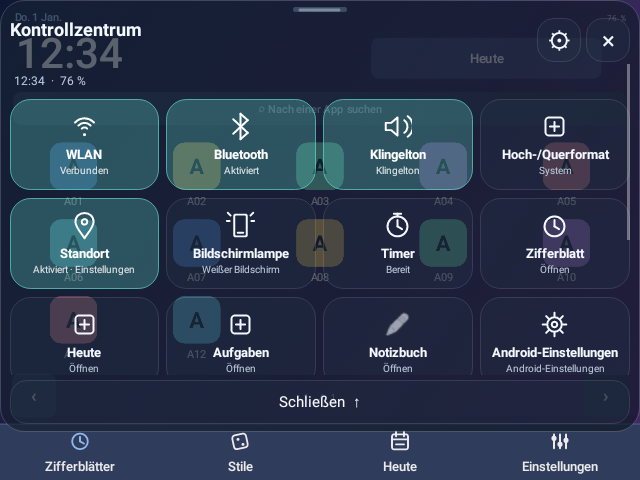</a></td><td align="center" valign="top"><b>Volume</b> <a href="../assets/localized/de/screenshots/volume-live-circle-open.png">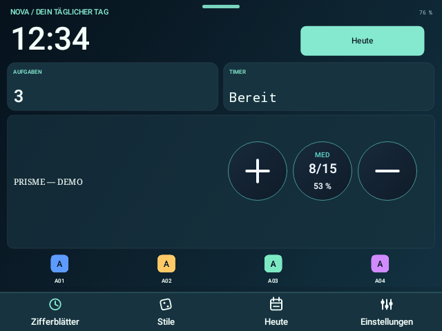</a></td></tr>
</table>

## Installation

**[PRISME 5.4 APK herunterladen](https://github.com/s00r1/PRISME/releases/download/v5.4/PRISME-5.4.apk)** · [Versionen und Prüfsummen](https://github.com/s00r1/PRISME/releases)

Erforderlich sind **vollständiges Android ab 7.1, mindestens API 25**, und die Installation gewöhnlicher Android-APKs. APK im Browser der Uhr herunterladen, mit dem Android-Installer öffnen und gegebenenfalls die Installationsquelle erlauben. PRISME starten und als Start-App wählen, sofern die Firmware dies erlaubt, oder als normale App öffnen. Für schwebende Lautstärke und globale Ausrichtung „Über anderen Apps einblenden“ erlauben. Sprache unter **Einstellungen → Stil → Sprache** wählen. Offizielle Updates über die vorhandene Version installieren.

Vom Computer: `adb install -r PRISME-5.4.apk`. Root, Firmwarewechsel oder Änderungen an Google-Diensten sind zur Installation nicht nötig.

## ✨ Neu in PRISME 5.4

- **🔋 Eigener Batterie-Reiter**: 24 Anzeigestile, 12 Farbpaletten, ladestandsabhängige Farben, Prozentwert sowie Größe, Position, Transparenz und Grenzwerte. Anzeige **nur auf dem Dashboard** oder **über anderen Apps** (Android-Berechtigung erforderlich). Diagnose mit mehreren Android-Messquellen; die Firmware kann trotzdem falsche Werte melden.
- **🎵 Eigener Musik-Reiter**: Miniplayer in **allen 22 Dashboard-Stilen** mit **Play/Pause, Zurück und Weiter**, 12 Designs sowie einstellbarer Größe, Position und Transparenz. Ein aktiver Mediaplayer ist erforderlich.
- **🔄 Globale Drehung**: Hoch-/Querformat direkt im schwebenden Control Center umschalten, **ohne absichtlich zum Dashboard zurückzukehren**. Firmware und App können die Funktion einschränken.
- **🎧 Rückkehr zum Startbildschirm**: App-Aufgaben möglichst nicht zurücksetzen. Hintergrundwiedergabe wird von Android und der jeweiligen App bestimmt und ist **nicht garantiert**.

**Hinweis:** Für die v5.4-APK wurde eine Play-Protect-Installationssperre gemeldet. Schutzeinstellungen nicht deaktivieren; siehe [Releases](https://github.com/s00r1/PRISME/releases). Die Galerie enthält auch ältere Screenshots.

## Funktionen

- **22 unterschiedliche Anordnungen**: Kalender, Desktop, Galerie, Terminal, Arcade, Konstellation, Textverzeichnis, Mosaik, Waben, Instrumente, Notizbuch und Minimalansicht.
- Ständige Navigation zu nativem Zifferblatt, Stilen, Heute und Einstellungen. Heute gedrückt halten öffnet fünf anpassbare Verknüpfungen.
- **Kontrollzentrum im iOS- oder Android-Stil**: Schaltflächen, Reihenfolge, Farben, Transparenz, Größe, Position und Gesten. Manche Befehle öffnen die Android-Einstellungen.
- **Hochformat / Querformat** per kurzem Tippen; langes Drücken bietet umgekehrte Ausrichtungen und Systemmodus. Drehbefehle auch in der Benachrichtigung. Auf DM100 geprüft; andere Firmware kann die Funktion einschränken.
- **Schwebender Lautstärkeregler** mit Stilen, Formen, Größe, Deckkraft, Position, ausklappbaren Tasten und optionalem Verblassen.
- App-/Einstellungssuche, Favoriten, zuletzt verwendete Apps, Arbeitsbereiche und eigene Namen.
- Heute, automatisch gespeicherte Notizen, Aufgaben, Android-Alarmtimer, Stoppuhr mit Runden und Tischuhr.
- Gesamtskalierung, Ränder, Schrift-/Symbolgrößen, Farben, Profile und lokale Sicherungen.
- **Französisch, Englisch, Deutsch, vereinfachtes Chinesisch, Türkisch, Russisch und Arabisch**, einschließlich Rechts-nach-links-Darstellung.

<!-- PRISME-VISUAL-SHOWCASE -->

## Das Kontrollzentrum nach Ihren Wünschen

iOS- oder Android-Ansicht, Verknüpfungen, Reihenfolge, Transparenz, Farben, Größe, Position und Gesten. Hochformat / Querformat antippen zum Drehen, gedrückt halten für Optionen.

<table>
<tr><td align="center" valign="top"><b>iOS</b> </td><td align="center" valign="top"><b>Android</b> <a href="../assets/localized/de/screenshots/control-center-android.png">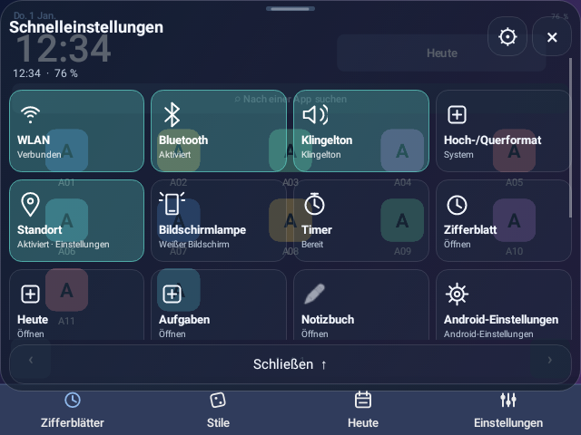</a></td></tr>
</table>

Anpassungsoptionen ansehen

<table>
<tr><td align="center" valign="top"><b>Center Options Appearance</b> <a href="../assets/localized/de/screenshots/center-options-appearance.png">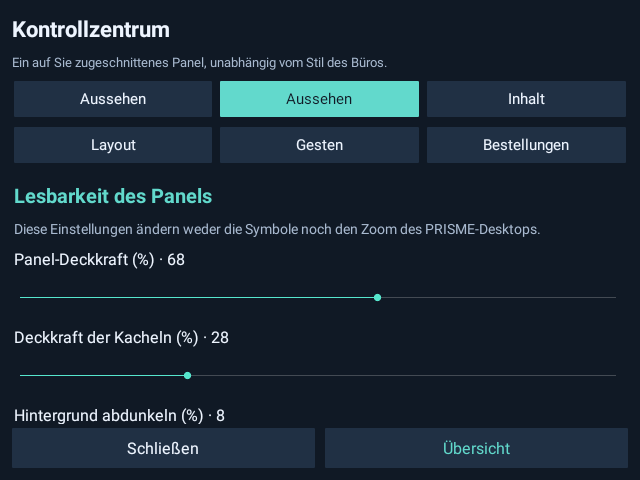</a></td><td align="center" valign="top"><b>Center Options Content</b> <a href="../assets/localized/de/screenshots/center-options-content.png">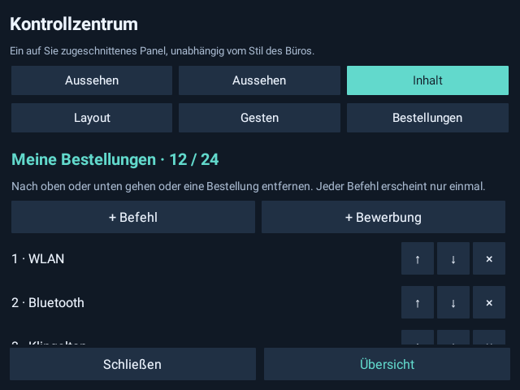</a></td><td align="center" valign="top"><b>Center Options Gestures</b> <a href="../assets/localized/de/screenshots/center-options-gestures.png">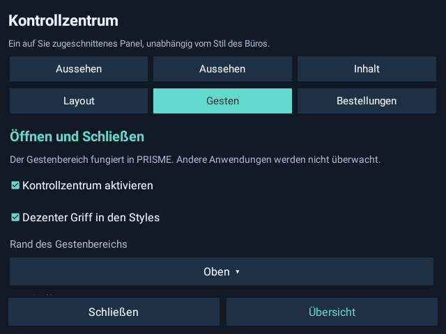</a></td></tr>
<tr><td align="center" valign="top"><b>Center Options Layout</b> <a href="../assets/localized/de/screenshots/center-options-layout.png">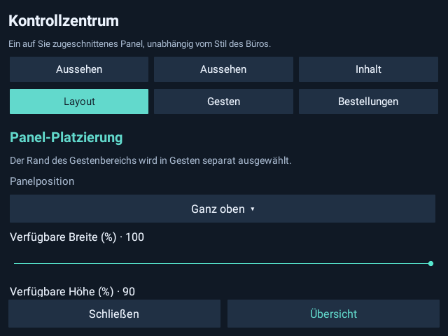</a></td><td align="center" valign="top"><b>Center Ios Transparent</b> <a href="../assets/localized/de/screenshots/center-ios-transparent.png">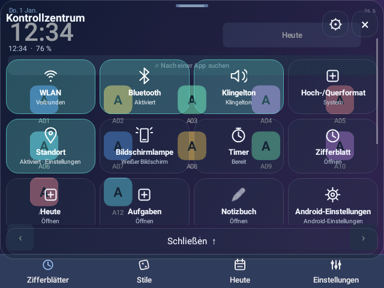</a></td><td align="center" valign="top"><b>Center Ios Opaque</b> <a href="../assets/localized/de/screenshots/center-ios-opaque.png">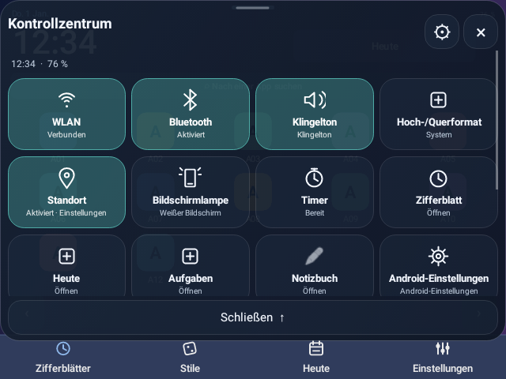</a></td></tr>
</table>

## Schwebende Lautstärke: kompakt und ausklappbar

Die kleine Taste klappt zu + und − auf. Form, Stil, Größe, Position und Deckkraft sind separat einstellbar. Hier sehen Sie die echten Android-Komponenten, einzeln und auf dem Startbildschirm.

<table>
<tr><td align="center" valign="top"><b>Kreis geschlossen</b> 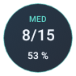</td><td align="center" valign="top"><b>Kreis ausgeklappt</b> 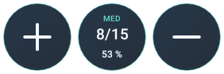</td><td align="center" valign="top"><b>Android</b> </td><td align="center" valign="top"><b>Neon</b> </td></tr>
<tr><td align="center" valign="top"><b>Minimal</b> 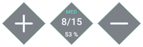</td><td align="center" valign="top"><b>Titan</b> </td><td align="center" valign="top"><b>Hell</b> 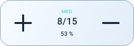</td><td align="center" valign="top"></td></tr>
</table>

<table>
<tr><td align="center" valign="top"><b>Kreis ausgeklappt</b> </td><td align="center" valign="top"><b>Android</b> <a href="../assets/localized/de/screenshots/volume-live-android.png">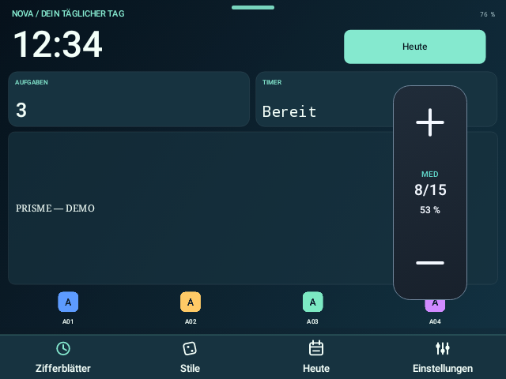</a></td></tr>
</table>

Anpassungsoptionen ansehen

<table>
<tr><td align="center" valign="top"><b>Volume Options Style</b> <a href="../assets/localized/de/screenshots/volume-options-style.png">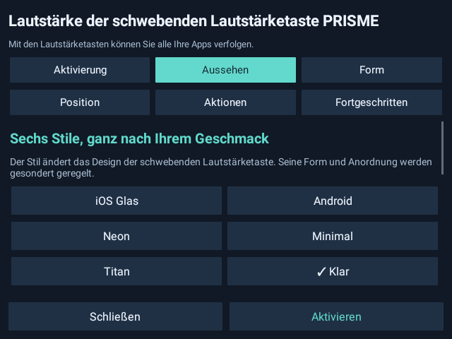</a></td><td align="center" valign="top"><b>Volume Options Shape</b> <a href="../assets/localized/de/screenshots/volume-options-shape.png">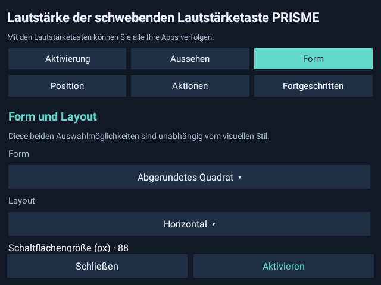</a></td></tr>
<tr><td align="center" valign="top"><b>Volume Options Position</b> <a href="../assets/localized/de/screenshots/volume-options-position.png">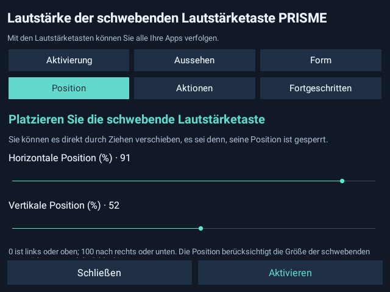</a></td><td align="center" valign="top"><b>Volume Options Advanced</b> <a href="../assets/localized/de/screenshots/volume-options-advanced.png">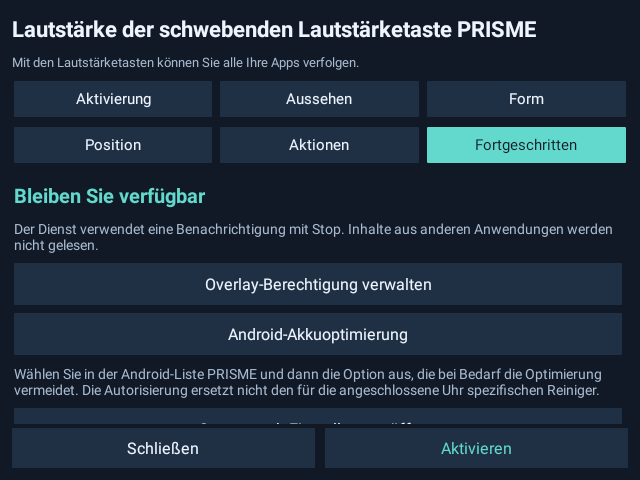</a></td></tr>
</table>

## Deutlich unterschiedliche Stile

Kalender, Terminal, Arcade, Konstellation, Typografie, Waben oder Tagesübersicht verändern die Anordnung. Bilder lassen sich vollständig öffnen.

Apple, Samsung, Garmin und andere Stilnamen bezeichnen Inspiration, keine kompatiblen Uhrenmodelle.

<table>
<tr><td align="center" valign="top"><b>Prisme Touch</b> <a href="../assets/localized/de/styles/style_00.png">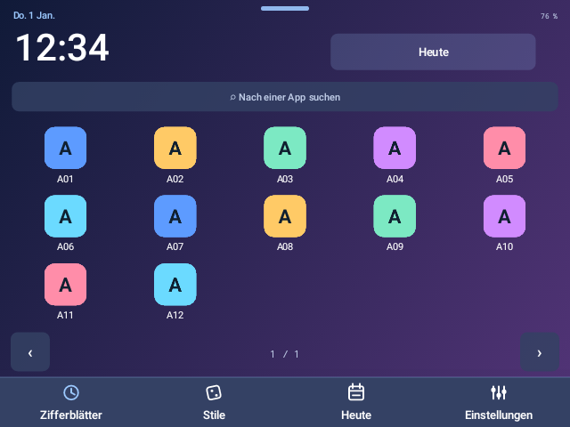</a></td><td align="center" valign="top"><b>Tablette</b> <a href="../assets/localized/de/styles/style_01.png">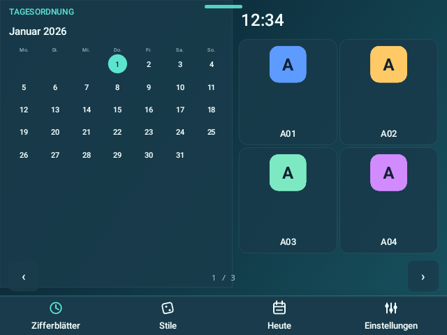</a></td><td align="center" valign="top"><b>Ghost Terminal</b> <a href="../assets/localized/de/styles/style_05.png">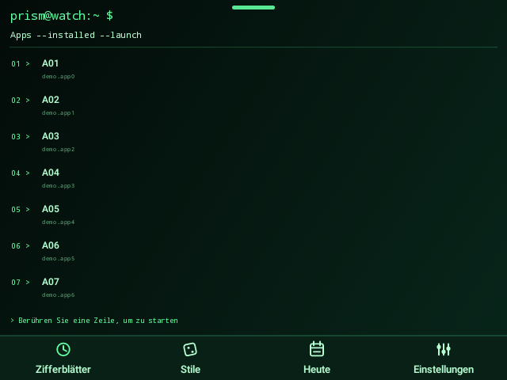</a></td></tr>
<tr><td align="center" valign="top"><b>Arcade 1986</b> <a href="../assets/localized/de/styles/style_06.png">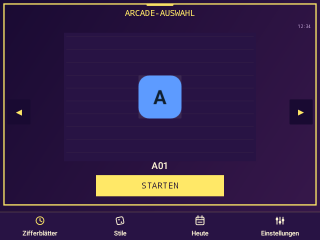</a></td><td align="center" valign="top"><b>Orbit</b> <a href="../assets/localized/de/styles/style_08.png">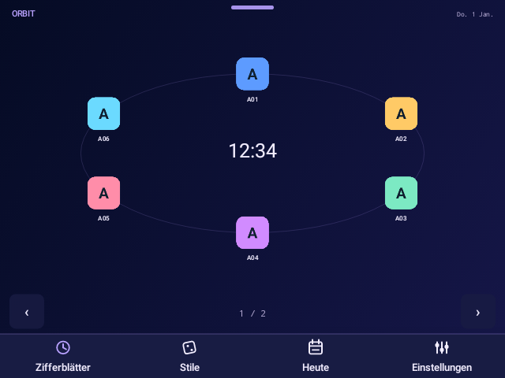</a></td><td align="center" valign="top"><b>Papier</b> <a href="../assets/localized/de/styles/style_09.png">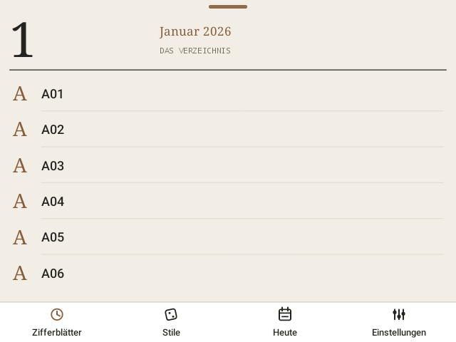</a></td></tr>
<tr><td align="center" valign="top"><b>Samsung Galaxy</b> <a href="../assets/localized/de/styles/style_13.png">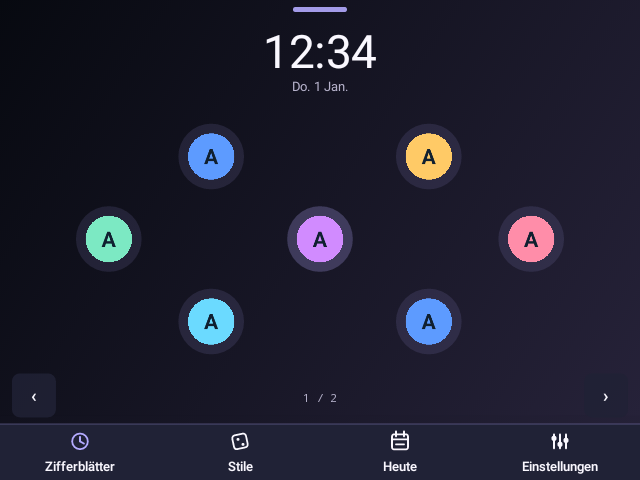</a></td><td align="center" valign="top"><b>Nova</b> <a href="../assets/localized/de/styles/style_20.png">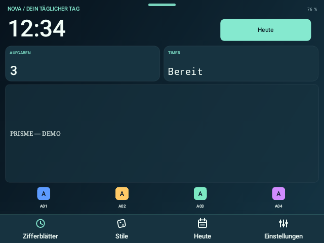</a></td><td align="center" valign="top"><b>Silence</b> <a href="../assets/localized/de/styles/style_21.png">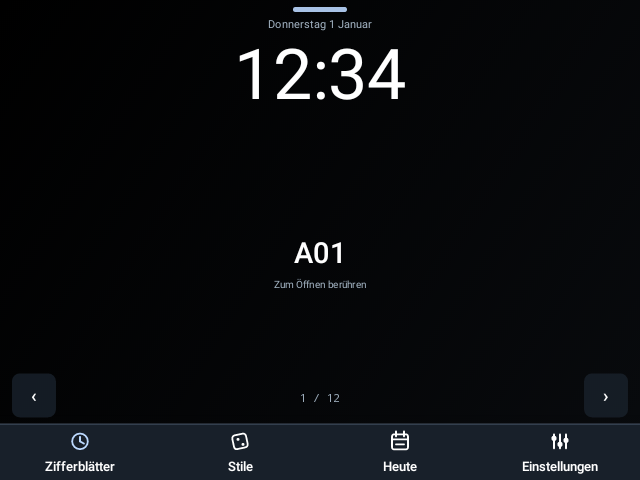</a></td></tr>
</table>

Alle 22 Stile anzeigen

<table>
<tr><td align="center" valign="top"><b>Prisme Touch</b> </td><td align="center" valign="top"><b>Tablette</b> </td><td align="center" valign="top"><b>Bureau Windows</b> <a href="../assets/localized/de/styles/style_02.png">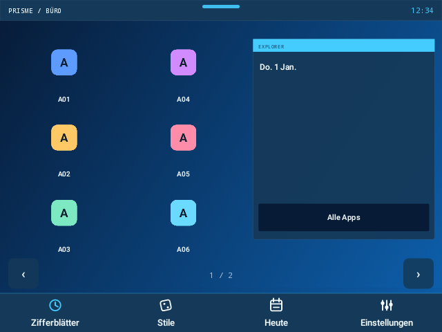</a></td></tr>
<tr><td align="center" valign="top"><b>Dock macOS</b> <a href="../assets/localized/de/styles/style_03.png">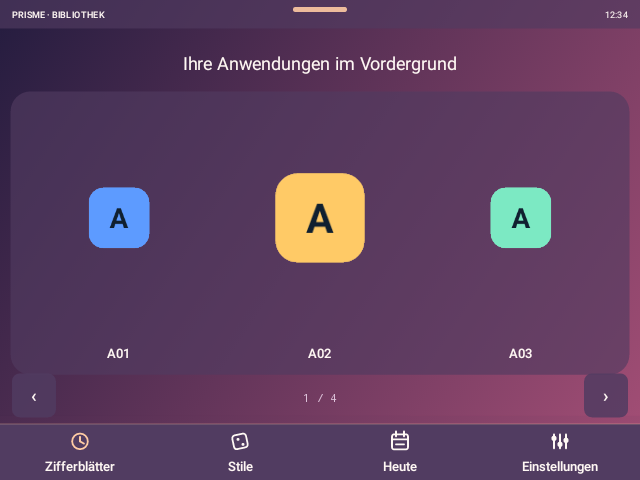</a></td><td align="center" valign="top"><b>Kali Workbench</b> <a href="../assets/localized/de/styles/style_04.png">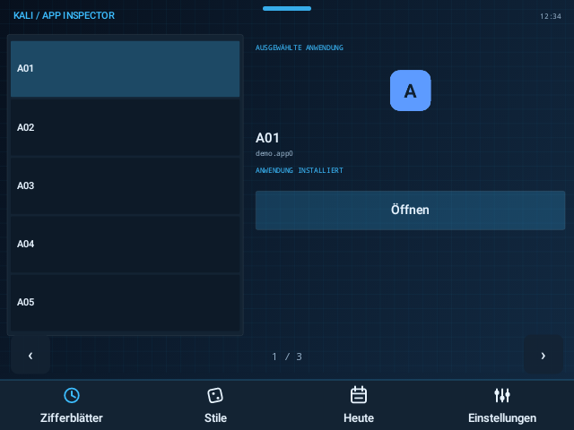</a></td><td align="center" valign="top"><b>Ghost Terminal</b> </td></tr>
<tr><td align="center" valign="top"><b>Arcade 1986</b> </td><td align="center" valign="top"><b>Meca Cockpit</b> <a href="../assets/localized/de/styles/style_07.png">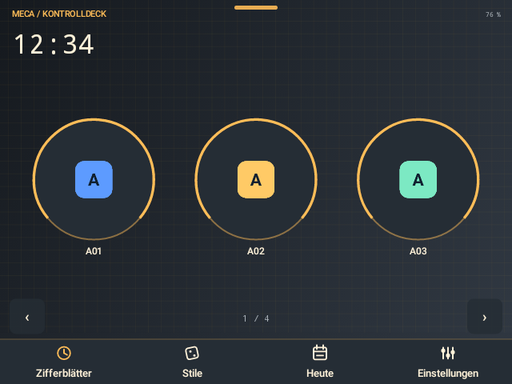</a></td><td align="center" valign="top"><b>Orbit</b> </td></tr>
<tr><td align="center" valign="top"><b>Papier</b> </td><td align="center" valign="top"><b>Aurora</b> <a href="../assets/localized/de/styles/style_10.png">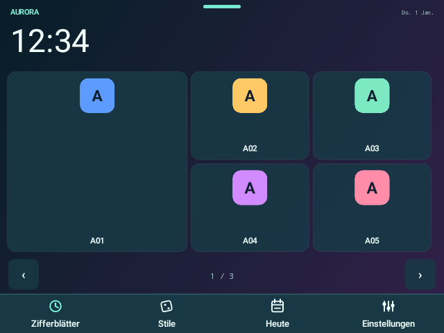</a></td><td align="center" valign="top"><b>LCD Studio</b> <a href="../assets/localized/de/styles/style_11.png">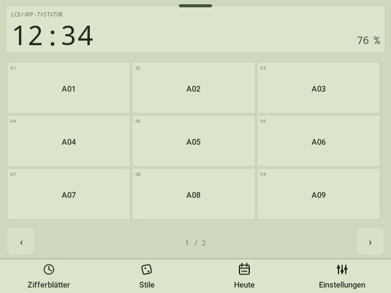</a></td></tr>
<tr><td align="center" valign="top"><b>Apple Ultra</b> <a href="../assets/localized/de/styles/style_12.png">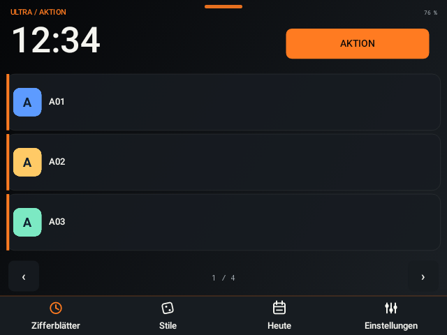</a></td><td align="center" valign="top"><b>Samsung Galaxy</b> </td><td align="center" valign="top"><b>Garmin MARQ</b> <a href="../assets/localized/de/styles/style_14.png">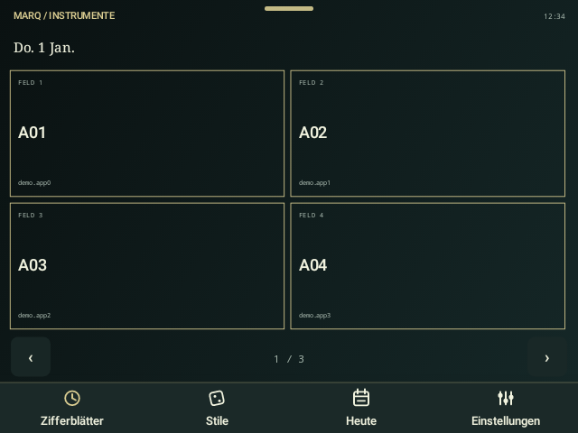</a></td></tr>
<tr><td align="center" valign="top"><b>TAG Racing</b> <a href="../assets/localized/de/styles/style_15.png">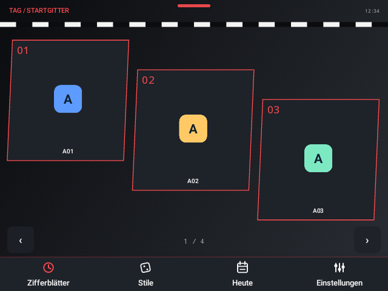</a></td><td align="center" valign="top"><b>Hublot Fusion</b> <a href="../assets/localized/de/styles/style_16.png">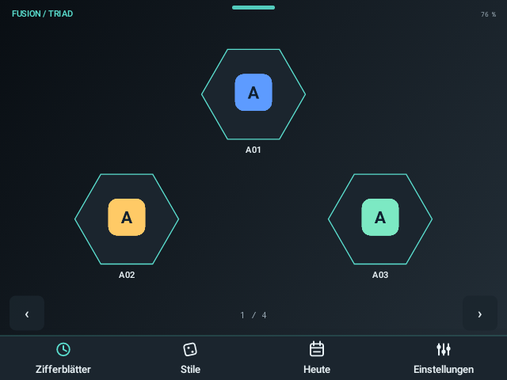</a></td><td align="center" valign="top"><b>Tambour Light</b> <a href="../assets/localized/de/styles/style_17.png">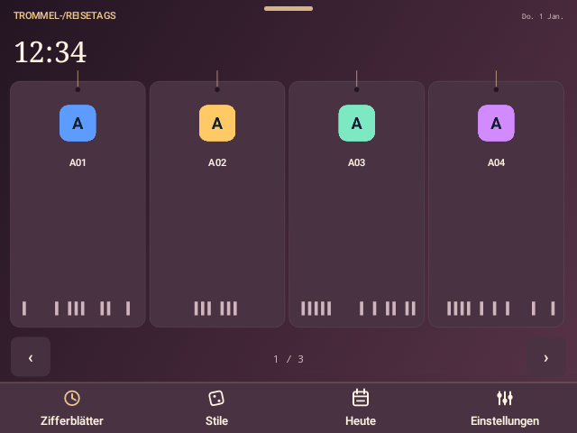</a></td></tr>
<tr><td align="center" valign="top"><b>Montblanc Summit</b> <a href="../assets/localized/de/styles/style_18.png">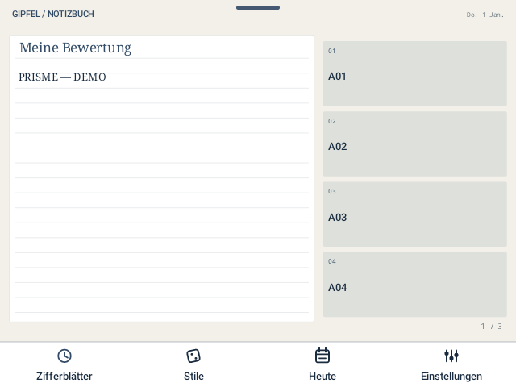</a></td><td align="center" valign="top"><b>Ultimate Design</b> <a href="../assets/localized/de/styles/style_19.png">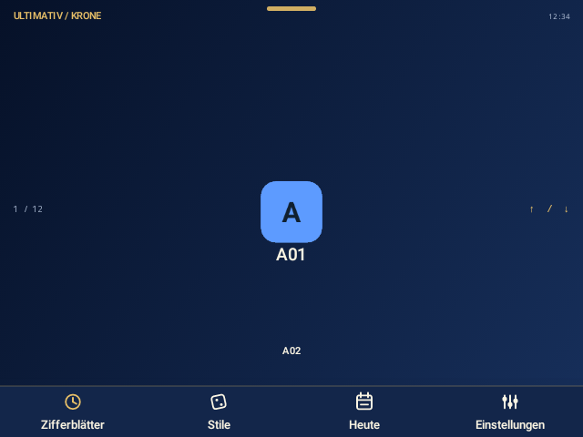</a></td><td align="center" valign="top"><b>Nova</b> </td></tr>
<tr><td align="center" valign="top"><b>Silence</b> </td><td align="center" valign="top"></td><td align="center" valign="top"></td></tr>
</table>

## Werkzeuge für den Alltag

<table>
<tr><td align="center" valign="top"><b>Today</b> <a href="../assets/localized/de/screenshots/today.png">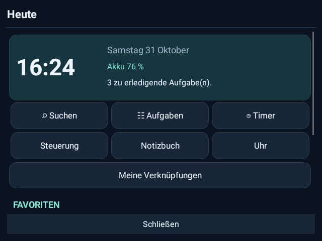</a></td><td align="center" valign="top"><b>Notes</b> <a href="../assets/localized/de/screenshots/notes.png">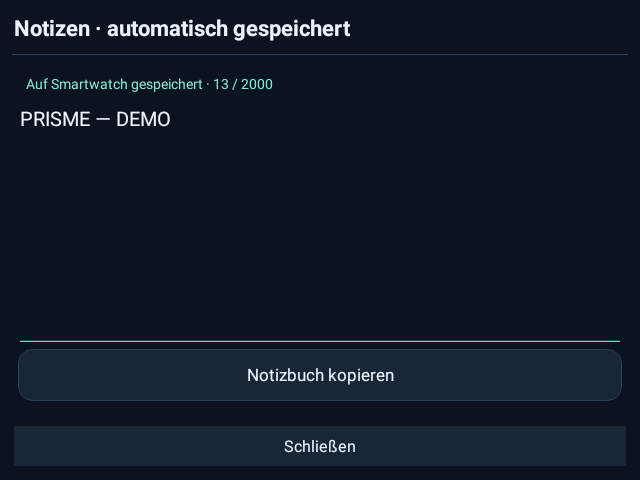</a></td></tr>
<tr><td align="center" valign="top"><b>Checklist</b> <a href="../assets/localized/de/screenshots/checklist.png">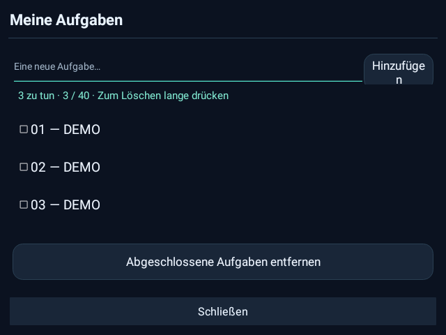</a></td><td align="center" valign="top"><b>Timer</b> <a href="../assets/localized/de/screenshots/timer.png">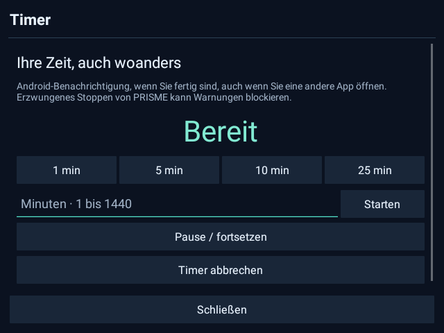</a></td></tr>
</table>

## Übersichtliche Einstellungskategorien

<table>
<tr><td align="center" valign="top"><b>Settings Style</b> </td><td align="center" valign="top"><b>Settings Shortcuts</b> <a href="../assets/localized/de/screenshots/settings-shortcuts.png">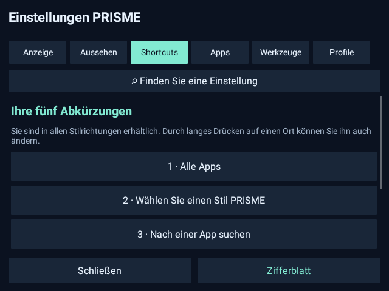</a></td><td align="center" valign="top"><b>Settings Tools</b> <a href="../assets/localized/de/screenshots/settings-tools.png">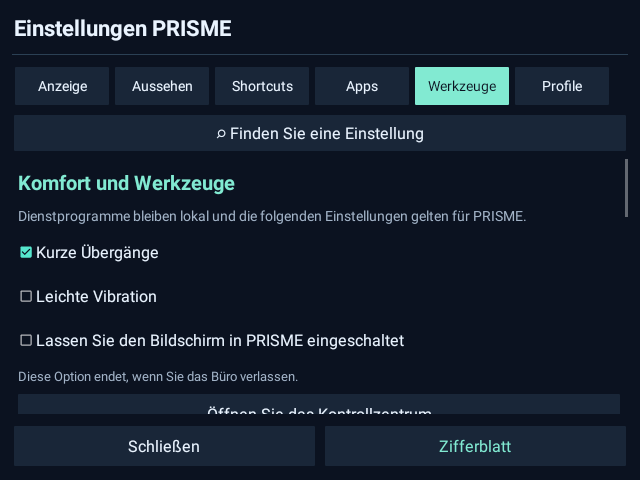</a></td></tr>
</table>

Alle PRISME-Bilder stammen aus einer getrennten Demo-App mit allgemeinen Symbolen und erfundenen Inhalten, ohne Konten oder persönliche App-Liste.

<!-- /PRISME-VISUAL-SHOWCASE -->

## Uhren

| Modell oder Familie | Status |
|---|---|
| Domiwear / Domino DM100, Android 7.1.1 | **Auf Gerät getestet**, Referenz 640 × 480 im Querformat |
| Andere DM100-Varianten | Einzeln prüfen; gleicher Name bedeutet nicht gleiche Firmware |
| Andere rechteckige Uhren mit 2,86″ / 640 × 480 | Nicht validiert; separater Gerätetest erforderlich |

Ungetestete Modelle sind **Kandidaten, keine zertifizierte Liste**. Betriebssystem, API und APK-Installation auf der echten Uhr prüfen. Dies ist kein Wear-OS-Zifferblatt. Pixel Watch und Wear-OS-Galaxy-Watch sind nicht validiert. watchOS, Tizen und proprietäre Systeme ohne Android-APK-Installation liegen außerhalb des Ziels. [Kriterien und Quellen](COMPATIBILITY.md).

## Bilder, Datenschutz und Grenzen

[Menüs und Optionen](SCREENSHOTS.md) · [Alle 22 Stile](STYLES.md)

Die Bilder zeigen echte Oberflächen eines getrennten Demo-Builds mit erfundenen Daten und allgemeinen Symbolen, keine Benutzerkonten oder persönliche App-Liste. Keine Internet-Berechtigung. Notizen, Aufgaben, Favoriten und Starts aus PRISME bleiben lokal; eigene Exporte können diese Daten enthalten. Keine privaten Schlüssel, Benutzer-Backups, Gerätekennungen oder persönlichen Protokolle werden veröffentlicht.

Hersteller-Energiesparen kann Timer und schwebende Dienste beenden. Musiksteuerung benötigt einen aktiven Player. Übersetzungen können verfeinert werden. Für die gemeldeten seitlichen schwarzen Bereiche auf einer DM100 gibt es **keine bestätigte Reparatur**. PRISME verändert weder Displaypanel noch Treiber. Die Darstellung auf anderen Bildschirmen ist nicht garantiert.

Java-Code, Ressourcen, Sprachdateien, Tests und optionaler Imou-Begleiter sind enthalten. [Erstellen und testen](BUILD.md) · [Berechtigungen](PRIVACY.md) · [Kompatibilität melden](https://github.com/s00r1/PRISME/issues/new/choose). Originalcode unter MIT-Lizenz: Nutzung, Änderung und Weitergabe mit Erhalt des Lizenzhinweises erlaubt. Markennamen beschreiben gestalterische Inspiration, ohne Verbindung zu den Marken.

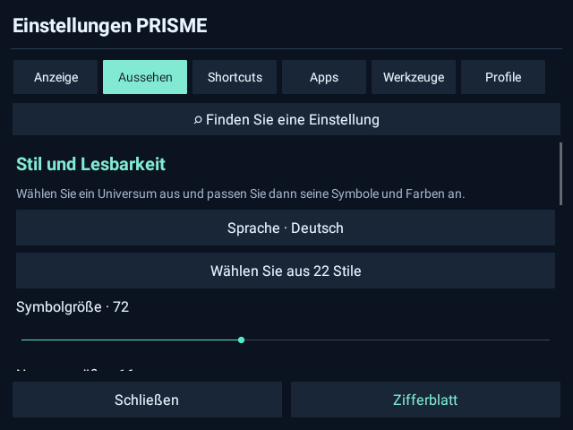

[◈ PRISME — Website / Site web](https://s00r1.github.io/PRISME/) · [Community / Testers](https://github.com/s00r1/PRISME/discussions/1)
