# PRISME — RECTANGULAR WATCHES ONLY

## Reference: large 2.86″ display · 640 × 480 landscape (4:3) · full Android 7.1+ / API 25+

> **NOT FOR ROUND OR SQUARE WATCHES. This release targets the rectangular DM100 format. Other rectangular sizes and resolutions are not validated.**

## 🌐 [VISIT THE OFFICIAL PRISME WEBSITE](https://s00r1.github.io/PRISME/)

**https://s00r1.github.io/PRISME/**

<table>
<tr><td align="center" valign="top"></td><td align="center" valign="top"></td></tr>
</table>

**Domiwear / Domino DM100 — device-tested reference; two views of the same model**

External product photos: DM100 listing. They illustrate the hardware, not PRISME. [Source](https://www.ebay.nl/itm/185939246016) · [Specifications](https://www.domino-china.com/news/19.html)

[Français](README.fr.md) · [English](README.en.md) · [Deutsch](README.de.md) · [中文](README.zh.md) · [Türkçe](README.tr.md) · [Русский](README.ru.md) · [العربية](README.ar.md)

**A customizable launcher for full-Android smartwatches.** Offline, with no account, advertising or telemetry.

**[⬇ Download the APK](https://github.com/s00r1/PRISME/releases/latest/download/PRISME.apk)** · [Control Center](#control-center) · [Volume](#floating-volume) · [22 styles](#styles-showcase)

<table>
<tr><td align="center" valign="top"><b>Control Center</b> <a href="../assets/localized/en/screenshots/control-center-ios.png">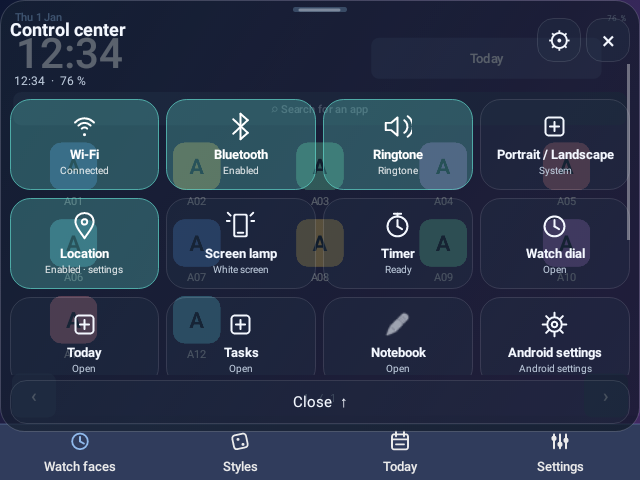</a></td><td align="center" valign="top"><b>Volume</b> <a href="../assets/localized/en/screenshots/volume-live-circle-open.png">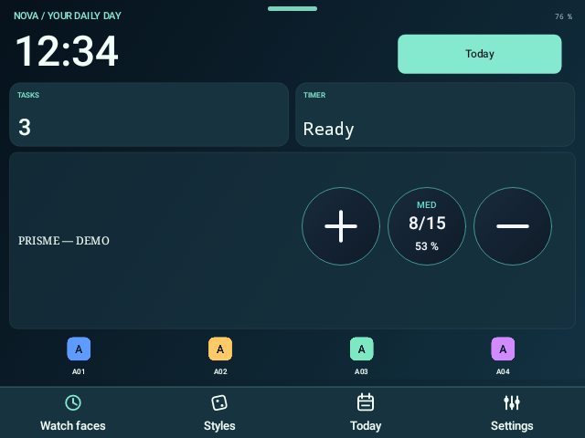</a></td></tr>
</table>

## Install

**[Download the ready-to-install PRISME.apk](https://github.com/s00r1/PRISME/releases/latest/download/PRISME.apk)** · [Releases and checksums](https://github.com/s00r1/PRISME/releases)

The watch needs **full Android 7.1 or later, API 25 minimum**, and ordinary Android APK installation. Download the APK in the watch browser, open it in Android’s installer and allow that installation source if prompted. Launch PRISME and select it as your home app if the firmware allows; it also opens as a normal app. Allow display over other apps for floating volume and global orientation. Choose **Settings → Style → Language**. Install official updates over the existing app.

Computer installation: `adb install -r PRISME.apk`. No root, firmware replacement or Google-service modifications are required.

## Features

- **22 distinct layouts**: calendar, desktop, app gallery, terminal, arcade, constellation, typography, mosaic, bubbles, instruments, notebook and minimal views.
- Persistent native-watch-face, Styles, Today and Settings navigation. Hold Today for five customizable shortcuts.
- **iOS-style or Android-style Control Center** with configurable tiles, order, colors, transparency, size, position and gestures. Some commands open Android settings when direct control is restricted.
- **Portrait / Landscape**: tap to rotate, hold for reversed orientations or System mode. Notification actions work from other apps. Verified on DM100; other firmware may restrict this feature.
- **Floating volume button** with multiple styles/shapes, size, opacity, position, expandable controls and optional idle fading.
- App/settings search, favorites, recent apps, workspaces and custom labels.
- Today, autosaving notes, checklists, Android-alarm timer, lap stopwatch and desk clock.
- Overall scale, margins, text/icon size, colors, profiles and local safety backups.
- **French, English, German, Simplified Chinese, Turkish, Russian and Arabic**, including right-to-left presentation.

<!-- PRISME-VISUAL-SHOWCASE -->

## Your Control Center, your way

Choose an iOS or Android presentation, shortcuts, order, transparency, colors, size, position and gestures. Tap Portrait / Landscape to rotate; hold for orientation options.

<table>
<tr><td align="center" valign="top"><b>iOS</b> </td><td align="center" valign="top"><b>Android</b> <a href="../assets/localized/en/screenshots/control-center-android.png">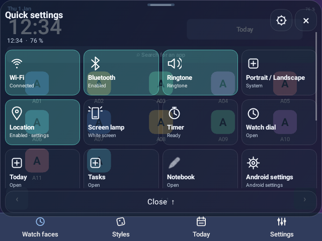</a></td></tr>
</table>

Explore customization options

<table>
<tr><td align="center" valign="top"><b>Center Options Appearance</b> <a href="../assets/localized/en/screenshots/center-options-appearance.png">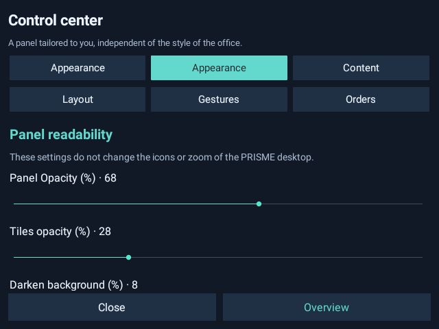</a></td><td align="center" valign="top"><b>Center Options Content</b> <a href="../assets/localized/en/screenshots/center-options-content.png">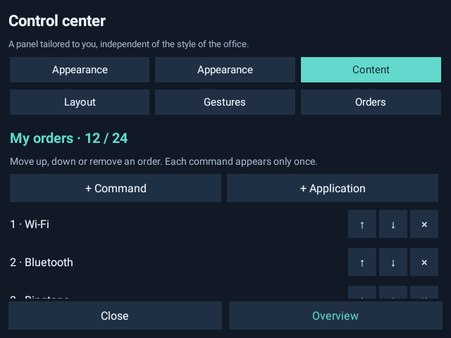</a></td><td align="center" valign="top"><b>Center Options Gestures</b> <a href="../assets/localized/en/screenshots/center-options-gestures.png">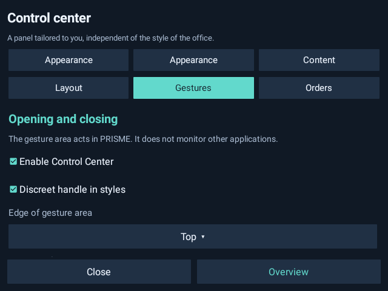</a></td></tr>
<tr><td align="center" valign="top"><b>Center Options Layout</b> <a href="../assets/localized/en/screenshots/center-options-layout.png">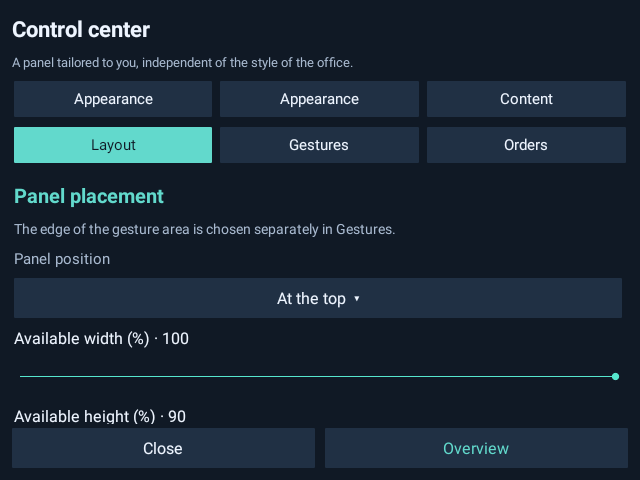</a></td><td align="center" valign="top"><b>Center Ios Transparent</b> <a href="../assets/localized/en/screenshots/center-ios-transparent.png">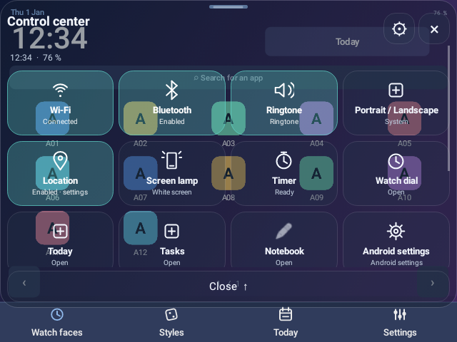</a></td><td align="center" valign="top"><b>Center Ios Opaque</b> <a href="../assets/localized/en/screenshots/center-ios-opaque.png">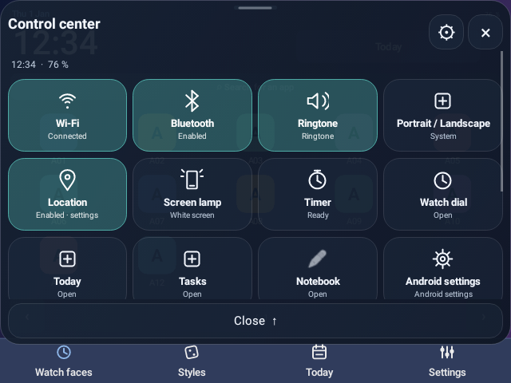</a></td></tr>
</table>

## Floating volume: compact, expandable, customizable

The floating button can expand into + and − controls. Shape, style, size, position and opacity are independent settings. These are the actual Android-rendered widgets, shown close up and on the dashboard.

<table>
<tr><td align="center" valign="top"><b>Collapsed circle</b> 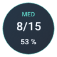</td><td align="center" valign="top"><b>Expanded circle</b> 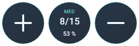</td><td align="center" valign="top"><b>Android</b> 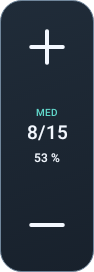</td><td align="center" valign="top"><b>Neon</b> 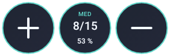</td></tr>
<tr><td align="center" valign="top"><b>Minimal</b> 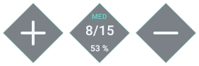</td><td align="center" valign="top"><b>Titanium</b> </td><td align="center" valign="top"><b>Light</b> 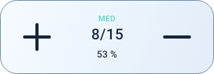</td><td align="center" valign="top"></td></tr>
</table>

<table>
<tr><td align="center" valign="top"><b>Expanded circle</b> </td><td align="center" valign="top"><b>Android</b> <a href="../assets/localized/en/screenshots/volume-live-android.png">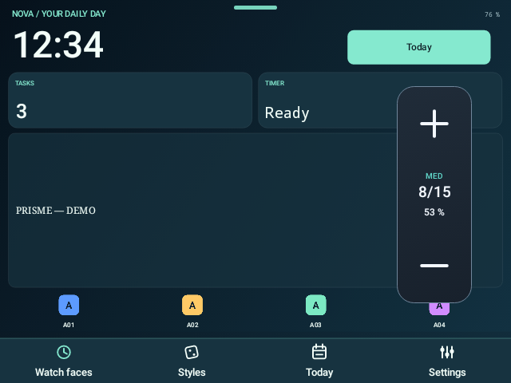</a></td></tr>
</table>

Explore customization options

<table>
<tr><td align="center" valign="top"><b>Volume Options Style</b> <a href="../assets/localized/en/screenshots/volume-options-style.png">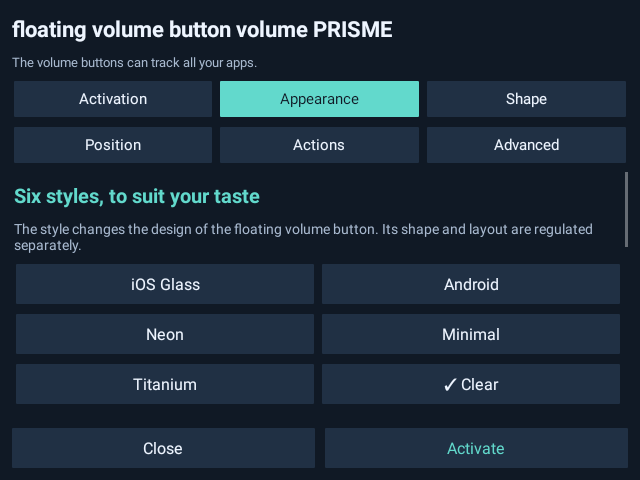</a></td><td align="center" valign="top"><b>Volume Options Shape</b> <a href="../assets/localized/en/screenshots/volume-options-shape.png">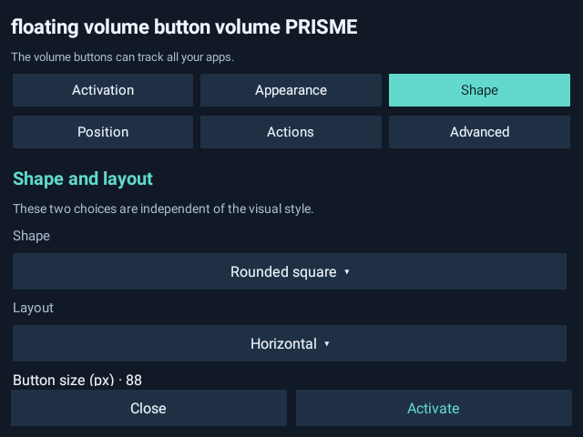</a></td></tr>
<tr><td align="center" valign="top"><b>Volume Options Position</b> <a href="../assets/localized/en/screenshots/volume-options-position.png">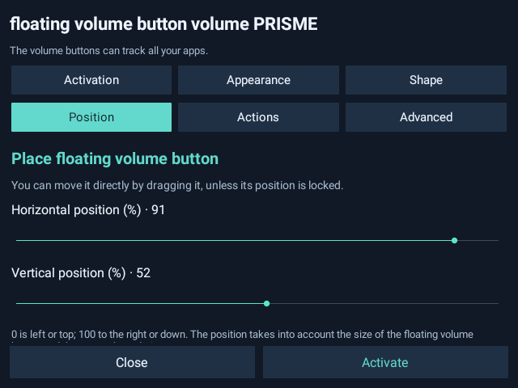</a></td><td align="center" valign="top"><b>Volume Options Advanced</b> <a href="../assets/localized/en/screenshots/volume-options-advanced.png">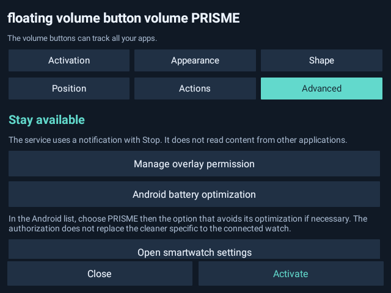</a></td></tr>
</table>

## Genuinely different layouts

Calendar, terminal, arcade, constellation, typography, bubbles or a daily dashboard: the structure actually changes. Open any image at full size.

Apple, Samsung, Garmin and other names in style titles describe visual inspiration, not compatible watch models.

<table>
<tr><td align="center" valign="top"><b>Prisme Touch</b> <a href="../assets/localized/en/styles/style_00.png">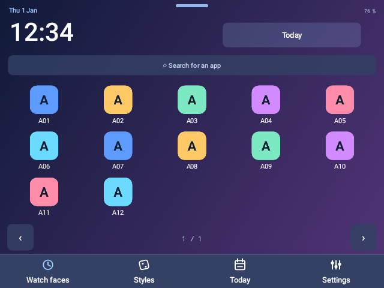</a></td><td align="center" valign="top"><b>Tablette</b> <a href="../assets/localized/en/styles/style_01.png">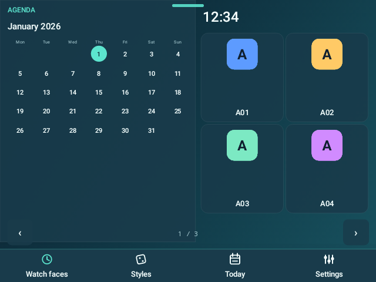</a></td><td align="center" valign="top"><b>Ghost Terminal</b> <a href="../assets/localized/en/styles/style_05.png">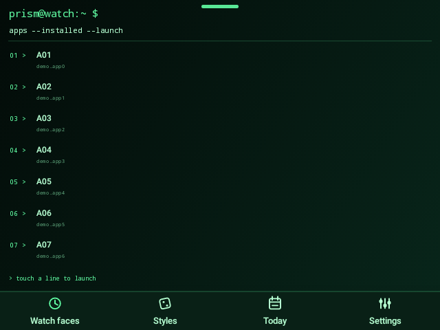</a></td></tr>
<tr><td align="center" valign="top"><b>Arcade 1986</b> <a href="../assets/localized/en/styles/style_06.png">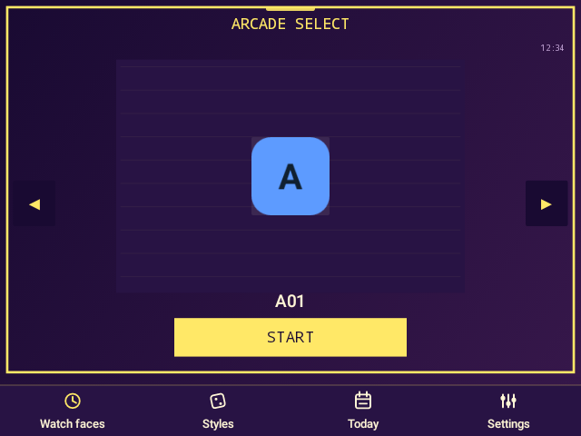</a></td><td align="center" valign="top"><b>Orbit</b> <a href="../assets/localized/en/styles/style_08.png">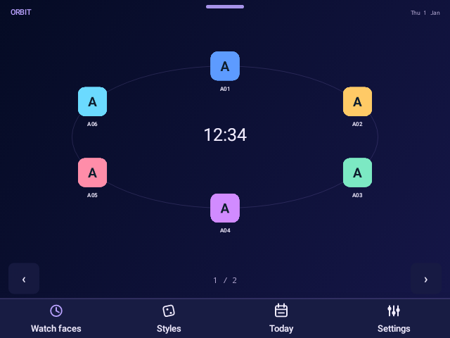</a></td><td align="center" valign="top"><b>Papier</b> <a href="../assets/localized/en/styles/style_09.png">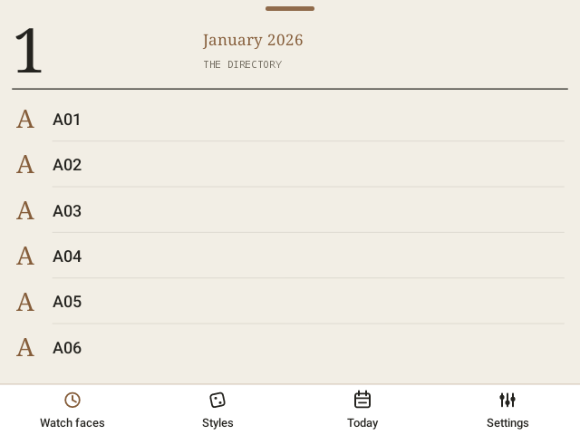</a></td></tr>
<tr><td align="center" valign="top"><b>Samsung Galaxy</b> <a href="../assets/localized/en/styles/style_13.png">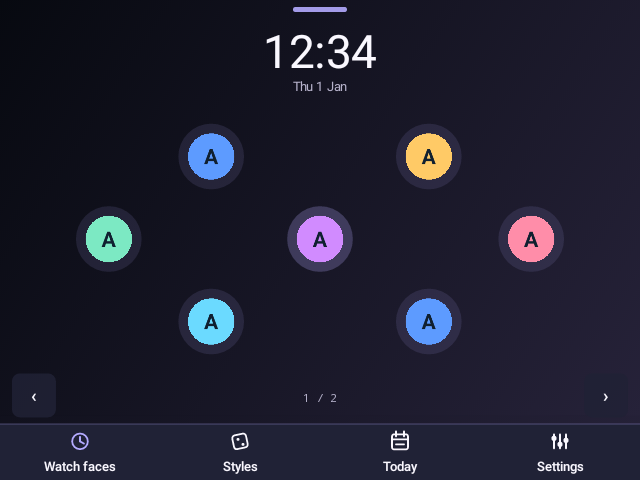</a></td><td align="center" valign="top"><b>Nova</b> <a href="../assets/localized/en/styles/style_20.png">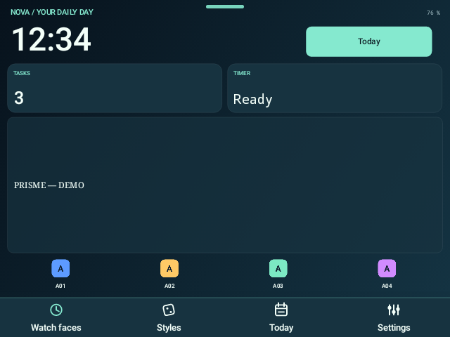</a></td><td align="center" valign="top"><b>Silence</b> <a href="../assets/localized/en/styles/style_21.png">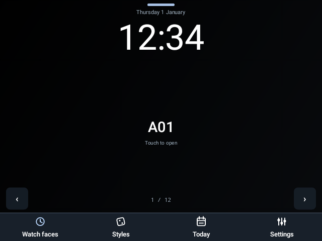</a></td></tr>
</table>

Show all 22 styles

<table>
<tr><td align="center" valign="top"><b>Prisme Touch</b> </td><td align="center" valign="top"><b>Tablette</b> </td><td align="center" valign="top"><b>Bureau Windows</b> <a href="../assets/localized/en/styles/style_02.png">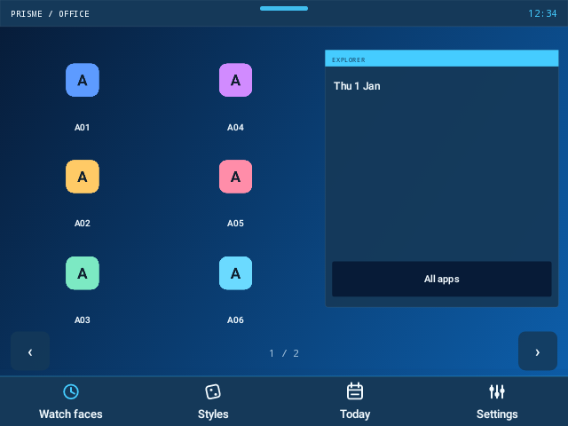</a></td></tr>
<tr><td align="center" valign="top"><b>Dock macOS</b> <a href="../assets/localized/en/styles/style_03.png">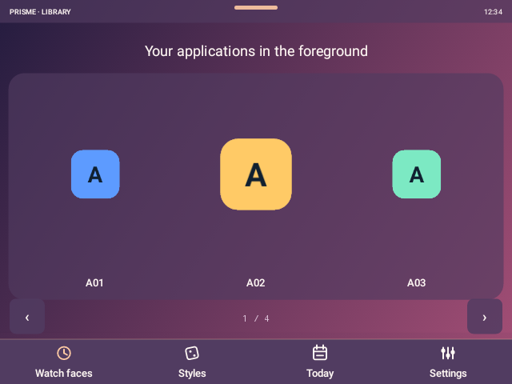</a></td><td align="center" valign="top"><b>Kali Workbench</b> <a href="../assets/localized/en/styles/style_04.png">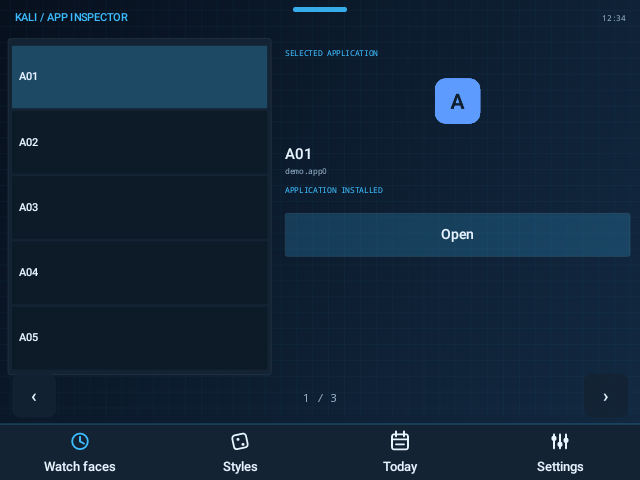</a></td><td align="center" valign="top"><b>Ghost Terminal</b> </td></tr>
<tr><td align="center" valign="top"><b>Arcade 1986</b> </td><td align="center" valign="top"><b>Meca Cockpit</b> <a href="../assets/localized/en/styles/style_07.png">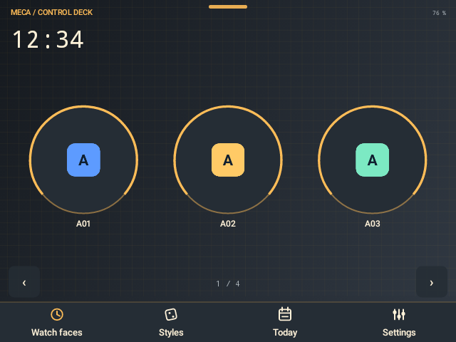</a></td><td align="center" valign="top"><b>Orbit</b> </td></tr>
<tr><td align="center" valign="top"><b>Papier</b> </td><td align="center" valign="top"><b>Aurora</b> <a href="../assets/localized/en/styles/style_10.png">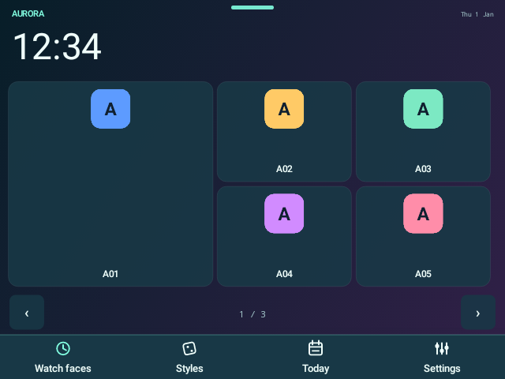</a></td><td align="center" valign="top"><b>LCD Studio</b> <a href="../assets/localized/en/styles/style_11.png">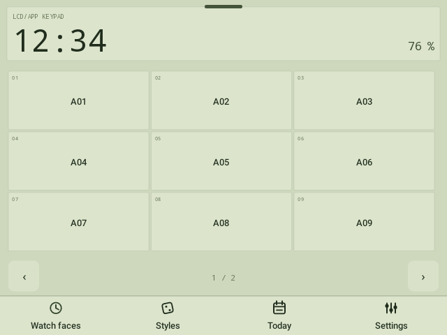</a></td></tr>
<tr><td align="center" valign="top"><b>Apple Ultra</b> <a href="../assets/localized/en/styles/style_12.png">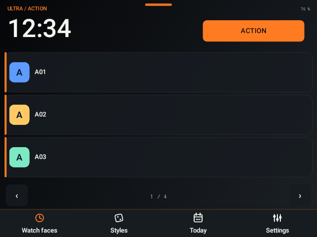</a></td><td align="center" valign="top"><b>Samsung Galaxy</b> </td><td align="center" valign="top"><b>Garmin MARQ</b> <a href="../assets/localized/en/styles/style_14.png">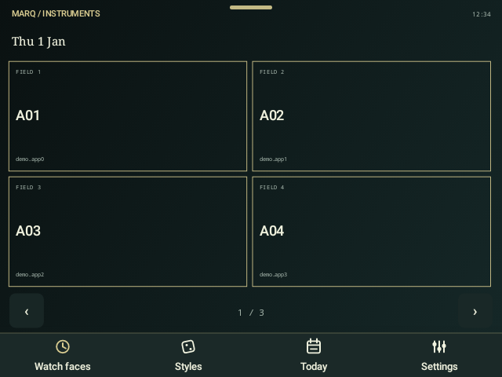</a></td></tr>
<tr><td align="center" valign="top"><b>TAG Racing</b> <a href="../assets/localized/en/styles/style_15.png">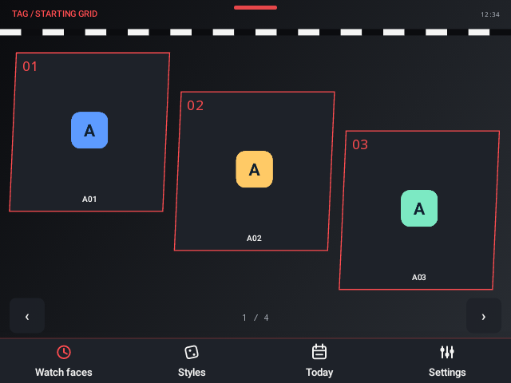</a></td><td align="center" valign="top"><b>Hublot Fusion</b> <a href="../assets/localized/en/styles/style_16.png">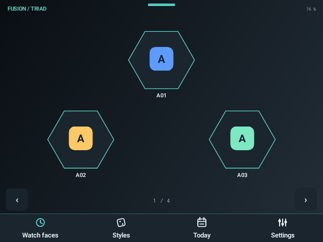</a></td><td align="center" valign="top"><b>Tambour Light</b> <a href="../assets/localized/en/styles/style_17.png">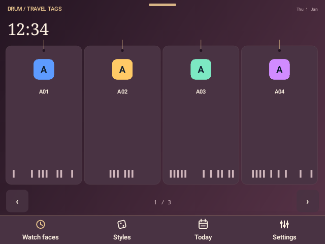</a></td></tr>
<tr><td align="center" valign="top"><b>Montblanc Summit</b> <a href="../assets/localized/en/styles/style_18.png">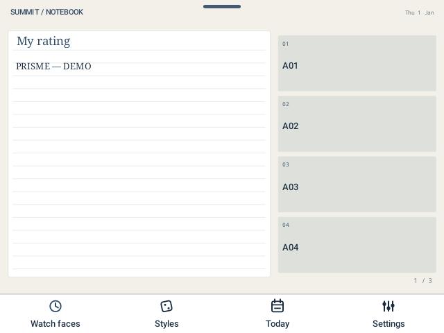</a></td><td align="center" valign="top"><b>Ultimate Design</b> <a href="../assets/localized/en/styles/style_19.png">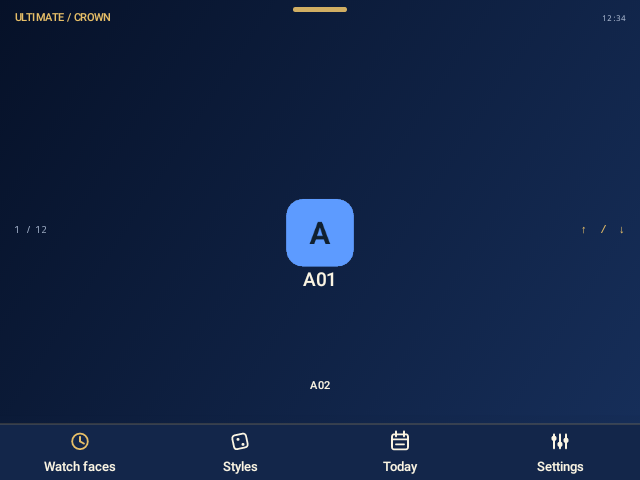</a></td><td align="center" valign="top"><b>Nova</b> </td></tr>
<tr><td align="center" valign="top"><b>Silence</b> </td><td align="center" valign="top"></td><td align="center" valign="top"></td></tr>
</table>

## Everyday tools

<table>
<tr><td align="center" valign="top"><b>Today</b> <a href="../assets/localized/en/screenshots/today.png">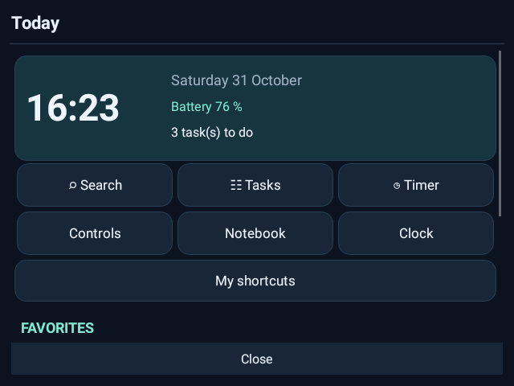</a></td><td align="center" valign="top"><b>Notes</b> <a href="../assets/localized/en/screenshots/notes.png">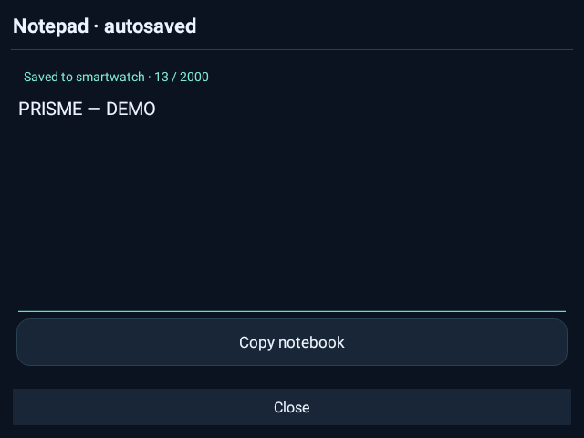</a></td></tr>
<tr><td align="center" valign="top"><b>Checklist</b> <a href="../assets/localized/en/screenshots/checklist.png">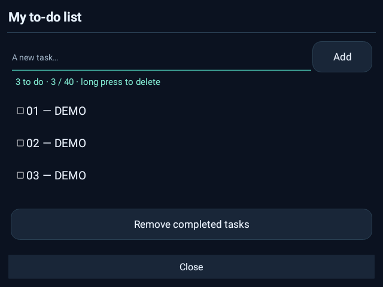</a></td><td align="center" valign="top"><b>Timer</b> <a href="../assets/localized/en/screenshots/timer.png">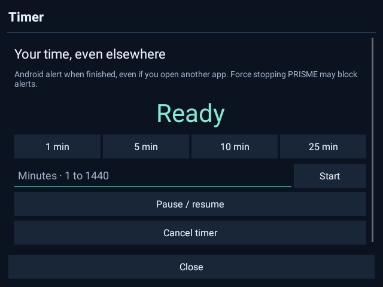</a></td></tr>
</table>

## Settings organized into categories

<table>
<tr><td align="center" valign="top"><b>Settings Style</b> </td><td align="center" valign="top"><b>Settings Shortcuts</b> <a href="../assets/localized/en/screenshots/settings-shortcuts.png">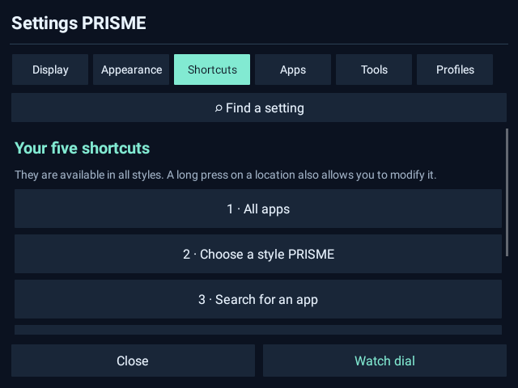</a></td><td align="center" valign="top"><b>Settings Tools</b> <a href="../assets/localized/en/screenshots/settings-tools.png">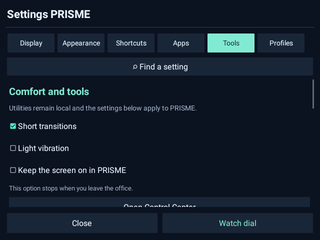</a></td></tr>
</table>

All PRISME captures use an isolated demo app, generic icons and fictional content. No account or personal installed-app catalog is shown.

<!-- /PRISME-VISUAL-SHOWCASE -->

## Watches

| Model or family | Status |
|---|---|
| Domiwear / Domino DM100, Android 7.1.1 | **Device-tested**, landscape reference 640 × 480 |
| Other DM100 variants | Verify individually; similar names do not prove identical firmware |
| Other rectangular watches matching 2.86″ / 640 × 480 | Not validated; separate device testing required |

Untested models are **candidates, not a certified support list**. Verify the actual OS/API and APK installation support. This is not a Wear OS watch-face package. Pixel Watch and Wear OS Galaxy Watch models are not validated. watchOS, Tizen and proprietary systems without Android APKs are outside the target. [Requirements and sources](COMPATIBILITY.md).

## Screenshots, privacy and limitations

[Menus and options](SCREENSHOTS.md) · [All 22 styles](STYLES.md)

Images show the real interfaces of an isolated demo build with fictional data and generic icons, not a user account or installed-app list. The app declares no Internet permission. Notes, tasks, favorites and launches made from PRISME stay locally; user-requested exports can contain that information. No private keys, user backups, account screenshots, watch identifiers or personal logs are published.

Manufacturer battery policies can stop timers and floating services. Music controls need an active player. Secondary translations may need refinement. Physical side bands reported on a DM100 have **no confirmed fix**; PRISME does not alter the panel or repair display drivers. Layout on other screens is not guaranteed.

Java source, resources, language catalogs, tests and the optional Imou companion are included. [Build and test](BUILD.md) · [Permissions](PRIVACY.md) · [Report compatibility](https://github.com/s00r1/PRISME/issues/new/choose). Original code is MIT-licensed: use, modification and redistribution are permitted with the required notice. Brand names describe visual inspiration, without affiliation.

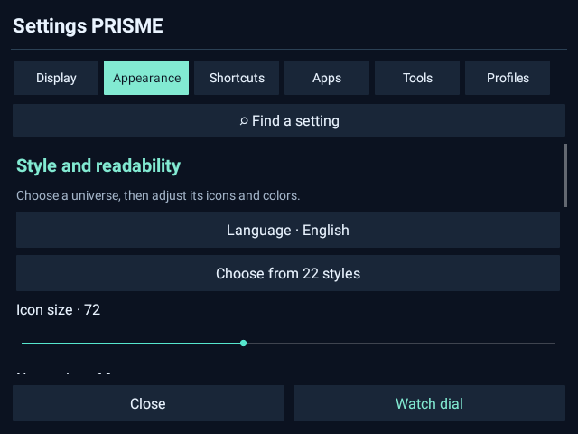

[◈ PRISME — Website / Site web](https://s00r1.github.io/PRISME/) · [Community / Testers](https://github.com/s00r1/PRISME/discussions/1)
