# PRISME — ТОЛЬКО ДЛЯ ПРЯМОУГОЛЬНЫХ ЧАСОВ

## Ориентир: большой экран 2,86″ · 640 × 480 по горизонтали (4:3) · полноценный Android 7.1+ / API 25+

> **НЕ ДЛЯ КРУГЛЫХ ИЛИ КВАДРАТНЫХ ЧАСОВ. Версия рассчитана на прямоугольный формат DM100. Другие прямоугольные размеры и разрешения не проверены.**

<table>
<tr><td align="center" valign="top"></td><td align="center" valign="top"></td></tr>
</table>

**Domiwear / Domino DM100 — проверенный ориентир; два вида одной модели**

Внешние фото товара: объявление DM100. Это аппаратная часть, не PRISME. [Source](https://www.ebay.nl/itm/185939246016) · [Specifications](https://www.domino-china.com/news/19.html)

[Français](README.fr.md) · [English](README.en.md) · [Deutsch](README.de.md) · [中文](README.zh.md) · [Türkçe](README.tr.md) · [Русский](README.ru.md) · [العربية](README.ar.md)

**Настраиваемый домашний экран для часов с полноценным Android.** Работает без Интернета, аккаунта, рекламы и телеметрии.

**[⬇ Скачать APK](https://github.com/s00r1/PRISME/releases/latest/download/PRISME.apk)** · [Control Center](#control-center) · [Volume](#floating-volume) · [22 styles](#styles-showcase)

<table>
<tr><td align="center" valign="top"><b>Control Center</b> <a href="../assets/localized/ru/screenshots/control-center-ios.png">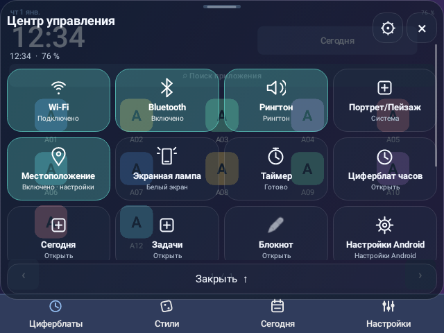</a></td><td align="center" valign="top"><b>Volume</b> <a href="../assets/localized/ru/screenshots/volume-live-circle-open.png">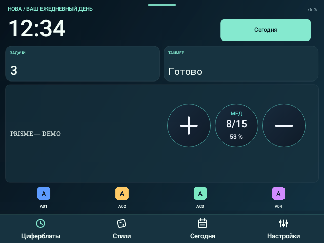</a></td></tr>
</table>

## Установка

**[Скачать готовый PRISME.apk](https://github.com/s00r1/PRISME/releases/latest/download/PRISME.apk)** · [Версии и контрольные суммы](https://github.com/s00r1/PRISME/releases)

Нужны **полноценный Android 7.1 или новее, минимум API 25**, и установка обычных Android APK. Скачайте APK в браузере часов, откройте установщиком Android и при запросе разрешите источник установки. Запустите PRISME и выберите домашним экраном, если прошивка позволяет; можно открывать и как обычное приложение. Для плавающей громкости и глобальной ориентации разрешите показ поверх приложений. Язык: **Настройки → Стиль → Язык**. Официальные обновления устанавливайте поверх существующей версии.

С компьютера: `adb install -r PRISME.apk`. Root, перепрошивка и изменение сервисов Google для установки не нужны.

## Возможности

- **22 разные композиции**: календарь, рабочий стол, галерея, терминал, аркада, созвездие, текстовый каталог, мозаика, соты, приборы, блокнот и минимальный экран.
- Постоянный доступ к штатному циферблату, стилям, разделу «Сегодня» и настройкам. Удержание «Сегодня» открывает пять настраиваемых ярлыков.
- **Центр управления в стиле iOS или Android**: кнопки, порядок, цвета, прозрачность, размер, положение и жесты. Некоторые команды открывают настройки Android.
- **Портрет / Альбом**: короткое нажатие поворачивает, долгое открывает обратные направления и системный режим. Доступны действия уведомления из других приложений. Проверено на DM100; другие прошивки могут ограничивать функцию.
- **Плавающая громкость**: стили, формы, размер, непрозрачность, положение, раскрывающиеся кнопки и затухание при бездействии.
- Поиск приложений/настроек, избранное, недавние приложения, рабочие пространства и свои названия.
- «Сегодня», автоматически сохраняемые заметки, задачи, таймер с сигналом Android, секундомер с кругами и настольные часы.
- Общий масштаб, поля, размеры текста/значков, цвета, профили и локальные копии.
- **Французский, английский, немецкий, упрощённый китайский, турецкий, русский и арабский**, включая отображение справа налево.

<!-- PRISME-VISUAL-SHOWCASE -->

## Центр управления по вашему выбору

Вид iOS или Android, ярлыки, порядок, прозрачность, цвета, размер, положение и жесты. Нажмите Портрет / Альбом для поворота, удерживайте для параметров.

<table>
<tr><td align="center" valign="top"><b>iOS</b> </td><td align="center" valign="top"><b>Android</b> <a href="../assets/localized/ru/screenshots/control-center-android.png">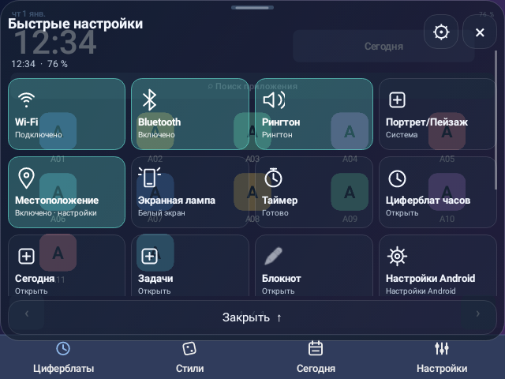</a></td></tr>
</table>

Посмотреть параметры оформления

<table>
<tr><td align="center" valign="top"><b>Center Options Appearance</b> <a href="../assets/localized/ru/screenshots/center-options-appearance.png">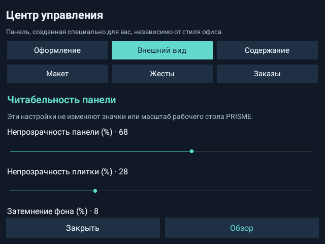</a></td><td align="center" valign="top"><b>Center Options Content</b> <a href="../assets/localized/ru/screenshots/center-options-content.png">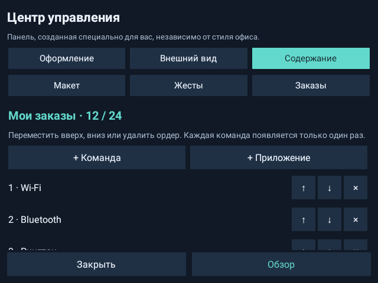</a></td><td align="center" valign="top"><b>Center Options Gestures</b> <a href="../assets/localized/ru/screenshots/center-options-gestures.png">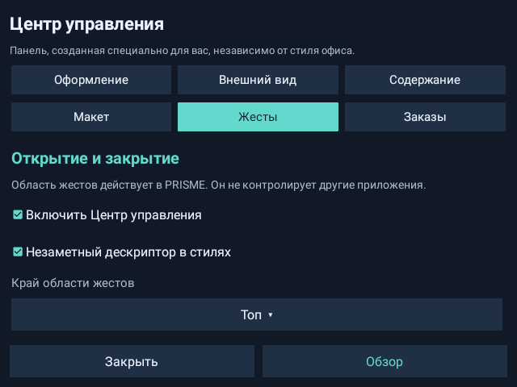</a></td></tr>
<tr><td align="center" valign="top"><b>Center Options Layout</b> <a href="../assets/localized/ru/screenshots/center-options-layout.png">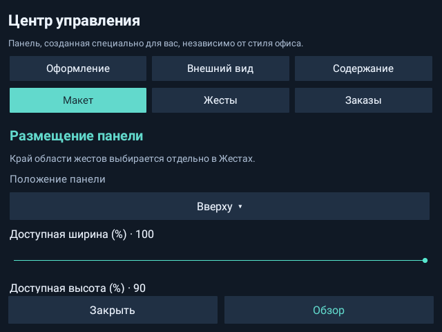</a></td><td align="center" valign="top"><b>Center Ios Transparent</b> <a href="../assets/localized/ru/screenshots/center-ios-transparent.png">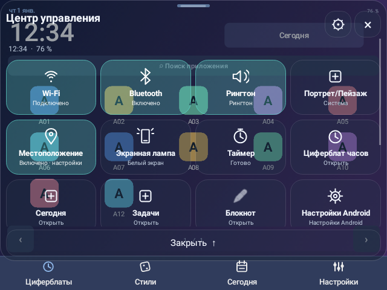</a></td><td align="center" valign="top"><b>Center Ios Opaque</b> <a href="../assets/localized/ru/screenshots/center-ios-opaque.png">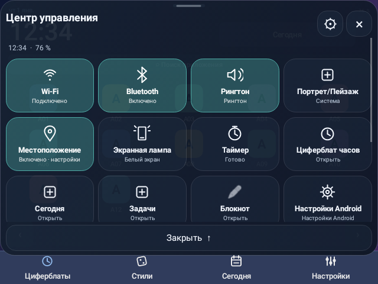</a></td></tr>
</table>

## Плавающая громкость: компактно и с раскрытием

Кнопка раскрывается в + и −. Форма, стиль, размер, положение и непрозрачность задаются отдельно. Показаны настоящие Android-компоненты крупным планом и на рабочем экране.

<table>
<tr><td align="center" valign="top"><b>Закрытый круг</b> 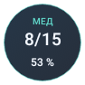</td><td align="center" valign="top"><b>Раскрытый круг</b> 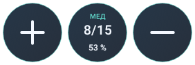</td><td align="center" valign="top"><b>Android</b> </td><td align="center" valign="top"><b>Неон</b> 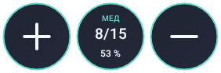</td></tr>
<tr><td align="center" valign="top"><b>Минимал</b> 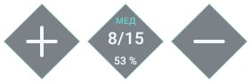</td><td align="center" valign="top"><b>Титан</b> </td><td align="center" valign="top"><b>Светлый</b> 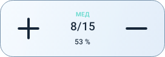</td><td align="center" valign="top"></td></tr>
</table>

<table>
<tr><td align="center" valign="top"><b>Раскрытый круг</b> </td><td align="center" valign="top"><b>Android</b> <a href="../assets/localized/ru/screenshots/volume-live-android.png">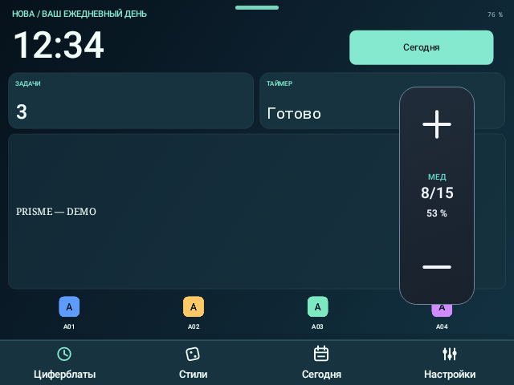</a></td></tr>
</table>

Посмотреть параметры оформления

<table>
<tr><td align="center" valign="top"><b>Volume Options Style</b> <a href="../assets/localized/ru/screenshots/volume-options-style.png">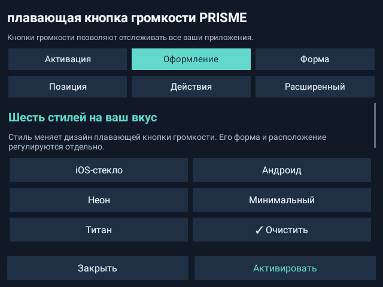</a></td><td align="center" valign="top"><b>Volume Options Shape</b> <a href="../assets/localized/ru/screenshots/volume-options-shape.png">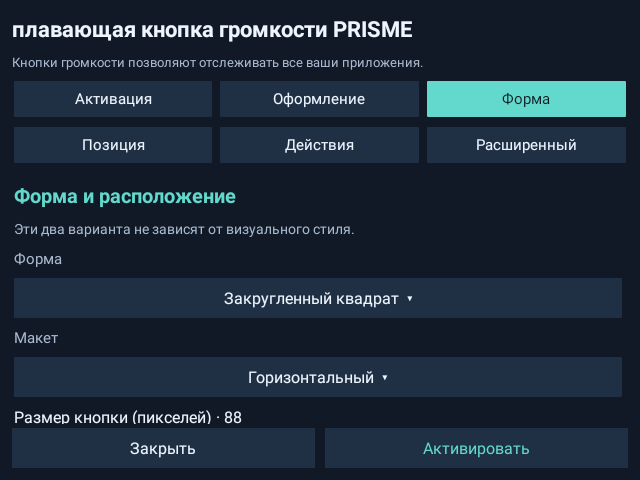</a></td></tr>
<tr><td align="center" valign="top"><b>Volume Options Position</b> <a href="../assets/localized/ru/screenshots/volume-options-position.png">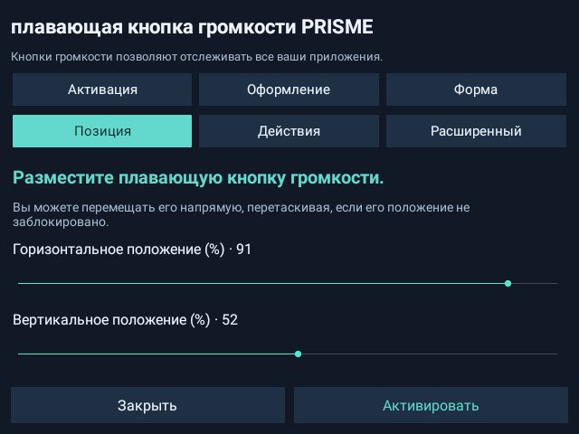</a></td><td align="center" valign="top"><b>Volume Options Advanced</b> <a href="../assets/localized/ru/screenshots/volume-options-advanced.png">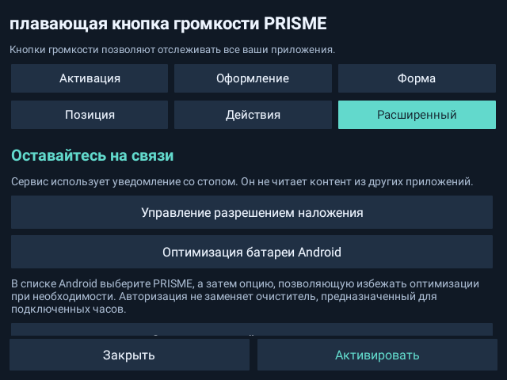</a></td></tr>
</table>

## Разные стили и структуры

Календарь, терминал, аркада, созвездие, текстовый каталог, соты и дневная панель имеют разную организацию. Изображения открываются в полном размере.

Apple, Samsung, Garmin и другие названия стилей обозначают вдохновение, а не совместимые модели часов.

<table>
<tr><td align="center" valign="top"><b>Prisme Touch</b> <a href="../assets/localized/ru/styles/style_00.png">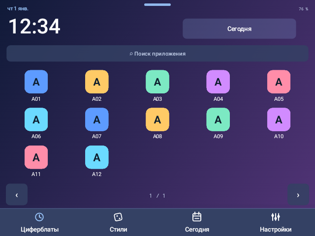</a></td><td align="center" valign="top"><b>Tablette</b> <a href="../assets/localized/ru/styles/style_01.png">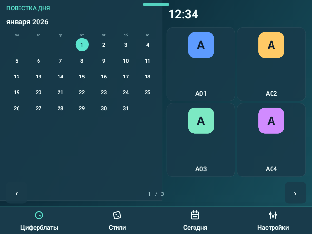</a></td><td align="center" valign="top"><b>Ghost Terminal</b> <a href="../assets/localized/ru/styles/style_05.png">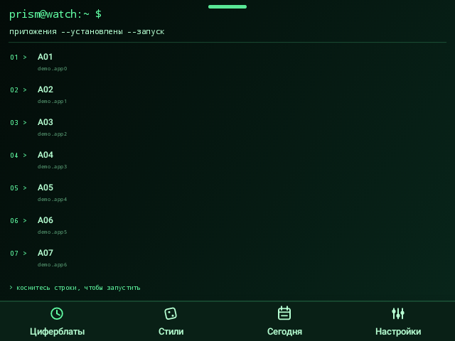</a></td></tr>
<tr><td align="center" valign="top"><b>Arcade 1986</b> <a href="../assets/localized/ru/styles/style_06.png">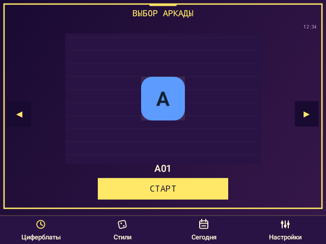</a></td><td align="center" valign="top"><b>Orbit</b> <a href="../assets/localized/ru/styles/style_08.png">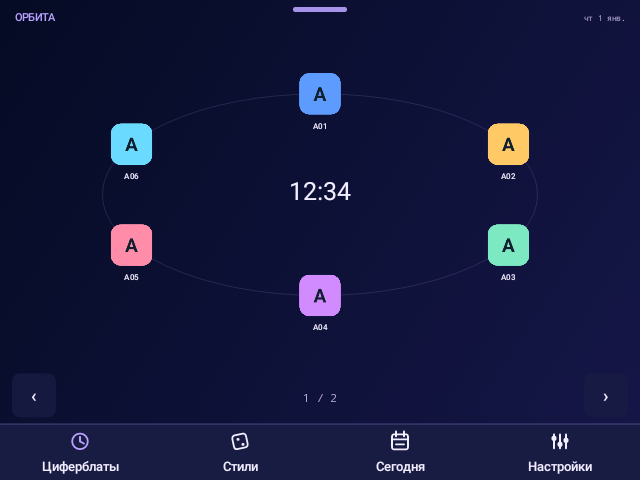</a></td><td align="center" valign="top"><b>Papier</b> <a href="../assets/localized/ru/styles/style_09.png">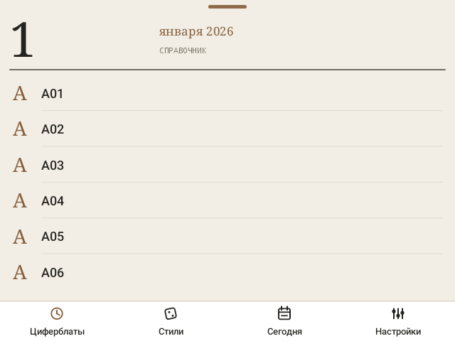</a></td></tr>
<tr><td align="center" valign="top"><b>Samsung Galaxy</b> <a href="../assets/localized/ru/styles/style_13.png">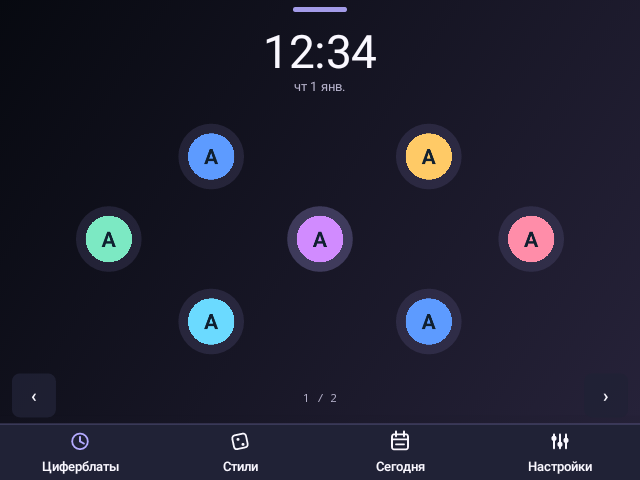</a></td><td align="center" valign="top"><b>Nova</b> <a href="../assets/localized/ru/styles/style_20.png">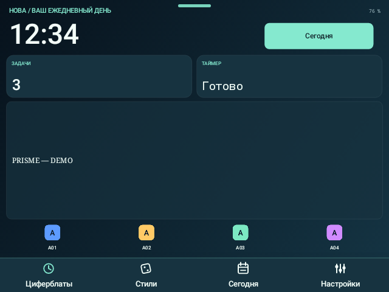</a></td><td align="center" valign="top"><b>Silence</b> <a href="../assets/localized/ru/styles/style_21.png">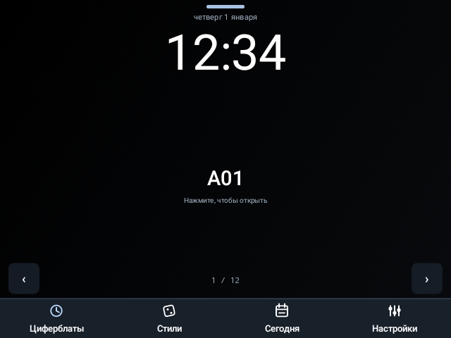</a></td></tr>
</table>

Показать все 22 стиля

<table>
<tr><td align="center" valign="top"><b>Prisme Touch</b> </td><td align="center" valign="top"><b>Tablette</b> </td><td align="center" valign="top"><b>Bureau Windows</b> <a href="../assets/localized/ru/styles/style_02.png">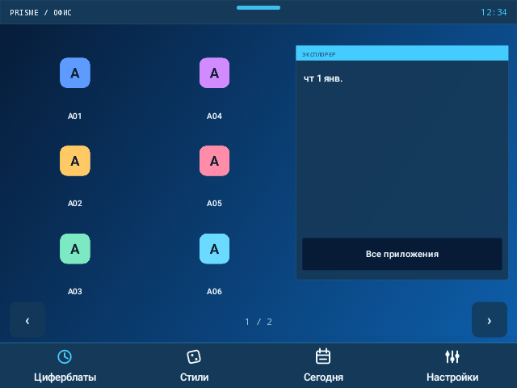</a></td></tr>
<tr><td align="center" valign="top"><b>Dock macOS</b> <a href="../assets/localized/ru/styles/style_03.png">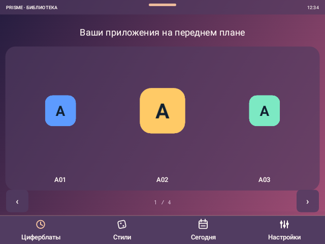</a></td><td align="center" valign="top"><b>Kali Workbench</b> <a href="../assets/localized/ru/styles/style_04.png">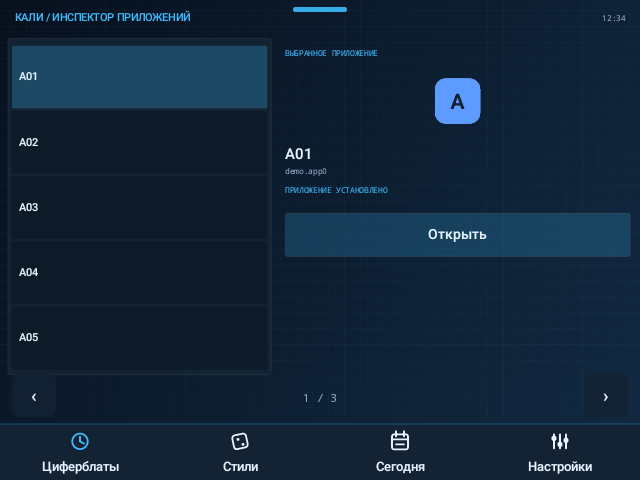</a></td><td align="center" valign="top"><b>Ghost Terminal</b> </td></tr>
<tr><td align="center" valign="top"><b>Arcade 1986</b> </td><td align="center" valign="top"><b>Meca Cockpit</b> <a href="../assets/localized/ru/styles/style_07.png">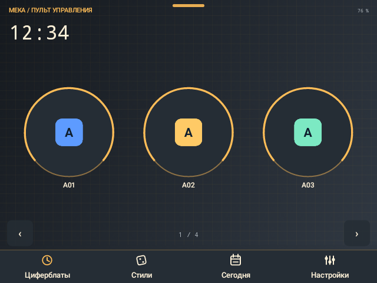</a></td><td align="center" valign="top"><b>Orbit</b> </td></tr>
<tr><td align="center" valign="top"><b>Papier</b> </td><td align="center" valign="top"><b>Aurora</b> <a href="../assets/localized/ru/styles/style_10.png">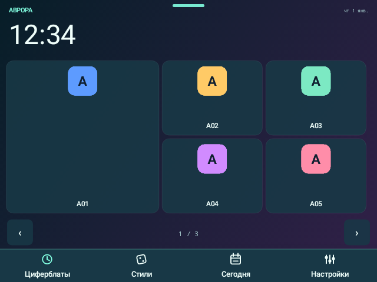</a></td><td align="center" valign="top"><b>LCD Studio</b> <a href="../assets/localized/ru/styles/style_11.png">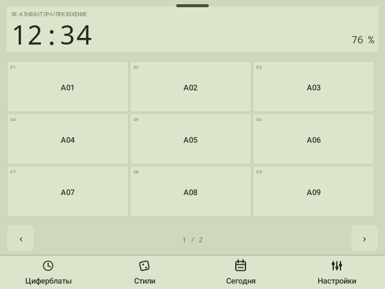</a></td></tr>
<tr><td align="center" valign="top"><b>Apple Ultra</b> <a href="../assets/localized/ru/styles/style_12.png">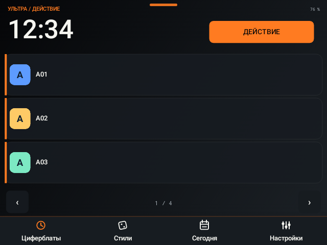</a></td><td align="center" valign="top"><b>Samsung Galaxy</b> </td><td align="center" valign="top"><b>Garmin MARQ</b> <a href="../assets/localized/ru/styles/style_14.png">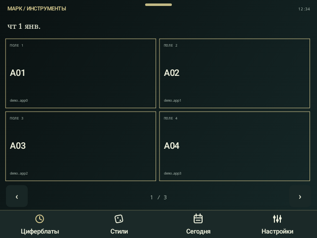</a></td></tr>
<tr><td align="center" valign="top"><b>TAG Racing</b> <a href="../assets/localized/ru/styles/style_15.png">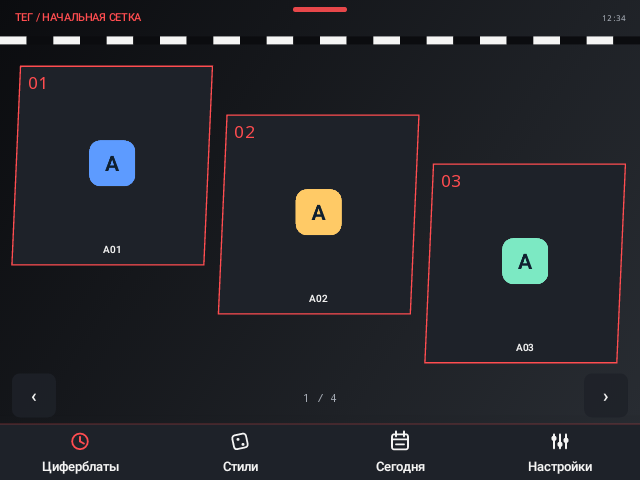</a></td><td align="center" valign="top"><b>Hublot Fusion</b> <a href="../assets/localized/ru/styles/style_16.png">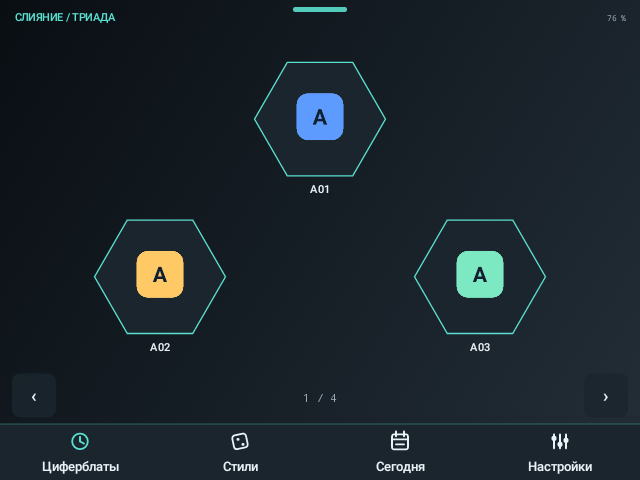</a></td><td align="center" valign="top"><b>Tambour Light</b> <a href="../assets/localized/ru/styles/style_17.png">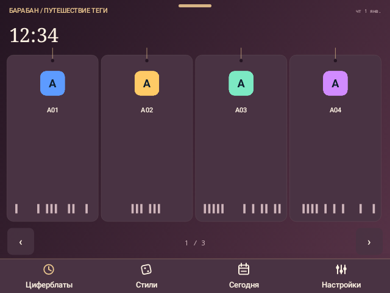</a></td></tr>
<tr><td align="center" valign="top"><b>Montblanc Summit</b> <a href="../assets/localized/ru/styles/style_18.png">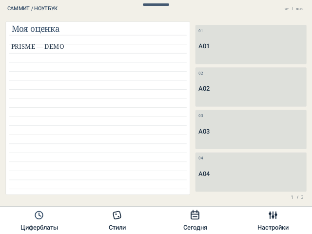</a></td><td align="center" valign="top"><b>Ultimate Design</b> <a href="../assets/localized/ru/styles/style_19.png">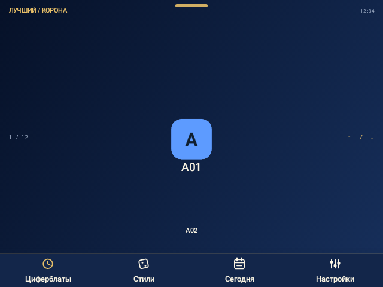</a></td><td align="center" valign="top"><b>Nova</b> </td></tr>
<tr><td align="center" valign="top"><b>Silence</b> </td><td align="center" valign="top"></td><td align="center" valign="top"></td></tr>
</table>

## Повседневные инструменты

<table>
<tr><td align="center" valign="top"><b>Today</b> <a href="../assets/localized/ru/screenshots/today.png">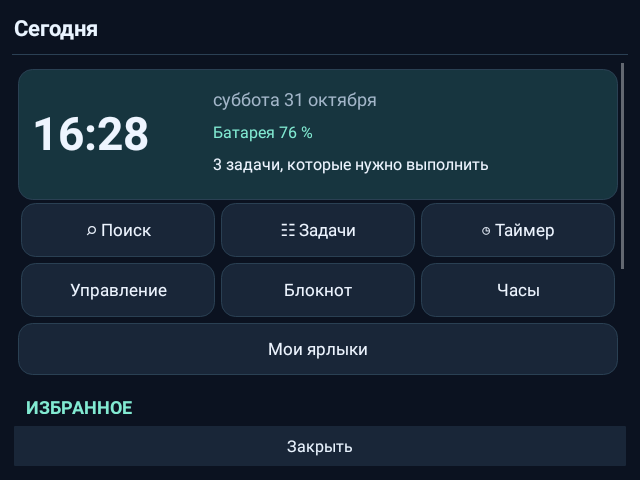</a></td><td align="center" valign="top"><b>Notes</b> <a href="../assets/localized/ru/screenshots/notes.png">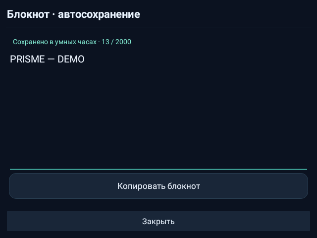</a></td></tr>
<tr><td align="center" valign="top"><b>Checklist</b> <a href="../assets/localized/ru/screenshots/checklist.png">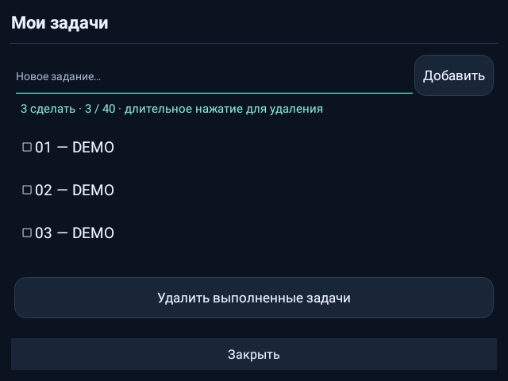</a></td><td align="center" valign="top"><b>Timer</b> <a href="../assets/localized/ru/screenshots/timer.png">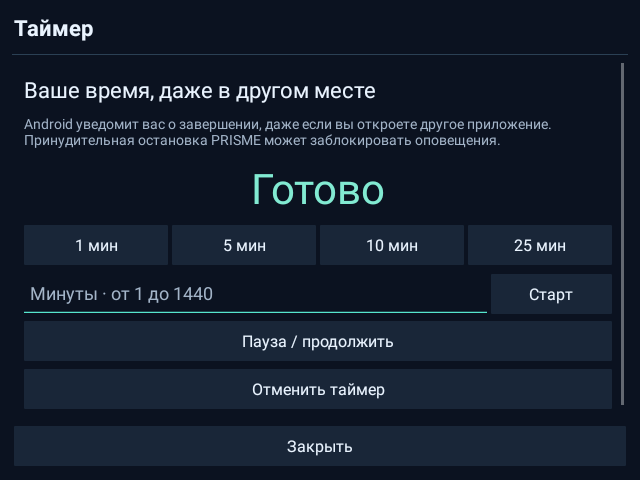</a></td></tr>
</table>

## Настройки по категориям

<table>
<tr><td align="center" valign="top"><b>Settings Style</b> <a href="../assets/localized/ru/screenshots/settings-style.png">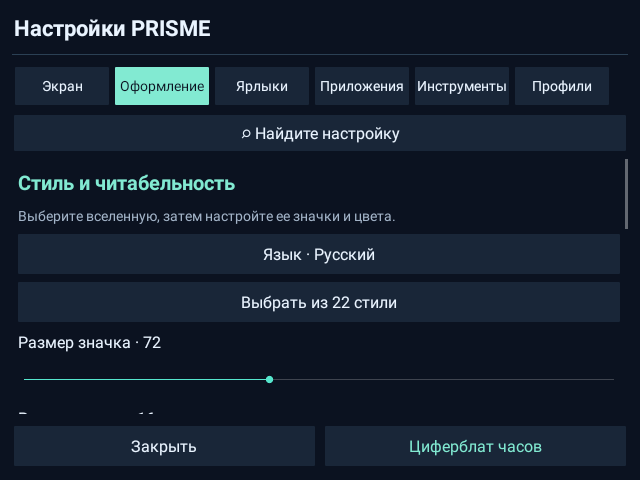</a></td><td align="center" valign="top"><b>Settings Shortcuts</b> <a href="../assets/localized/ru/screenshots/settings-shortcuts.png">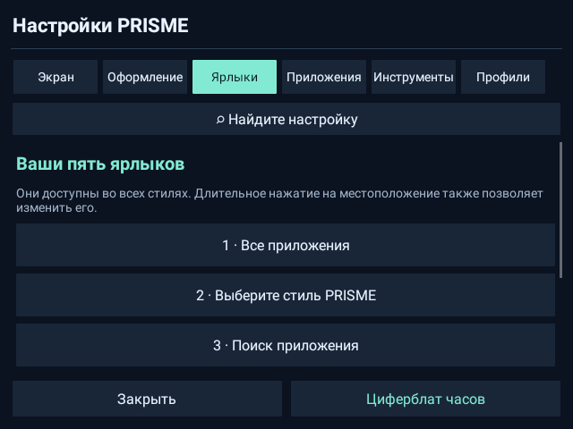</a></td><td align="center" valign="top"><b>Settings Tools</b> <a href="../assets/localized/ru/screenshots/settings-tools.png">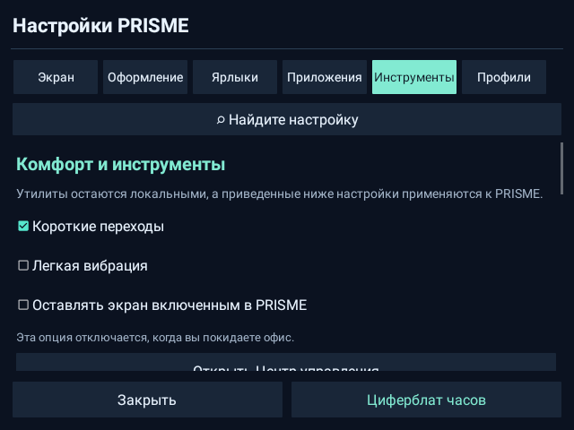</a></td></tr>
</table>

Все изображения PRISME сделаны в отдельной демо-сборке с условными значками и вымышленными данными, без аккаунтов и личного списка приложений.

<!-- /PRISME-VISUAL-SHOWCASE -->

## Часы

| Модель или семейство | Статус |
|---|---|
| Domiwear / Domino DM100, Android 7.1.1 | **Проверено на устройстве**, альбомный ориентир 640 × 480 |
| Другие варианты DM100 | Нужна отдельная проверка: название не доказывает одинаковую прошивку |
| Другие прямоугольные часы 2,86″ / 640 × 480 | Не проверены; нужен отдельный тест |

Непроверенные модели — **кандидаты, а не сертифицированный список**. Проверяйте настоящую ОС, API и установку APK. Это не циферблат Wear OS. Pixel Watch и Wear OS Galaxy Watch не валидированы. watchOS, Tizen и закрытые системы без Android APK вне целевой платформы. [Критерии и источники](COMPATIBILITY.md).

## Изображения, конфиденциальность и ограничения

[Меню и параметры](SCREENSHOTS.md) · [Все 22 стиля](STYLES.md)

Изображения показывают реальные интерфейсы отдельной демонстрационной сборки с вымышленными данными и условными значками. На них нет аккаунта или личного списка приложений. Разрешение Internet отсутствует. Заметки, задачи, избранное и запуски из PRISME хранятся локально; собственный экспорт может их содержать. Закрытые ключи, пользовательские копии, идентификаторы часов и личные журналы не публикуются.

Энергосбережение производителя может останавливать таймер и плавающие службы. Для музыки нужен активный проигрыватель. Переводы могут уточняться. Для боковых чёрных областей на DM100 **подтверждённого исправления нет**. PRISME не меняет панель и драйвер. Отображение на других экранах не гарантируется.

Включены Java-код, ресурсы, языки, тесты и необязательный помощник Imou. [Сборка и тесты](BUILD.md) · [Разрешения](PRIVACY.md) · [Сообщить о совместимости](https://github.com/s00r1/PRISME/issues/new/choose). Оригинальный код под лицензией MIT: использование, изменение и распространение разрешены с сохранением уведомления. Названия марок обозначают визуальное вдохновение; связи с компаниями нет.

[◈ PRISME — Website / Site web](https://s00r1.github.io/PRISME/) · [Community / Testers](https://github.com/s00r1/PRISME/discussions/1)
