# PRISME — YALNIZCA DİKDÖRTGEN SAATLER

## Referans: 2,86″ büyük ekran · yatay 640 × 480 (4:3) · tam Android 7.1+ / API 25+

> **YUVARLAK VEYA KARE SAATLER İÇİN DEĞİLDİR. Bu sürüm DM100 dikdörtgen biçimini hedefler. Diğer dikdörtgen boyut ve çözünürlükler doğrulanmamıştır.**

## 🌐 [RESMÎ PRISME WEB SİTESİNİ AÇ](https://s00r1.github.io/PRISME/)

**https://s00r1.github.io/PRISME/**

<table>
<tr><td align="center" valign="top"></td><td align="center" valign="top"></td></tr>
</table>

**Domiwear / Domino DM100 — test edilen referans; aynı modelin iki görünümü**

Harici ürün fotoğrafları: DM100 ilanı. Donanımı gösterir, PRISME’yi değil. [Source](https://www.ebay.nl/itm/185939246016) · [Specifications](https://www.domino-china.com/news/19.html)

[Français](README.fr.md) · [English](README.en.md) · [Deutsch](README.de.md) · [中文](README.zh.md) · [Türkçe](README.tr.md) · [Русский](README.ru.md) · [العربية](README.ar.md)

**Tam Android çalıştıran saatler için özelleştirilebilir ana ekran.** Çevrimdışı çalışır; hesap, reklam ve telemetri içermez.

**[⬇ APK indir](https://github.com/s00r1/PRISME/releases/download/v5.4/PRISME-5.4.apk)** · [Control Center](#control-center) · [Volume](#floating-volume) · [22 styles](#styles-showcase)

<table>
<tr><td align="center" valign="top"><b>Control Center</b> <a href="../assets/localized/tr/screenshots/control-center-ios.png">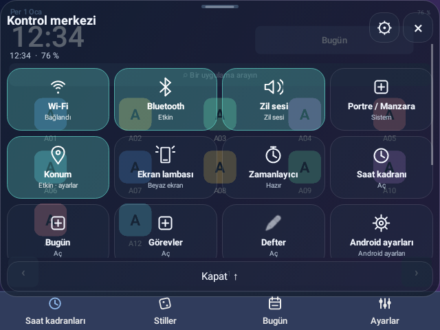</a></td><td align="center" valign="top"><b>Volume</b> <a href="../assets/localized/tr/screenshots/volume-live-circle-open.png">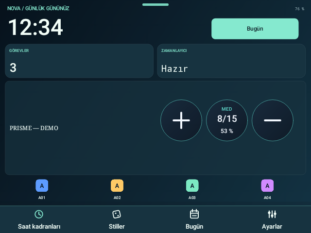</a></td></tr>
</table>

## Kurulum

**[Kuruluma hazır PRISME 5.4 APK dosyasını indir](https://github.com/s00r1/PRISME/releases/download/v5.4/PRISME-5.4.apk)** · [Sürümler ve sağlama toplamları](https://github.com/s00r1/PRISME/releases)

Saatte **tam Android 7.1 veya üzeri, en az API 25** ve normal Android APK kurma desteği gerekir. APK'yi saat tarayıcısından indirin, Android yükleyicisiyle açın ve istenirse bu kaynağa izin verin. PRISME'yi başlatın; aygıt yazılımı izin veriyorsa varsayılan ana ekran seçin veya normal uygulama olarak açın. Yüzen ses ve genel yönlendirme için diğer uygulamaların üzerinde gösterme izni verin. Dil: **Ayarlar → Stil → Dil**. Resmî güncellemeleri mevcut sürümün üzerine kurun.

Bilgisayardan: `adb install -r PRISME-5.4.apk`. Kurulum için root, aygıt yazılımı veya Google hizmetlerini değiştirmek gerekmez.

## ✨ PRISME 5.4 yenilikleri

- **🔋 Ayrı Pil ayarları**: 24 gösterge stili, 12 renk paleti, şarj seviyesine göre renkler, yüzde göstergesi, boyut, konum, saydamlık ve eşikler. **Yalnızca ana ekranda** veya **diğer uygulamaların üzerinde** gösterim seçeneği (Android izni gerekir). Birden fazla pil kaynağı karşılaştırılır; cihaz yazılımı yine de yanlış yüzde bildirebilir.
- **🎵 Ayrı Müzik ayarları**: **22 ana ekran stilinin tamamında** mini oynatıcı; **oynat/duraklat, önceki ve sonraki**, 12 tasarım ve ayarlanabilir boyut/konum/saydamlık. Etkin bir medya oynatıcı gerekir.
- **🔄 Genel ekran döndürme**: uygulamadan PRISME ana ekranına dönmeden kayan Control Center üzerinden dikey/yatay geçiş denemesi. Sonuç cihaz yazılımına bağlıdır.
- **🎧 Ana ekrana dönüş**: uygulama görevlerini sıfırlamamaya yönelik geçişler. Arka planda ses/video oynatma Android ve ilgili uygulamaya bağlıdır; **garanti edilmez**.

**Not:** v5.4 APK kurulumu için Play Protect engeli bildirildi. Güvenlik korumasını kapatmayın; düzeltmeler için [Releases](https://github.com/s00r1/PRISME/releases) sayfasını kontrol edin. Galeride eski sürümlerden görseller bulunabilir.

## Özellikler

- **22 farklı düzen**: takvim, masaüstü, galeri, terminal, oyun salonu, takımyıldız, metin dizini, mozaik, baloncuklar, göstergeler, not defteri ve sade ekran.
- Yerel kadran, Stiller, Bugün ve ayarlara sürekli erişim. Bugün'e uzun basınca beş özelleştirilebilir kısayol açılır.
- **iOS veya Android tarzı kontrol merkezi**: düğmeler, sıra, renkler, saydamlık, boyut, konum ve hareketler ayarlanabilir. Bazı komutlar Android ayarlarını açar.
- **Dikey / Yatay**: dokunarak döndürme; uzun basışla ters yönler ve Sistem modu. Bildirimden diğer uygulamaların içindeyken de döndürülebilir. DM100 üzerinde test edildi; diğer sistemler kısıtlayabilir.
- **Yüzen ses düğmesi**: farklı stiller/şekiller, boyut, opaklık, konum, açılır tuşlar ve isteğe bağlı boşta solma.
- Uygulama/ayar araması, favoriler, son uygulamalar, çalışma alanları ve özel adlar.
- Bugün, otomatik not kaydı, görevler, Android alarmlı süreölçer, tur kayıtlı kronometre ve masa saati.
- Genel ölçek, kenar boşlukları, metin/simge boyutu, renkler, profiller ve yerel yedekler.
- **Fransızca, İngilizce, Almanca, Basitleştirilmiş Çince, Türkçe, Rusça ve Arapça**; sağdan sola görünüm desteği.

<!-- PRISME-VISUAL-SHOWCASE -->

## Kontrol merkezinizi kendinize göre düzenleyin

iOS veya Android görünümü; kısayollar, sıra, saydamlık, renk, boyut, konum ve hareketler. Döndürmek için Dikey / Yatay düğmesine dokunun; seçenekler için basılı tutun.

<table>
<tr><td align="center" valign="top"><b>iOS</b> </td><td align="center" valign="top"><b>Android</b> <a href="../assets/localized/tr/screenshots/control-center-android.png">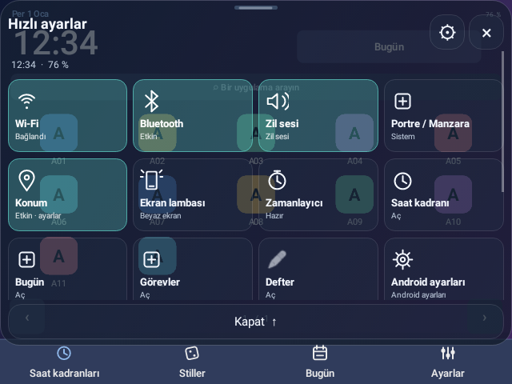</a></td></tr>
</table>

Özelleştirme seçenekleri

<table>
<tr><td align="center" valign="top"><b>Center Options Appearance</b> <a href="../assets/localized/tr/screenshots/center-options-appearance.png">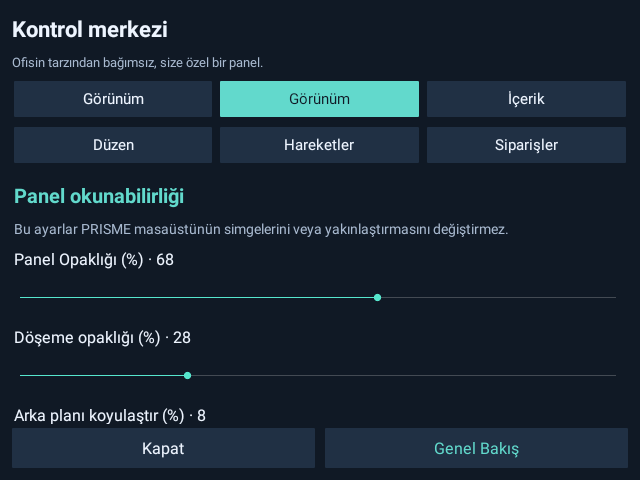</a></td><td align="center" valign="top"><b>Center Options Content</b> <a href="../assets/localized/tr/screenshots/center-options-content.png">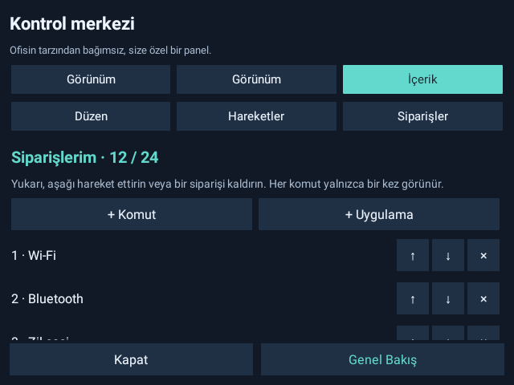</a></td><td align="center" valign="top"><b>Center Options Gestures</b> <a href="../assets/localized/tr/screenshots/center-options-gestures.png">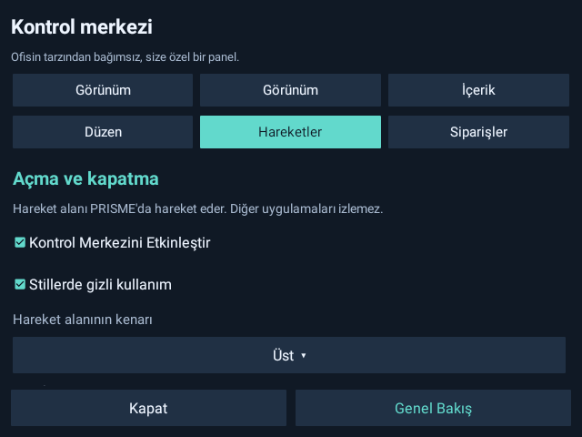</a></td></tr>
<tr><td align="center" valign="top"><b>Center Options Layout</b> <a href="../assets/localized/tr/screenshots/center-options-layout.png">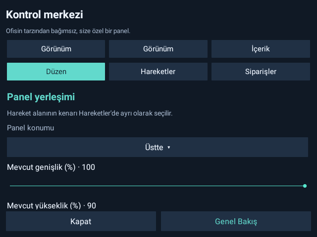</a></td><td align="center" valign="top"><b>Center Ios Transparent</b> <a href="../assets/localized/tr/screenshots/center-ios-transparent.png">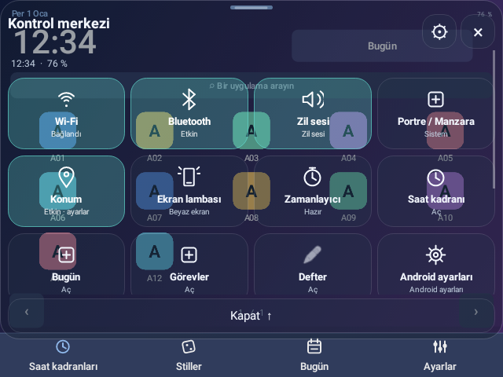</a></td><td align="center" valign="top"><b>Center Ios Opaque</b> <a href="../assets/localized/tr/screenshots/center-ios-opaque.png">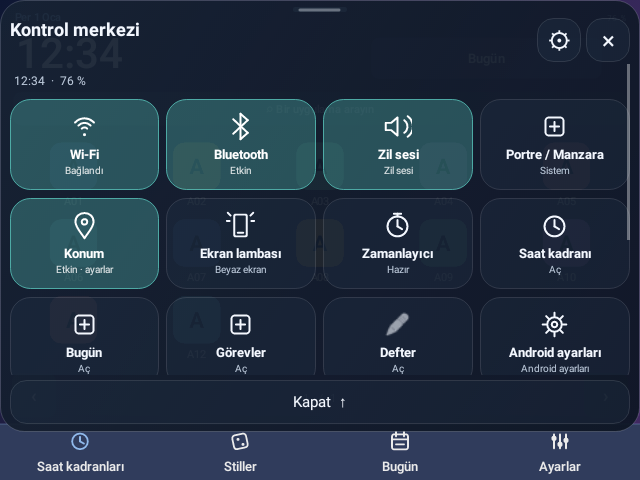</a></td></tr>
</table>

## Yüzen ses: küçük, açılabilir ve özelleştirilebilir

Düğme + ve − denetimlerine açılabilir. Şekil, stil, boyut, konum ve opaklık ayrı ayarlanır. Gerçek Android bileşenleri yakından ve ana ekran üzerinde gösterilir.

<table>
<tr><td align="center" valign="top"><b>Kapalı daire</b> 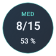</td><td align="center" valign="top"><b>Açık daire</b> 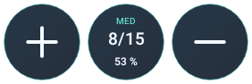</td><td align="center" valign="top"><b>Android</b> 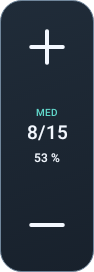</td><td align="center" valign="top"><b>Neon</b> 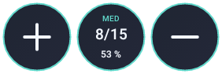</td></tr>
<tr><td align="center" valign="top"><b>Minimal</b> 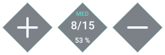</td><td align="center" valign="top"><b>Titanyum</b> </td><td align="center" valign="top"><b>Açık</b> 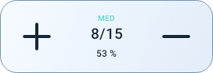</td><td align="center" valign="top"></td></tr>
</table>

<table>
<tr><td align="center" valign="top"><b>Açık daire</b> </td><td align="center" valign="top"><b>Android</b> <a href="../assets/localized/tr/screenshots/volume-live-android.png">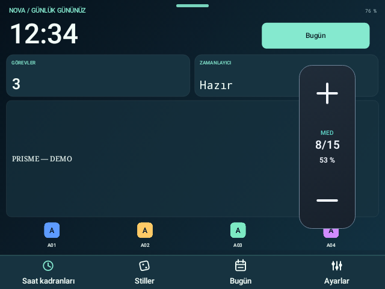</a></td></tr>
</table>

Özelleştirme seçenekleri

<table>
<tr><td align="center" valign="top"><b>Volume Options Style</b> <a href="../assets/localized/tr/screenshots/volume-options-style.png">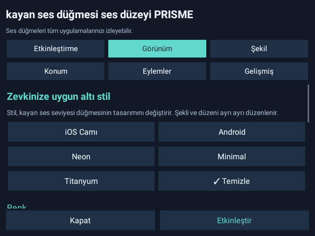</a></td><td align="center" valign="top"><b>Volume Options Shape</b> <a href="../assets/localized/tr/screenshots/volume-options-shape.png">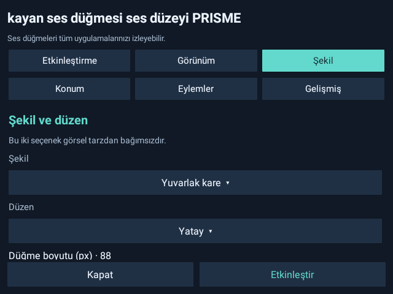</a></td></tr>
<tr><td align="center" valign="top"><b>Volume Options Position</b> </td><td align="center" valign="top"><b>Volume Options Advanced</b> <a href="../assets/localized/tr/screenshots/volume-options-advanced.png">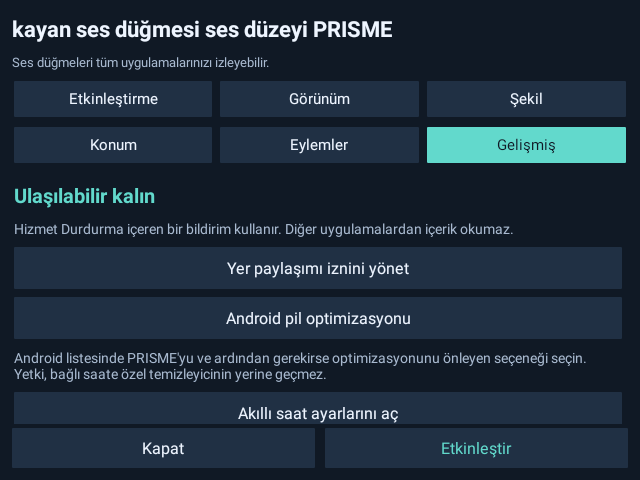</a></td></tr>
</table>

## Birbirinden farklı stiller

Takvim, terminal, oyun salonu, takımyıldız, yazı dizini, baloncuklar veya günlük pano farklı yapılar kullanır. Resimleri tam boyutta açabilirsiniz.

Stillerdeki Apple, Samsung, Garmin gibi adlar görsel esinlenmedir; uyumlu saat modelleri değildir.

<table>
<tr><td align="center" valign="top"><b>Prisme Touch</b> <a href="../assets/localized/tr/styles/style_00.png">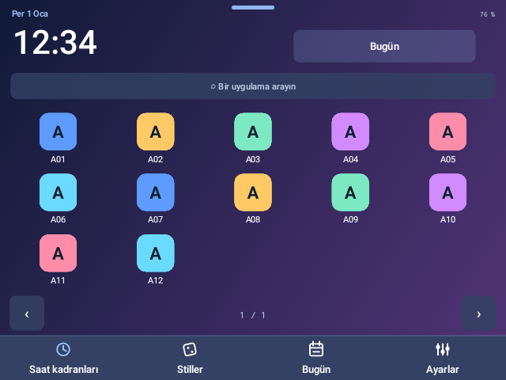</a></td><td align="center" valign="top"><b>Tablette</b> <a href="../assets/localized/tr/styles/style_01.png">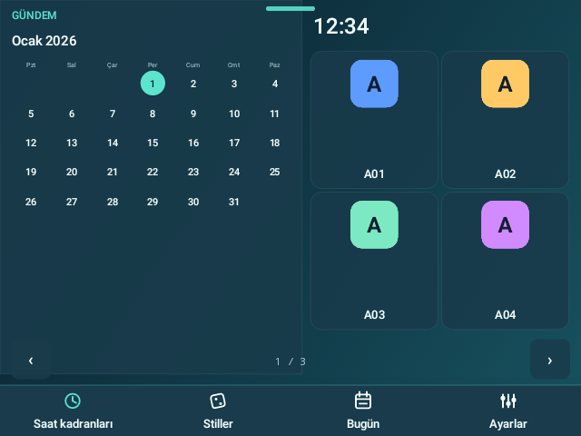</a></td><td align="center" valign="top"><b>Ghost Terminal</b> <a href="../assets/localized/tr/styles/style_05.png">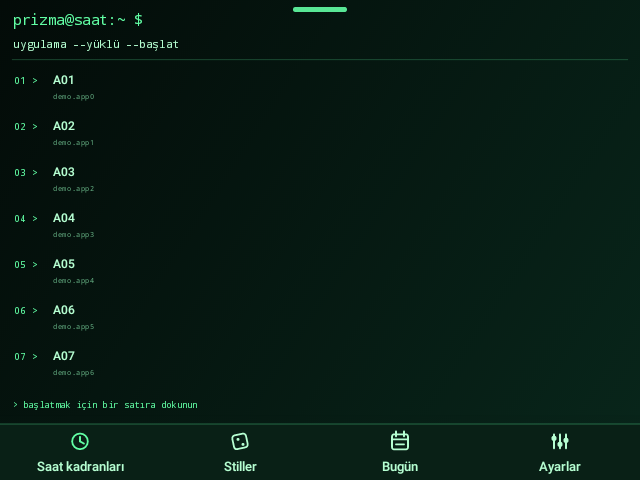</a></td></tr>
<tr><td align="center" valign="top"><b>Arcade 1986</b> <a href="../assets/localized/tr/styles/style_06.png">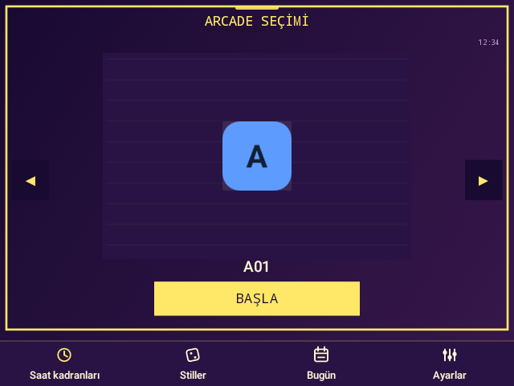</a></td><td align="center" valign="top"><b>Orbit</b> <a href="../assets/localized/tr/styles/style_08.png">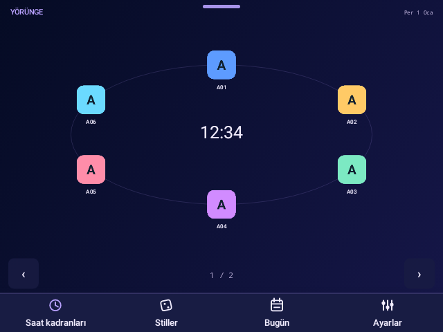</a></td><td align="center" valign="top"><b>Papier</b> <a href="../assets/localized/tr/styles/style_09.png">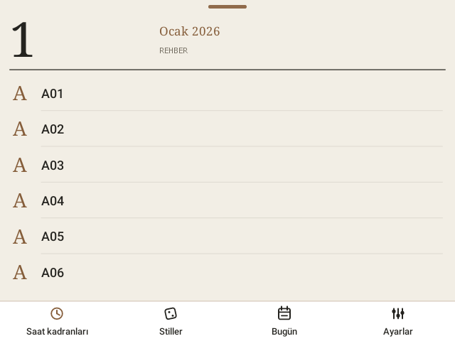</a></td></tr>
<tr><td align="center" valign="top"><b>Samsung Galaxy</b> <a href="../assets/localized/tr/styles/style_13.png">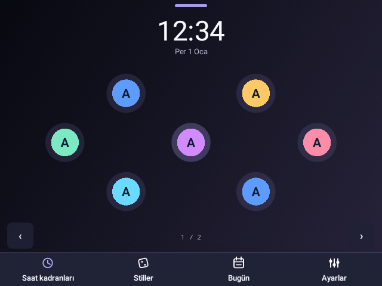</a></td><td align="center" valign="top"><b>Nova</b> <a href="../assets/localized/tr/styles/style_20.png">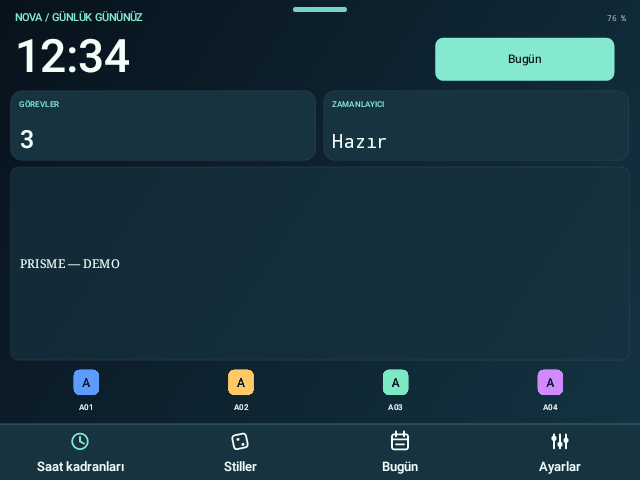</a></td><td align="center" valign="top"><b>Silence</b> <a href="../assets/localized/tr/styles/style_21.png">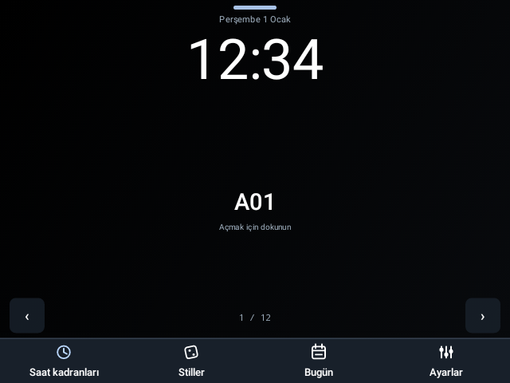</a></td></tr>
</table>

22 stilin tümünü göster

<table>
<tr><td align="center" valign="top"><b>Prisme Touch</b> </td><td align="center" valign="top"><b>Tablette</b> </td><td align="center" valign="top"><b>Bureau Windows</b> <a href="../assets/localized/tr/styles/style_02.png">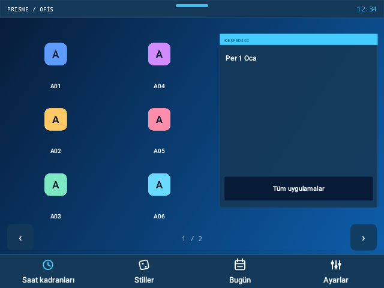</a></td></tr>
<tr><td align="center" valign="top"><b>Dock macOS</b> <a href="../assets/localized/tr/styles/style_03.png">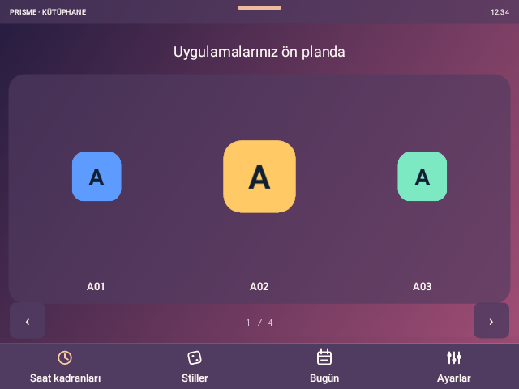</a></td><td align="center" valign="top"><b>Kali Workbench</b> <a href="../assets/localized/tr/styles/style_04.png">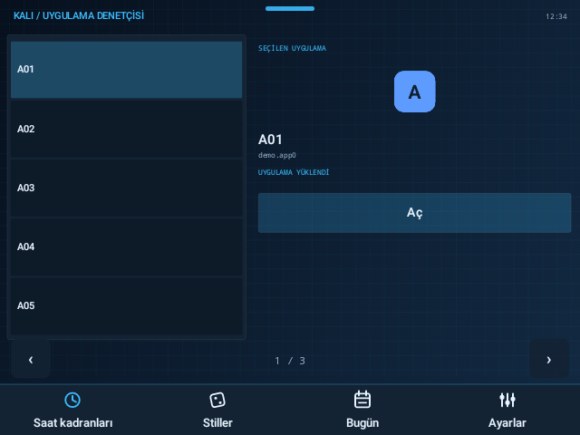</a></td><td align="center" valign="top"><b>Ghost Terminal</b> </td></tr>
<tr><td align="center" valign="top"><b>Arcade 1986</b> </td><td align="center" valign="top"><b>Meca Cockpit</b> <a href="../assets/localized/tr/styles/style_07.png">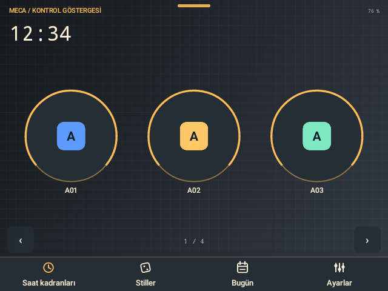</a></td><td align="center" valign="top"><b>Orbit</b> </td></tr>
<tr><td align="center" valign="top"><b>Papier</b> </td><td align="center" valign="top"><b>Aurora</b> <a href="../assets/localized/tr/styles/style_10.png">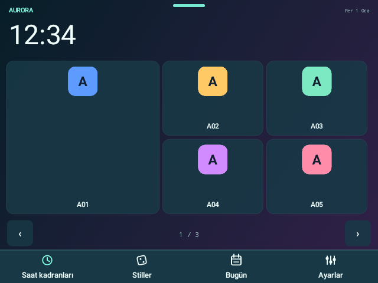</a></td><td align="center" valign="top"><b>LCD Studio</b> <a href="../assets/localized/tr/styles/style_11.png">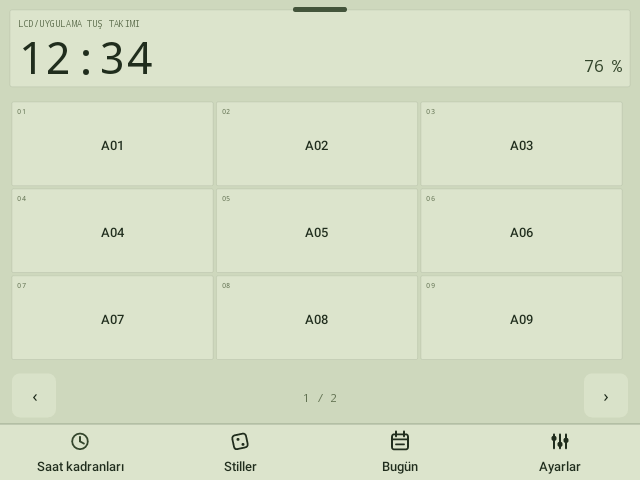</a></td></tr>
<tr><td align="center" valign="top"><b>Apple Ultra</b> <a href="../assets/localized/tr/styles/style_12.png">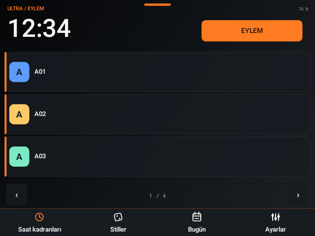</a></td><td align="center" valign="top"><b>Samsung Galaxy</b> </td><td align="center" valign="top"><b>Garmin MARQ</b> <a href="../assets/localized/tr/styles/style_14.png">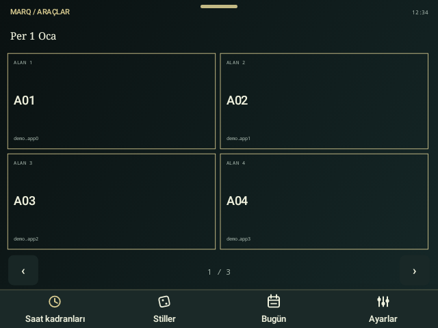</a></td></tr>
<tr><td align="center" valign="top"><b>TAG Racing</b> <a href="../assets/localized/tr/styles/style_15.png">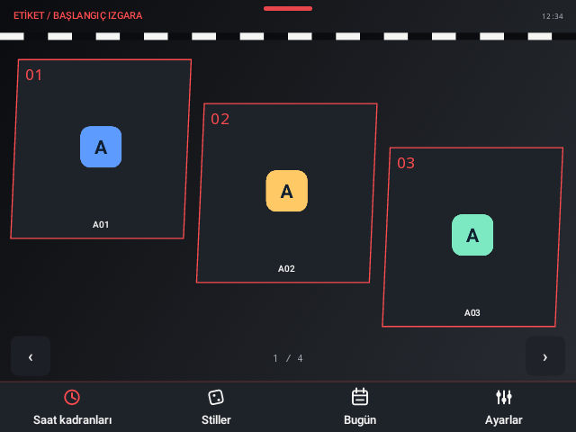</a></td><td align="center" valign="top"><b>Hublot Fusion</b> <a href="../assets/localized/tr/styles/style_16.png">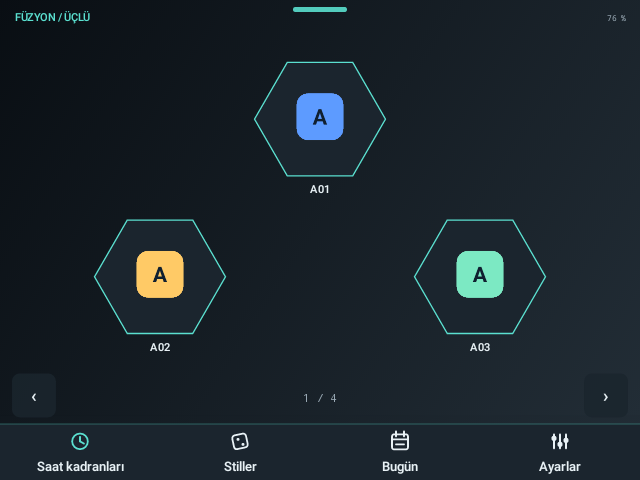</a></td><td align="center" valign="top"><b>Tambour Light</b> <a href="../assets/localized/tr/styles/style_17.png">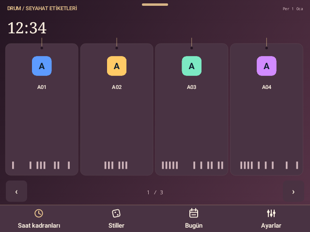</a></td></tr>
<tr><td align="center" valign="top"><b>Montblanc Summit</b> <a href="../assets/localized/tr/styles/style_18.png">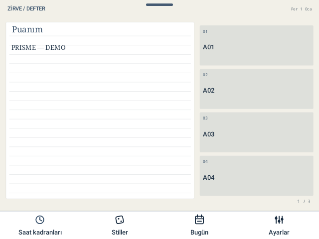</a></td><td align="center" valign="top"><b>Ultimate Design</b> <a href="../assets/localized/tr/styles/style_19.png">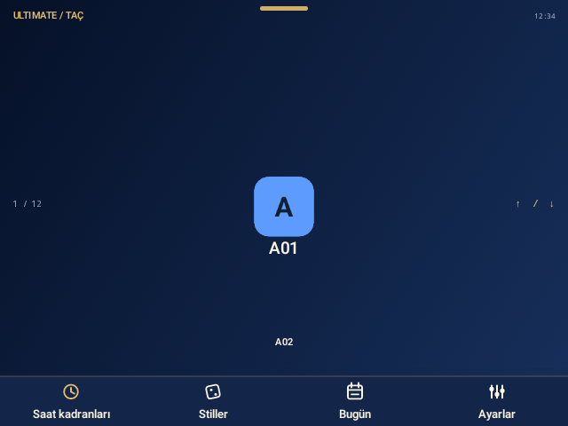</a></td><td align="center" valign="top"><b>Nova</b> </td></tr>
<tr><td align="center" valign="top"><b>Silence</b> </td><td align="center" valign="top"></td><td align="center" valign="top"></td></tr>
</table>

## Günlük araçlar

<table>
<tr><td align="center" valign="top"><b>Today</b> <a href="../assets/localized/tr/screenshots/today.png">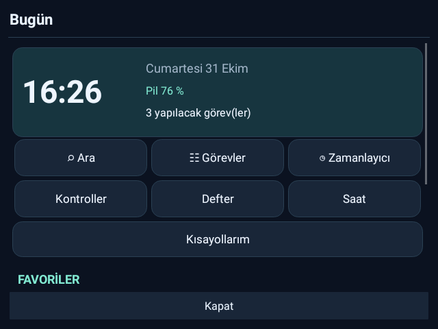</a></td><td align="center" valign="top"><b>Notes</b> <a href="../assets/localized/tr/screenshots/notes.png">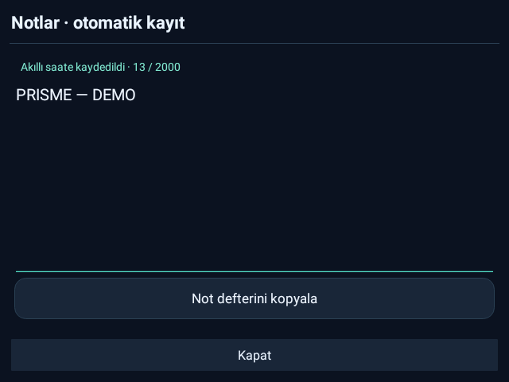</a></td></tr>
<tr><td align="center" valign="top"><b>Checklist</b> <a href="../assets/localized/tr/screenshots/checklist.png">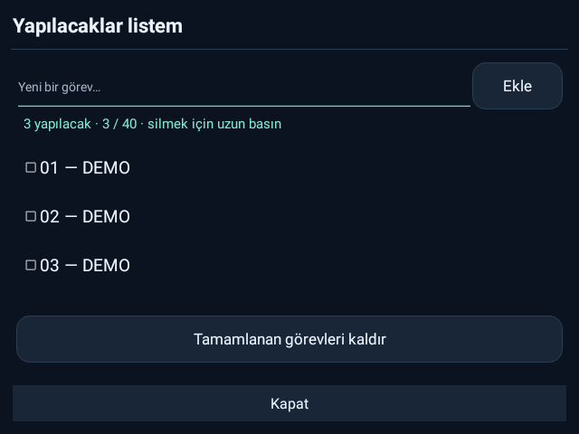</a></td><td align="center" valign="top"><b>Timer</b> <a href="../assets/localized/tr/screenshots/timer.png">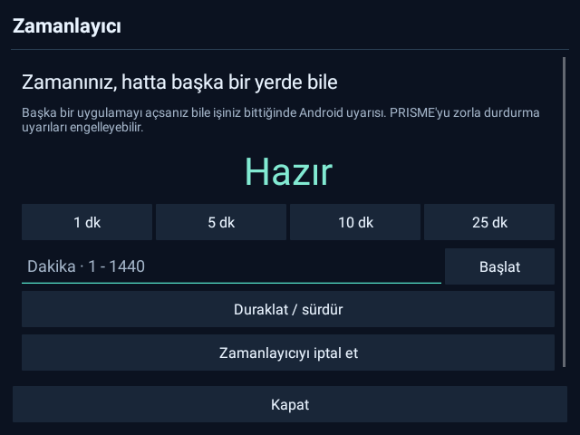</a></td></tr>
</table>

## Kategorilere ayrılmış ayarlar

<table>
<tr><td align="center" valign="top"><b>Settings Style</b> </td><td align="center" valign="top"><b>Settings Shortcuts</b> <a href="../assets/localized/tr/screenshots/settings-shortcuts.png">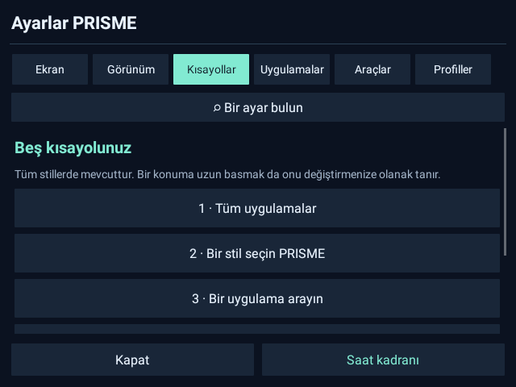</a></td><td align="center" valign="top"><b>Settings Tools</b> <a href="../assets/localized/tr/screenshots/settings-tools.png">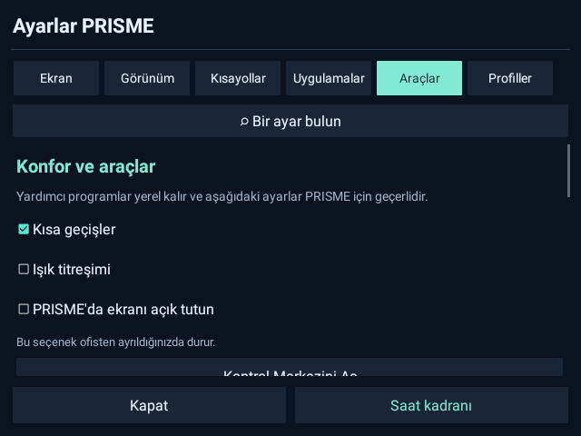</a></td></tr>
</table>

Tüm PRISME görselleri ayrı bir demo uygulamasında genel simgeler ve kurmaca içerikle oluşturulmuştur; hesap veya kişisel uygulama listesi göstermez.

<!-- /PRISME-VISUAL-SHOWCASE -->

## Saatler

| Model veya aile | Durum |
|---|---|
| Domiwear / Domino DM100, Android 7.1.1 | **Cihazda test edildi**, yatay referans 640 × 480 |
| Diğer DM100 varyantları | Ayrı ayrı doğrulanmalı; benzer ad aynı yazılım anlamına gelmez |
| 2,86″ / 640 × 480 biçimindeki diğer dikdörtgen saatler | Doğrulanmadı; ayrı cihaz testi gerekir |

Bu adlar **aday listesidir, sertifikalı destek listesi değildir**. Gerçek saatin işletim sistemi, API düzeyi ve APK kurulumunu kontrol edin. Proje Wear OS kadranı değildir. Pixel Watch ve Wear OS Galaxy Watch doğrulanmamıştır. watchOS, Tizen ve Android APK yükleyemeyen özel sistemler hedef dışıdır. [Koşullar ve kaynaklar](COMPATIBILITY.md).

## Görseller, gizlilik ve sınırlar

[Menüler ve seçenekler](SCREENSHOTS.md) · [22 stilin tümü](STYLES.md)

Görseller ayrı bir demo derlemesinin gerçek arayüzlerinden, kurmaca veriler ve genel simgelerle alınmıştır. Kullanıcı hesabı veya kişisel uygulama listesi göstermez. Internet izni yoktur. Notlar, görevler, favoriler ve PRISME'den başlatmalar yerel kalır; kullanıcı dışa aktarımları bunları içerebilir. Özel anahtarlar, kullanıcı yedekleri, cihaz kimlikleri ve kişisel günlükler yayımlanmaz.

Üretici pil yönetimi süreölçeri ve yüzen hizmetleri durdurabilir. Müzik denetimi etkin oynatıcı gerektirir. Çeviriler geliştirilebilir. DM100'de bildirilen yan siyah alanlar için **doğrulanmış onarım yoktur**. PRISME paneli veya sürücüyü değiştirmez. Diğer ekranların görünümü garanti edilmez.

Java kaynakları, kaynak dosyaları, dil katalogları, testler ve isteğe bağlı Imou yardımcısı dahildir. [Derleme ve test](BUILD.md) · [İzinler](PRIVACY.md) · [Uyumluluk bildir](https://github.com/s00r1/PRISME/issues/new/choose). Özgün kod MIT lisanslıdır; lisans bildirimi korunarak kullanım, değişiklik ve yeniden dağıtıma izin verilir. Marka adları yalnızca görsel esinlenmeyi anlatır; markalarla bağlantı yoktur.

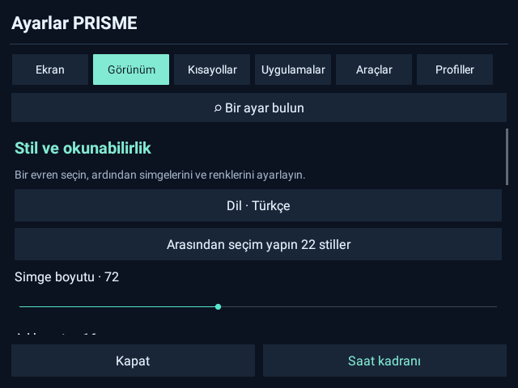

[◈ PRISME — Website / Site web](https://s00r1.github.io/PRISME/) · [Community / Testers](https://github.com/s00r1/PRISME/discussions/1)

[DM100 hardware audit · 2026-11-05 (FR), current source/release status and real screenshots](AUDIT-2026-11-05.md)
