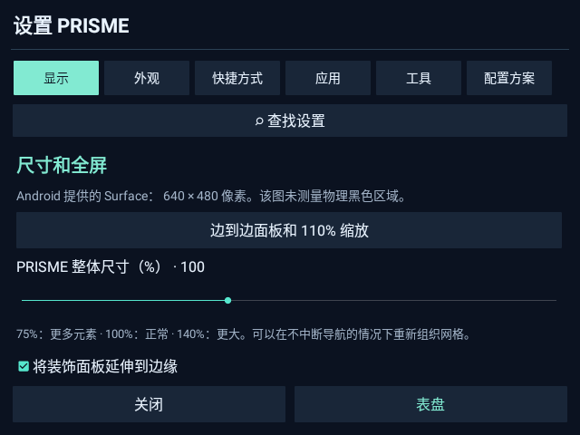

# PRISME 5.1

[Français](README.fr.md) · [English](README.en.md) · [Deutsch](README.de.md) · [中文](README.zh.md) · [Türkçe](README.tr.md) · [Русский](README.ru.md) · [العربية](README.ar.md)

**面向完整 Android 智能手表的可自定义桌面。** 可离线使用，无需账户，无广告或遥测。

## 安装

**[下载可直接安装的 PRISME.apk](https://github.com/s00r1/PRISME/releases/latest/download/PRISME.apk)** · [版本与校验和](https://github.com/s00r1/PRISME/releases)

需要**完整 Android 7.1 或更高版本，最低 API 25**，并支持安装普通 Android APK。在手表浏览器下载 APK，使用 Android 安装程序打开；如有提示，允许该安装来源。启动 PRISME，固件允许时可设为默认桌面，也可作为普通应用打开。悬浮音量和全局方向需要“显示在其他应用上层”权限。在**设置 → 样式 → 语言**中选择语言。官方更新直接覆盖原有版本安装。

电脑安装：`adb install -r PRISME.apk`。无需 root、刷固件或修改 Google 服务。

## 功能

- **22 种不同布局**：日历、桌面、应用画廊、终端、街机、星座、文字目录、拼贴、蜂窝、仪表、笔记本和极简视图。
- 固定导航：原生表盘、样式、今日和设置。长按“今日”打开五个可自定义快捷方式。
- **iOS 或 Android 风格控制中心**：可调整按钮、顺序、颜色、透明度、大小、位置及开关手势。部分按钮会打开 Android 设置。
- **竖屏 / 横屏**：轻触旋转，长按选择反向方向或系统模式；通知按钮也可在其他应用中旋转。已在 DM100 测试，其他固件可能限制此功能。
- **悬浮音量按钮**：多种样式和形状，可调尺寸、不透明度、位置、展开控制和闲置淡出。
- 应用及设置搜索、收藏、最近应用、工作区、自定义名称。
- 今日、自动保存笔记、待办清单、Android 闹钟式倒计时、分段秒表、桌面时钟。
- 全局缩放、边距、文本和图标大小、颜色、配置文件、本地备份。
- **法语、英语、德语、简体中文、土耳其语、俄语及阿拉伯语**，支持从右到左显示。

## 手表兼容性

| 型号或系列 | 状态 |
|---|---|
| Domiwear / Domino DM100，Android 7.1.1 | **已实机测试**，横屏参考 640 × 480 |
| 其他 DM100 变体 | 需分别确认；同名不代表相同固件 |
| LEMFO LEM T / LEM16 | **未测试**；满足 Android 条件时可作为社区测试候选 |
| KOSPET PRIME / PRIME SE / PRIME Pro / Optimus 2 | **未测试**；不保证圆屏布局或全局旋转 |
| 其他完整 Android、API 25+ 手表 | 需评估安装和功能 |

未测试型号是**候选清单，不是认证支持清单**。请检查实际手表的系统、API 和 APK 安装能力。本项目不是 Wear OS 表盘包；Pixel Watch 和 Wear OS Galaxy Watch 尚未验证。watchOS、Tizen 以及无法安装 Android APK 的专有系统不在目标范围。[条件与来源](COMPATIBILITY.md)。

## 图片、隐私与限制

[菜单和选项](SCREENSHOTS.md) · [全部 22 种样式](STYLES.md)

图片来自独立演示构建中的真实界面，使用虚构数据和通用图标，不含用户账户或个人应用清单。应用没有 Internet 权限。笔记、任务、收藏和从 PRISME 发起的启动记录保存在本地；用户主动导出的文件可能含有这些数据。仓库不发布私有密钥、用户备份、设备标识符或个人日志。

厂商省电机制可能终止计时和悬浮服务。音乐控制需要活跃的播放器。部分翻译可继续完善。DM100 上报告的侧边黑色区域**尚无已确认的修复**。PRISME 不改变面板或显示驱动，也不保证所有屏幕的布局。

提供 Java 源码、资源、语言目录、测试及可选 Imou 辅助应用。[构建和测试](BUILD.md) · [权限](PRIVACY.md) · [报告兼容性](https://github.com/s00r1/PRISME/issues/new/choose)。源码可供查看，尚未选择开源许可证。APK 可免费下载、安装和使用。样式中的品牌名称仅表示视觉灵感，本项目与这些品牌无隶属关系。

