# PRISME — 仅适用于长方形手表

## 参考：2.86 英寸大屏 · 横屏 640 × 480（4:3）· 完整 Android 7.1+ / API 25+

> **不适用于圆形或正方形手表。本版本面向 DM100 长方形屏幕。其他长方形尺寸和分辨率尚未验证。**

<table>
<tr><td align="center" valign="top"></td><td align="center" valign="top"></td></tr>
</table>

**Domiwear / Domino DM100 — 已实机测试的参考型号，同一型号的两张图片**

外部产品照片来自 DM100 商品页面，展示硬件，并非 PRISME。 [Source](https://www.ebay.nl/itm/185939246016) · [Specifications](https://www.domino-china.com/news/19.html)

[Français](README.fr.md) · [English](README.en.md) · [Deutsch](README.de.md) · [中文](README.zh.md) · [Türkçe](README.tr.md) · [Русский](README.ru.md) · [العربية](README.ar.md)

**面向完整 Android 智能手表的可自定义桌面。** 可离线使用，无需账户，无广告或遥测。

**[⬇ 下载 APK](https://github.com/s00r1/PRISME/releases/latest/download/PRISME.apk)** · [Control Center](#control-center) · [Volume](#floating-volume) · [22 styles](#styles-showcase)

<table>
<tr><td align="center" valign="top"><b>Control Center</b> <a href="../assets/screenshots/control-center-ios.png">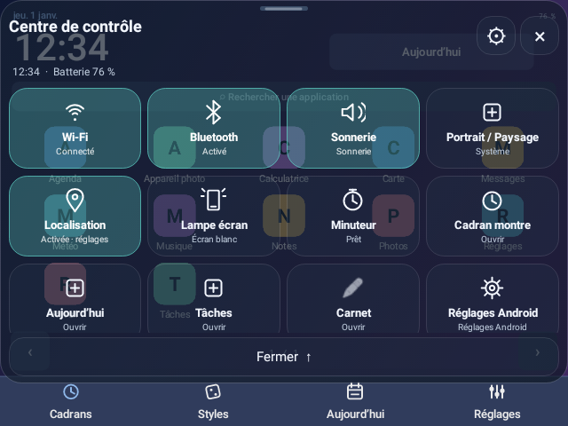</a></td><td align="center" valign="top"><b>Volume</b> </td></tr>
</table>

## 安装

**[下载可直接安装的 PRISME.apk](https://github.com/s00r1/PRISME/releases/latest/download/PRISME.apk)** · [版本与校验和](https://github.com/s00r1/PRISME/releases)

需要**完整 Android 7.1 或更高版本，最低 API 25**，并支持安装普通 Android APK。在手表浏览器下载 APK，使用 Android 安装程序打开；如有提示，允许该安装来源。启动 PRISME，固件允许时可设为默认桌面，也可作为普通应用打开。悬浮音量和全局方向需要“显示在其他应用上层”权限。在**设置 → 样式 → 语言**中选择语言。官方更新直接覆盖原有版本安装。

电脑安装：`adb install -r PRISME.apk`。无需 root、刷固件或修改 Google 服务。

## 功能

- **22 种不同布局**：日历、桌面、应用画廊、终端、街机、星座、文字目录、拼贴、蜂窝、仪表、笔记本和极简视图。
- 固定导航：原生表盘、样式、今日和设置。长按“今日”打开五个可自定义快捷方式。
- **iOS 或 Android 风格控制中心**：可调整按钮、顺序、颜色、透明度、大小、位置及开关手势。部分按钮会打开 Android 设置。
- **竖屏 / 横屏**：轻触旋转，长按选择反向方向或系统模式；通知按钮也可在其他应用中旋转。已在 DM100 测试，其他固件可能限制此功能。
- **悬浮音量按钮**：多种样式和形状，可调尺寸、不透明度、位置、展开控制和闲置淡出。
- 应用及设置搜索、收藏、最近应用、工作区、自定义名称。
- 今日、自动保存笔记、待办清单、Android 闹钟式倒计时、分段秒表、桌面时钟。
- 全局缩放、边距、文本和图标大小、颜色、配置文件、本地备份。
- **法语、英语、德语、简体中文、土耳其语、俄语及阿拉伯语**，支持从右到左显示。

<!-- PRISME-VISUAL-SHOWCASE -->

## 按您的习惯定制控制中心

可选 iOS 或 Android 布局，自定义快捷方式、顺序、透明度、颜色、大小、位置和手势。轻触竖屏 / 横屏旋转，长按打开方向选项。

<table>
<tr><td align="center" valign="top"><b>iOS</b> </td><td align="center" valign="top"><b>Android</b> <a href="../assets/screenshots/control-center-android.png">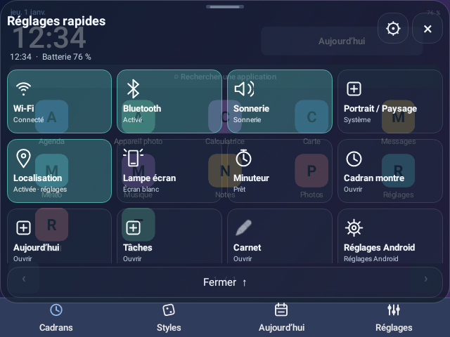</a></td></tr>
</table>

查看自定义选项

<table>
<tr><td align="center" valign="top"><b>Center Options Appearance</b> <a href="../assets/screenshots/center-options-appearance.png">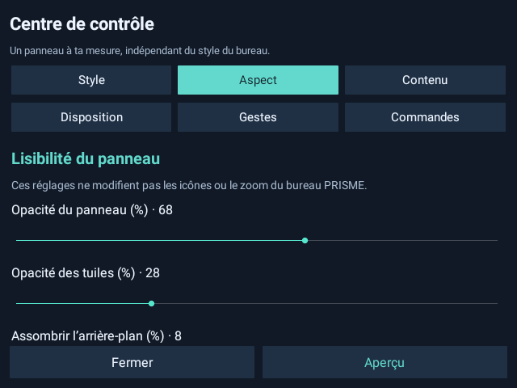</a></td><td align="center" valign="top"><b>Center Options Content</b> <a href="../assets/screenshots/center-options-content.png">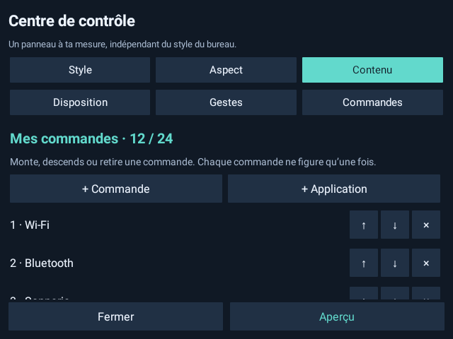</a></td><td align="center" valign="top"><b>Center Options Gestures</b> <a href="../assets/screenshots/center-options-gestures.png">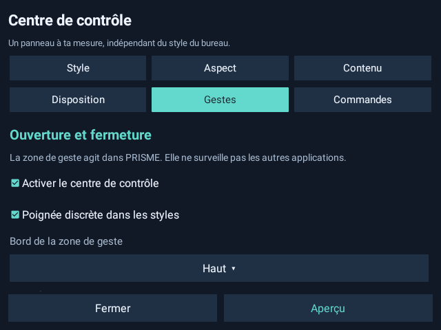</a></td></tr>
<tr><td align="center" valign="top"><b>Center Options Layout</b> <a href="../assets/screenshots/center-options-layout.png">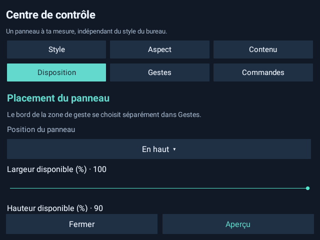</a></td><td align="center" valign="top"><b>Center Ios Transparent</b> <a href="../assets/screenshots/center-ios-transparent.png">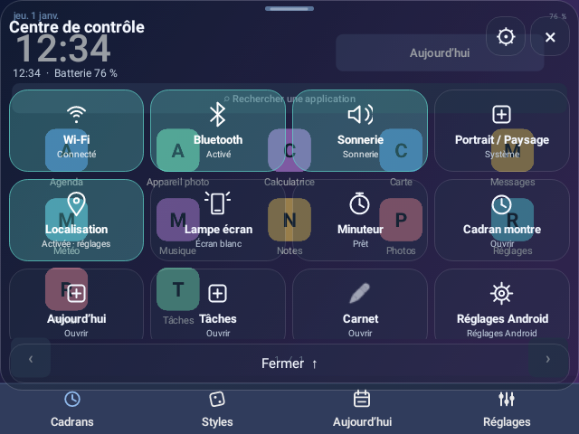</a></td><td align="center" valign="top"><b>Center Ios Opaque</b> <a href="../assets/screenshots/center-ios-opaque.png">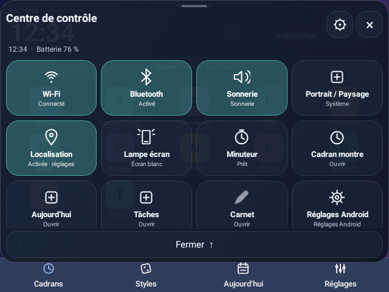</a></td></tr>
</table>

## 悬浮音量：小巧、可展开、可自定义

悬浮按钮可展开为 + 和 −。形状、样式、尺寸、位置和不透明度独立调整。以下是真实 Android 组件的特写及桌面效果。

<table>
<tr><td align="center" valign="top"><b>收起的圆形</b> 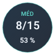</td><td align="center" valign="top"><b>展开的圆形</b> </td><td align="center" valign="top"><b>Android</b> </td><td align="center" valign="top"><b>霓虹</b> </td></tr>
<tr><td align="center" valign="top"><b>极简</b> 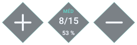</td><td align="center" valign="top"><b>钛金属</b> </td><td align="center" valign="top"><b>浅色</b> 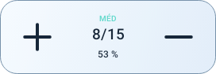</td><td align="center" valign="top"></td></tr>
</table>

<table>
<tr><td align="center" valign="top"><b>展开的圆形</b> </td><td align="center" valign="top"><b>Android</b> <a href="../assets/screenshots/volume-live-android.png">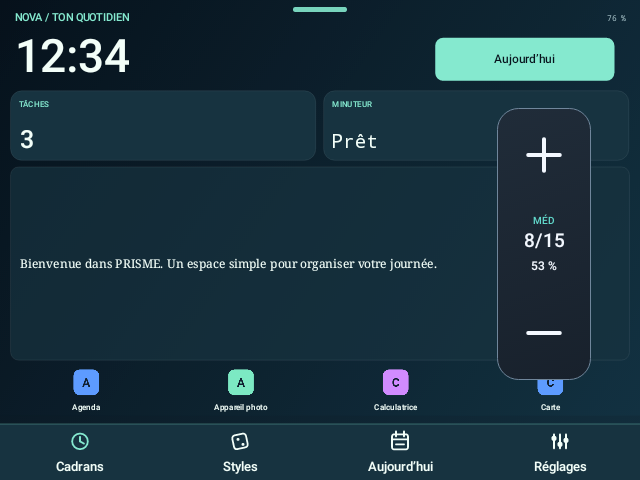</a></td></tr>
</table>

查看自定义选项

<table>
<tr><td align="center" valign="top"><b>Volume Options Style</b> <a href="../assets/screenshots/volume-options-style.png">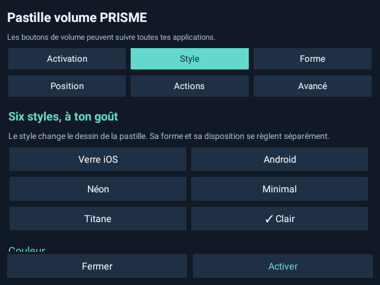</a></td><td align="center" valign="top"><b>Volume Options Shape</b> <a href="../assets/screenshots/volume-options-shape.png">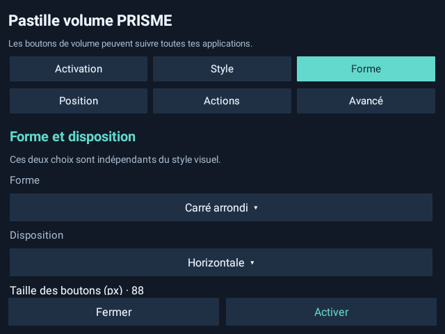</a></td></tr>
<tr><td align="center" valign="top"><b>Volume Options Position</b> <a href="../assets/screenshots/volume-options-position.png">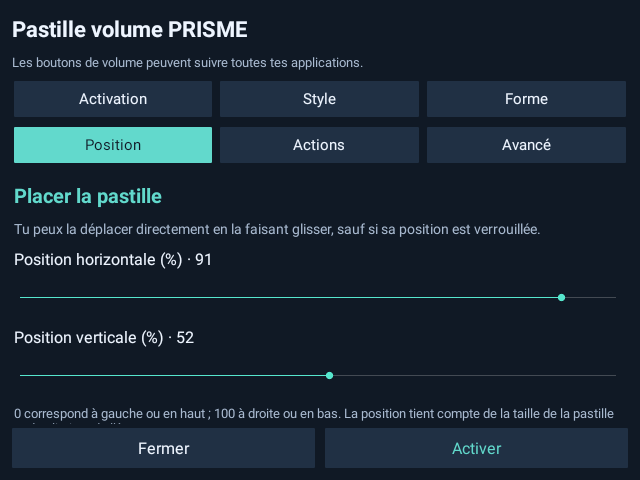</a></td><td align="center" valign="top"><b>Volume Options Advanced</b> <a href="../assets/screenshots/volume-options-advanced.png">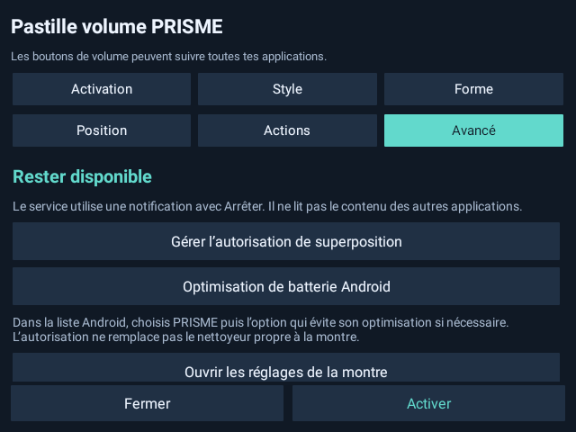</a></td></tr>
</table>

## 真正不同的布局

日历、终端、街机、星座、文字目录、蜂窝或日常仪表板，结构各不相同。点击图片可查看原尺寸。

样式名称中的 Apple、Samsung、Garmin 等仅表示视觉灵感，不代表兼容的手表型号。

<table>
<tr><td align="center" valign="top"><b>Prisme Touch</b> <a href="../assets/styles/style_00.png">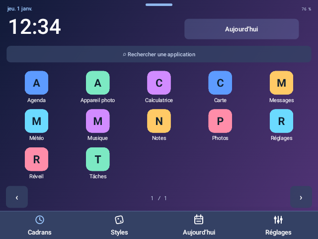</a></td><td align="center" valign="top"><b>Tablette</b> <a href="../assets/styles/style_01.png">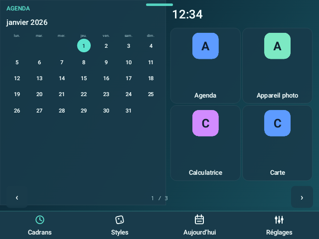</a></td><td align="center" valign="top"><b>Ghost Terminal</b> <a href="../assets/styles/style_05.png">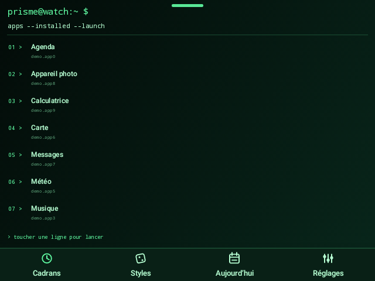</a></td></tr>
<tr><td align="center" valign="top"><b>Arcade 1986</b> <a href="../assets/styles/style_06.png">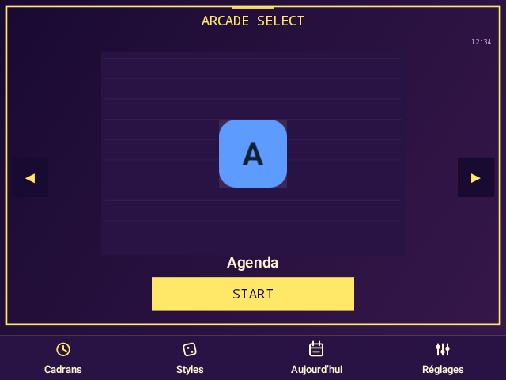</a></td><td align="center" valign="top"><b>Orbit</b> <a href="../assets/styles/style_08.png">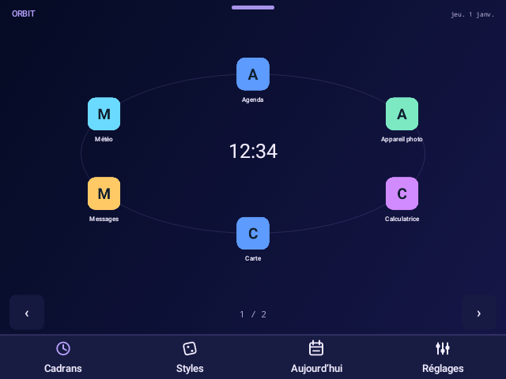</a></td><td align="center" valign="top"><b>Papier</b> <a href="../assets/styles/style_09.png">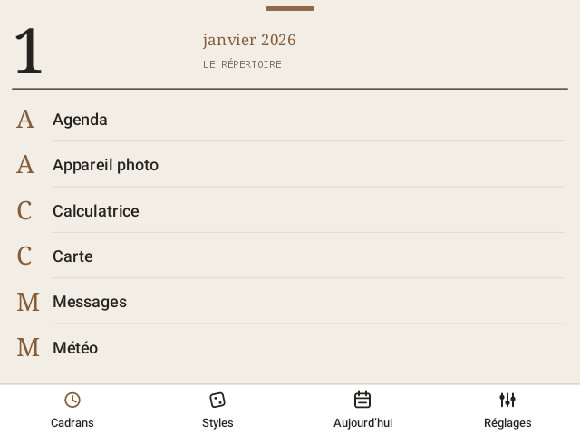</a></td></tr>
<tr><td align="center" valign="top"><b>Samsung Galaxy</b> <a href="../assets/styles/style_13.png">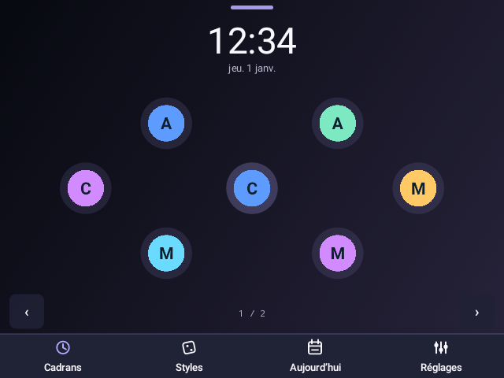</a></td><td align="center" valign="top"><b>Nova</b> <a href="../assets/styles/style_20.png">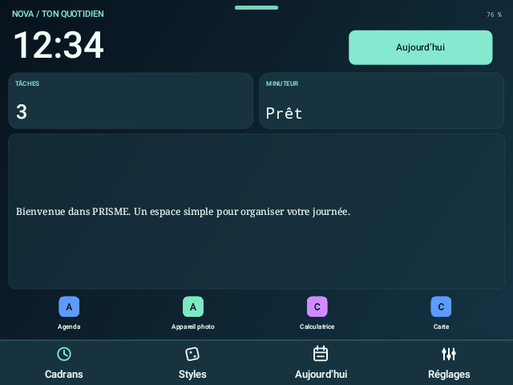</a></td><td align="center" valign="top"><b>Silence</b> <a href="../assets/styles/style_21.png">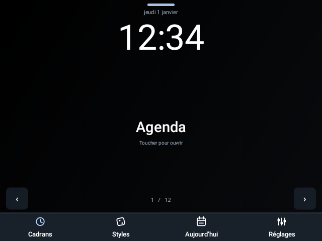</a></td></tr>
</table>

显示全部 22 种样式

<table>
<tr><td align="center" valign="top"><b>Prisme Touch</b> </td><td align="center" valign="top"><b>Tablette</b> </td><td align="center" valign="top"><b>Bureau Windows</b> <a href="../assets/styles/style_02.png">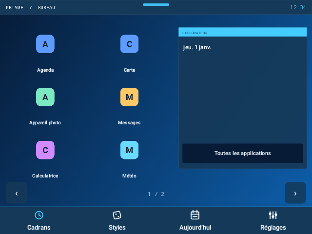</a></td></tr>
<tr><td align="center" valign="top"><b>Dock macOS</b> <a href="../assets/styles/style_03.png">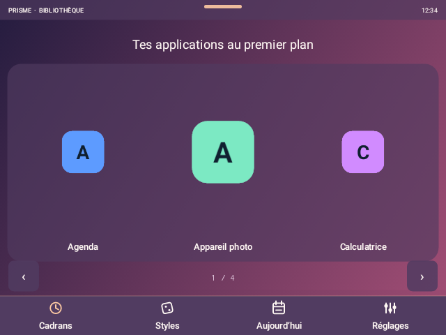</a></td><td align="center" valign="top"><b>Kali Workbench</b> <a href="../assets/styles/style_04.png">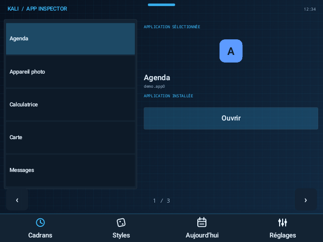</a></td><td align="center" valign="top"><b>Ghost Terminal</b> </td></tr>
<tr><td align="center" valign="top"><b>Arcade 1986</b> </td><td align="center" valign="top"><b>Meca Cockpit</b> </td><td align="center" valign="top"><b>Orbit</b> </td></tr>
<tr><td align="center" valign="top"><b>Papier</b> </td><td align="center" valign="top"><b>Aurora</b> <a href="../assets/styles/style_10.png">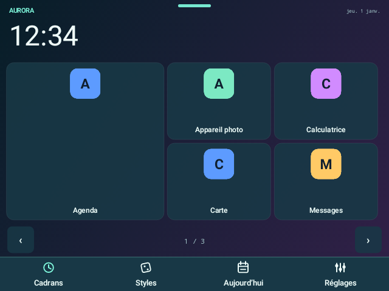</a></td><td align="center" valign="top"><b>LCD Studio</b> <a href="../assets/styles/style_11.png">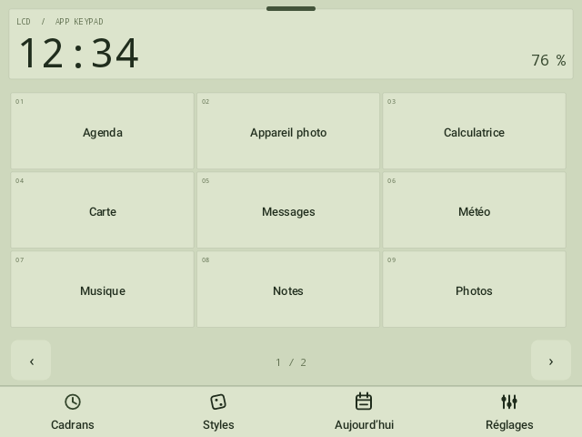</a></td></tr>
<tr><td align="center" valign="top"><b>Apple Ultra</b> <a href="../assets/styles/style_12.png">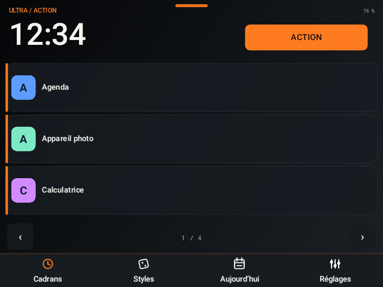</a></td><td align="center" valign="top"><b>Samsung Galaxy</b> </td><td align="center" valign="top"><b>Garmin MARQ</b> <a href="../assets/styles/style_14.png">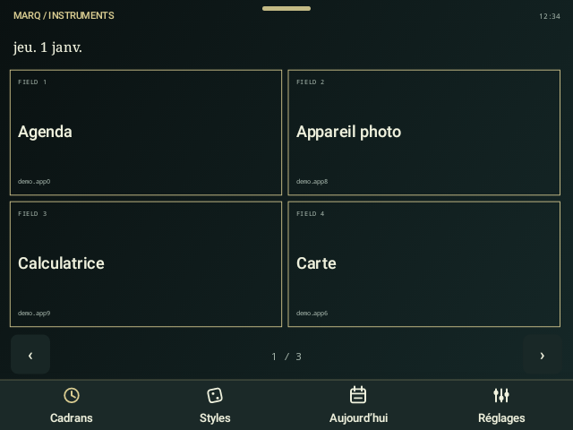</a></td></tr>
<tr><td align="center" valign="top"><b>TAG Racing</b> <a href="../assets/styles/style_15.png">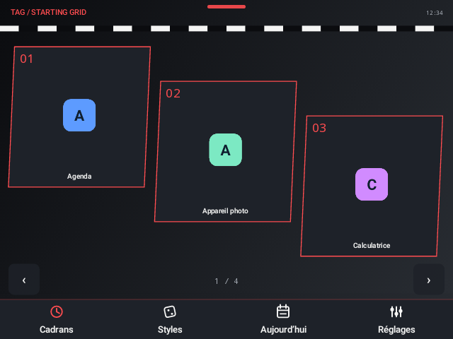</a></td><td align="center" valign="top"><b>Hublot Fusion</b> <a href="../assets/styles/style_16.png">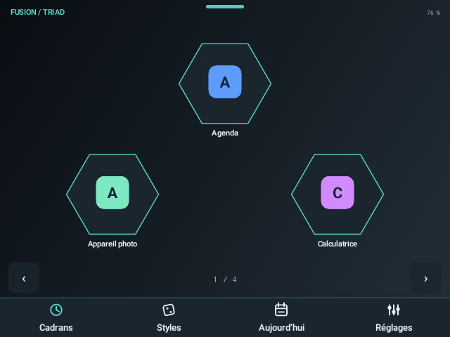</a></td><td align="center" valign="top"><b>Tambour Light</b> <a href="../assets/styles/style_17.png">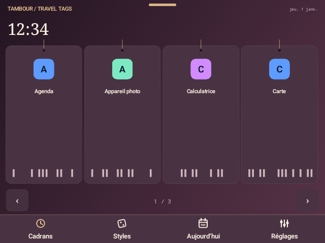</a></td></tr>
<tr><td align="center" valign="top"><b>Montblanc Summit</b> <a href="../assets/styles/style_18.png">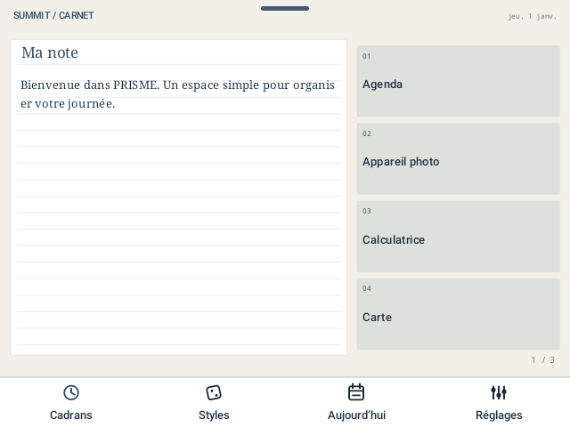</a></td><td align="center" valign="top"><b>Ultimate Design</b> <a href="../assets/styles/style_19.png">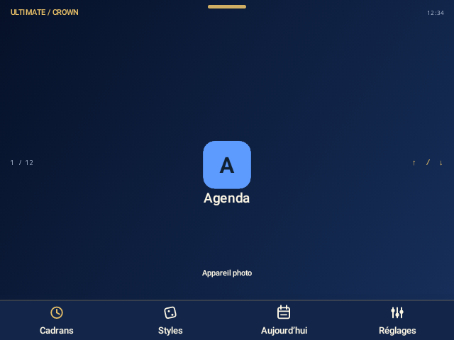</a></td><td align="center" valign="top"><b>Nova</b> </td></tr>
<tr><td align="center" valign="top"><b>Silence</b> </td><td align="center" valign="top"></td><td align="center" valign="top"></td></tr>
</table>

## 日常工具

<table>
<tr><td align="center" valign="top"><b>Today</b> <a href="../assets/screenshots/today.png">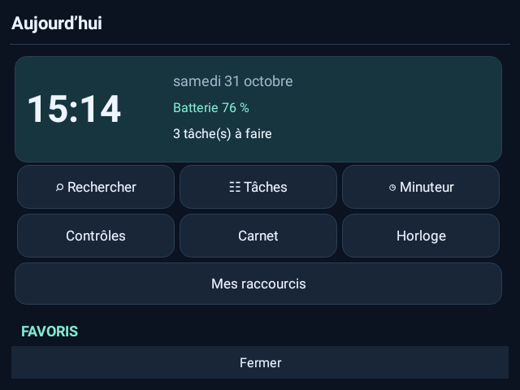</a></td><td align="center" valign="top"><b>Notes</b> <a href="../assets/screenshots/notes.png">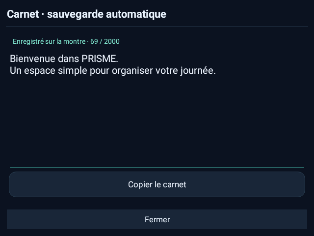</a></td></tr>
<tr><td align="center" valign="top"><b>Checklist</b> <a href="../assets/screenshots/checklist.png">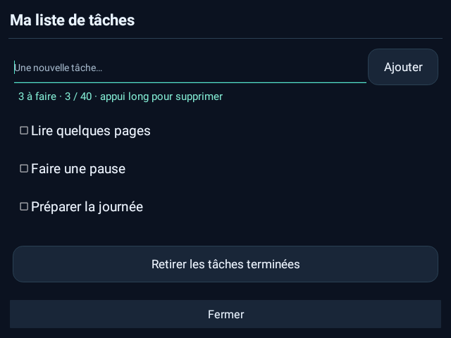</a></td><td align="center" valign="top"><b>Timer</b> <a href="../assets/screenshots/timer.png">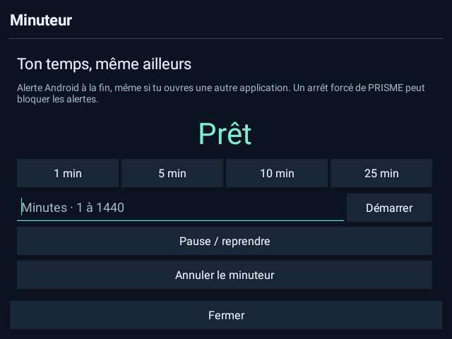</a></td></tr>
</table>

## 分类清晰的设置

<table>
<tr><td align="center" valign="top"><b>Settings Style</b> <a href="../assets/screenshots/settings-style.png">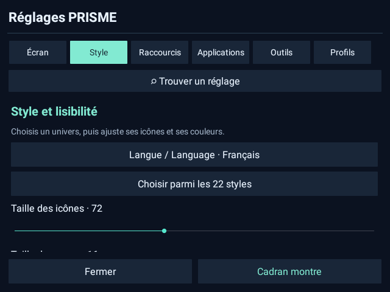</a></td><td align="center" valign="top"><b>Settings Shortcuts</b> <a href="../assets/screenshots/settings-shortcuts.png">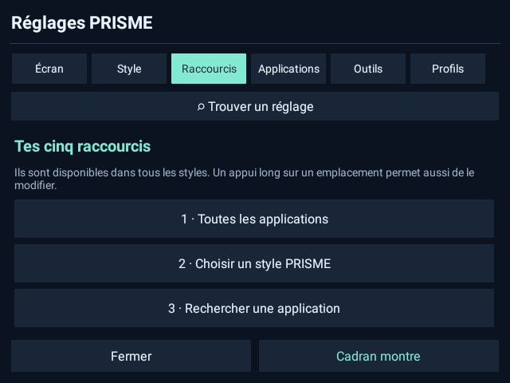</a></td><td align="center" valign="top"><b>Settings Tools</b> <a href="../assets/screenshots/settings-tools.png">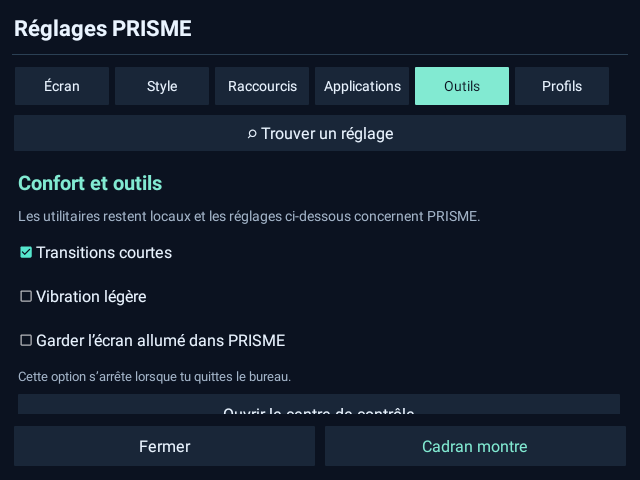</a></td></tr>
</table>

PRISME 图片全部来自独立演示应用，使用通用图标和虚构内容，不展示账户或个人应用清单。

<!-- /PRISME-VISUAL-SHOWCASE -->

## 手表兼容性

| 型号或系列 | 状态 |
|---|---|
| Domiwear / Domino DM100，Android 7.1.1 | **已实机测试**，横屏参考 640 × 480 |
| 其他 DM100 变体 | 需分别确认；同名不代表相同固件 |
| 其他参考尺寸 2.86 英寸 / 640 × 480 的长方形手表 | 尚未验证，需要单独实机测试 |

未测试型号是**候选清单，不是认证支持清单**。请检查实际手表的系统、API 和 APK 安装能力。本项目不是 Wear OS 表盘包；Pixel Watch 和 Wear OS Galaxy Watch 尚未验证。watchOS、Tizen 以及无法安装 Android APK 的专有系统不在目标范围。[条件与来源](COMPATIBILITY.md)。

## 图片、隐私与限制

[菜单和选项](SCREENSHOTS.md) · [全部 22 种样式](STYLES.md)

图片来自独立演示构建中的真实界面，使用虚构数据和通用图标，不含用户账户或个人应用清单。应用没有 Internet 权限。笔记、任务、收藏和从 PRISME 发起的启动记录保存在本地；用户主动导出的文件可能含有这些数据。仓库不发布私有密钥、用户备份、设备标识符或个人日志。

厂商省电机制可能终止计时和悬浮服务。音乐控制需要活跃的播放器。部分翻译可继续完善。DM100 上报告的侧边黑色区域**尚无已确认的修复**。PRISME 不改变面板或显示驱动，也不保证所有屏幕的布局。

提供 Java 源码、资源、语言目录、测试及可选 Imou 辅助应用。[构建和测试](BUILD.md) · [权限](PRIVACY.md) · [报告兼容性](https://github.com/s00r1/PRISME/issues/new/choose)。原创代码采用 MIT 许可证，保留许可证声明即可使用、修改和再分发。样式中的品牌名称仅表示视觉灵感，本项目与这些品牌无隶属关系。

