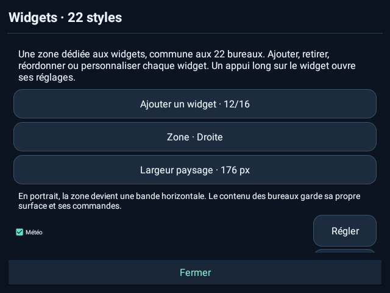
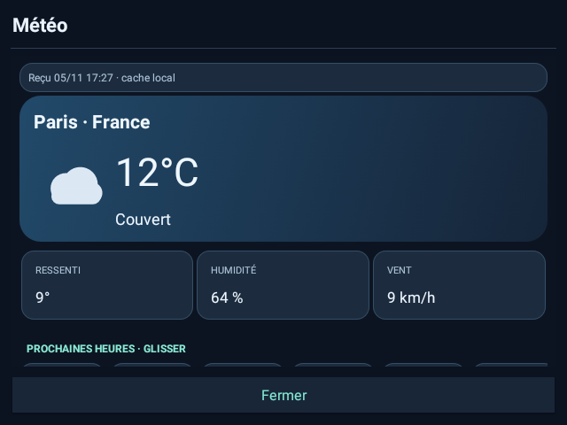
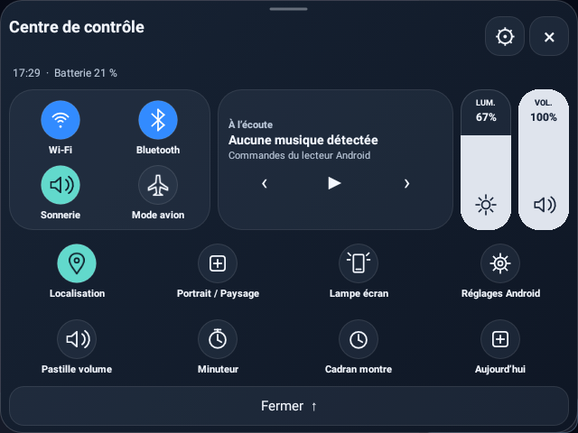
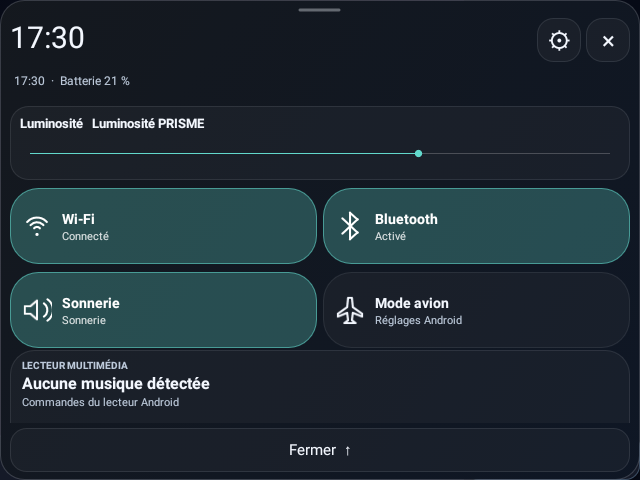

# PRISME 6.0.0

Version stable préparée pour revue et publication après fusion de la PR. **VersionCode 24 · Android complet 7.1 / API 25 minimum.** PRISME 6 conserve les 22 bureaux comme écran principal et ajoute un système commun de widgets, une météo facultative, deux centres de contrôle repensés, des cartes facultatives et l’éditeur PC officiel.

## Fichiers à joindre à la Release

- **PRISME-6.0.0.apk** : application signée avec le certificat d’origine, versionCode 24.
- **PRISME-PC-Studio-6.0.0.zip** : éditeur des 13 widgets et des cartes, Studio classique, 22 aperçus locaux, guide, licence, empreintes et lanceur Windows. Extraire puis ouvrir `index.html` ; aucun serveur requis.
- **PRISME-6.0.0-sources.zip** : sources de l’application, des éditeurs, des tests et de la documentation.
- **SHA256SUMS.txt** : empreintes des trois fichiers distribués.

Le nom de version est **6.0.0**, sans suffixe beta. Les liens de téléchargement `v6.0.0` sont prêts pour la publication ; préparer cette PR ne publie pas la Release.

## Les 22 styles, avec vos widgets

Le bureau sélectionné reste l’accueil principal. Un sélecteur compact avec recherche et galerie d’aperçus est accessible depuis Styles et le bouton permanent **22 styles** des réglages. Choisir un style affiche immédiatement ce bureau et suspend Sense automatique. Dans les cartes, **Bureau**, **22 styles** et Retour Android ramènent au bureau choisi. Les pages existantes sont conservées.

Une zone dédiée s’adapte aux 22 bureaux : gauche/droite de 144 à 208 px en paysage, bande horizontale en portrait, défilement et masquage complet. **13 types** : Météo, Horloge, Musique, Batterie, Tâches, Carnet, Minuteurs, Calendrier, Horloge mondiale, Système, Concentration, Raccourcis, Chronomètre. Jusqu’à **16 instances**, ajout/retrait, activation, ordre et annulation/rétablissement ; retirer un widget ne supprime pas les données de son outil.

Six apparences, trois densités, quatre présentations par type, accent du bureau ou six accents choisis, opacité du fond, arrondis, taille du texte, titre et détails. Chaque widget peut être réservé à certains styles. Horloges digitale/analogique/grands chiffres/date-heure, secondes, 12/24 h et fuseau mondial.

## Météo connectée facultative

Widget personnalisable dans les 22 styles : conditions actuelles et tendance, format compact, cinq jours ou prochaines heures. Le panneau détaillé propose ressenti, humidité, vent, douze heures et cinq jours. °C/°F, actualisation manuelle, fréquence de 15 à 180 minutes en premier plan, cache horodaté et états d’erreur/ancienneté.

Open-Meteo utilise uniquement des requêtes HTTPS après consentement explicite et sélection manuelle d’une ville. Aucun GPS, compte ou suivi de position. **La permission Internet est ajoutée pour cette fonction** ; ville, coordonnées, consentement et cache restent locaux et ne sont jamais importés. Le fournisseur reçoit l’IP et la recherche/les coordonnées de la ville. Attribution Open-Meteo et conditions d’usage non commercial de son API gratuite sont documentées.

## Deux centres de contrôle visuellement distincts

- **iOS** : modules séparés, commutateurs circulaires et curseurs verticaux de luminosité et volume.
- **Android** : grandes tuiles de réglages rapides, états textuels et curseurs horizontaux.

La personnalisation, les gestes, raccourcis, réglages d’affichage et accès musicaux sont conservés. Les commandes soumises aux restrictions Android ouvrent les réglages système si le basculement direct n’est pas possible.

| iOS | Android |
| --- | --- |
|  |  |

## Outils et protections conservés

Cartes facultatives sur cinq pages au maximum, sept types de blocs, six palettes, déplacement/redimensionnement et annulation. Huit minuteurs nommés avec pause/reprise, musique simple ou enrichie facultative, calculatrice décimale, conversions hors ligne, carnet, checklist, chronomètre et concentration. Les 24 présentations de batterie, douze palettes, volume flottant, Studio historique, Sense et dock restent disponibles.

Sauvegardes privées, coffres AES-GCM, journal d’import et mode de secours restent intégrés. Les activations sensibles sont locales. Importer une disposition ne force pas l’ouverture des cartes ou l’activation de Sense ; les profils sont validés avant écriture.

## PC Studio et documentation

L’éditeur réunit les widgets des 22 styles et les cartes facultatives dans deux onglets. Charger un export JSON complet V5/V6, préparer sa composition puis exporter `PRISME-6-Studio.json`. Les notes, tâches et autres sections du profil chargé sont conservées. Les unités et la fréquence météo sont portables ; la ville et les consentements restent sur la montre. Aucun contenu n’est envoyé. Le ZIP fonctionne directement en `file://` et conserve le Studio classique.

README français/anglais, site, guide V6, guide PC, confidentialité et rapport de validation décrivent les nouveautés, le transfert, les limites et la migration.

## Mise à jour et validation

Exporter sa configuration puis installer par-dessus PRISME, sans désinstallation. Le paquet et le certificat d’origine sont conservés. Les formats JSON antérieurs restent acceptés ; V6 exporte le schéma 7. Garder un export V5 pour un retour arrière, qu’Android peut refuser en installation directe si le numéro est inférieur.

Les essais automatisés, parcours navigateur et inspections des 22 styles sur la DM100 figurent dans le [rapport de validation](V6-VALIDATION.md). Les autres modèles, tous les lecteurs tiers, l’autonomie prolongée et Play Protect ne sont pas certifiés. Les prévisions dépendent du réseau et du fournisseur.

[Guide V6](V6-GUIDE.md) · [Éditeur PC](PC-STUDIO.md) · [Confidentialité](PRIVACY.md)
