# Menus et options / Menus and settings

[Français](README.fr.md) · [English](README.en.md) · [Deutsch](README.de.md) · [中文](README.zh.md) · [Türkçe](README.tr.md) · [Русский](README.ru.md) · [العربية](README.ar.md)

Captures des vraies interfaces rendues sur Android dans une application de démonstration séparée, avec données fictives et icônes génériques. Les fenêtres des autres applications sont exclues. / Actual Android UI views rendered by an isolated demo build with fictional data; other applications’ windows are excluded.

## Bureau / Dashboard

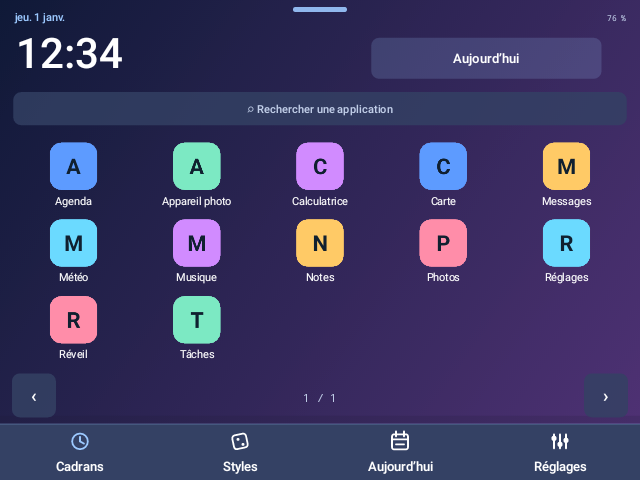

## Centre iOS / iOS Control Center

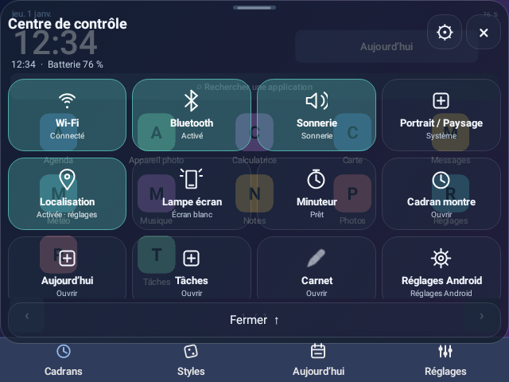

## Centre Android / Android Control Center

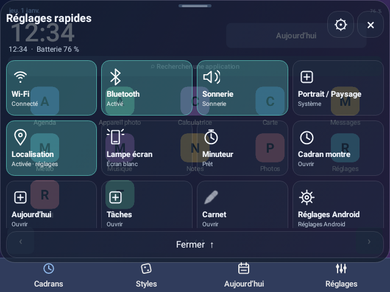

## Volume : activation / Floating volume

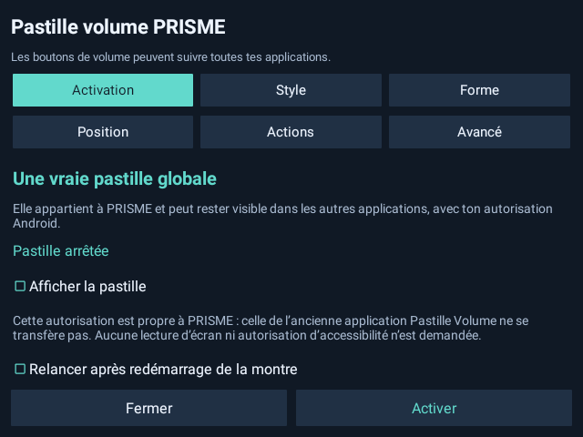

## Volume : styles

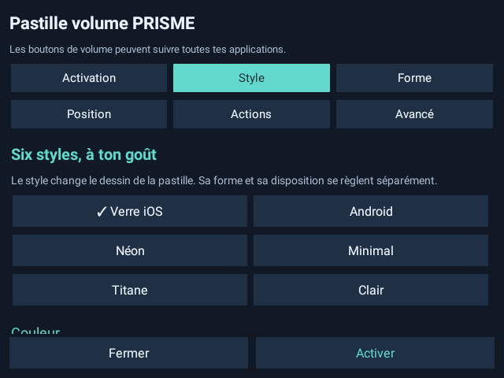

## Volume : formes / Shapes

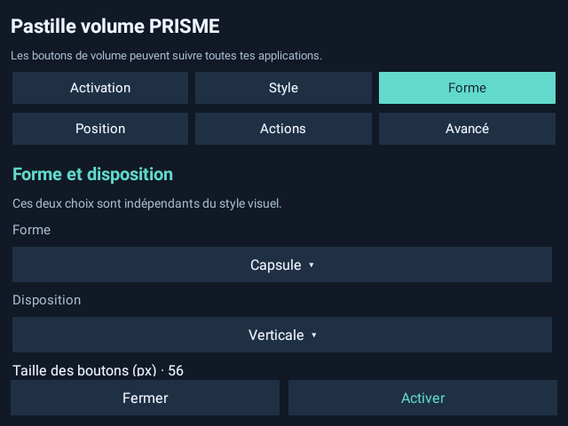

## Volume : position

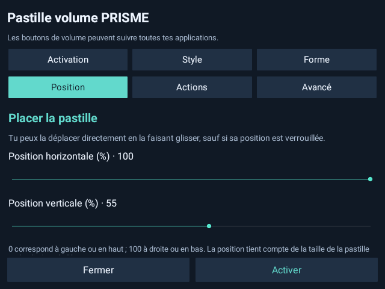

## Volume : actions

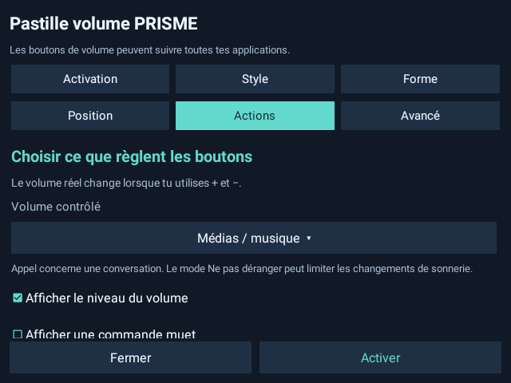

## Volume : avancé / Advanced

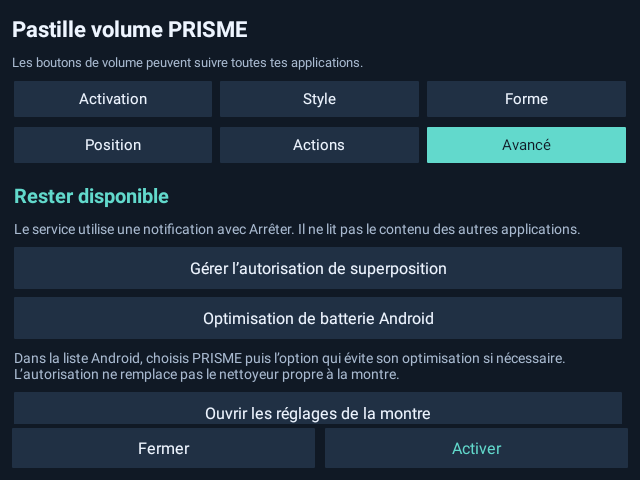

## Écran / Display

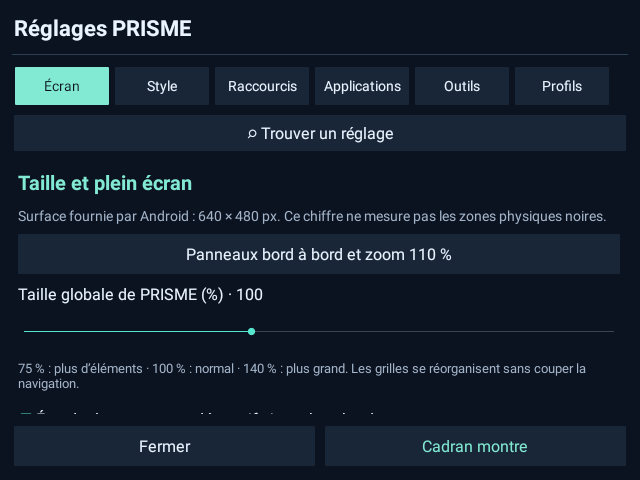

## Style / Appearance

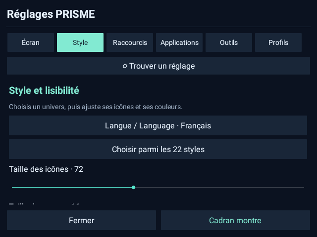

## Raccourcis / Shortcuts

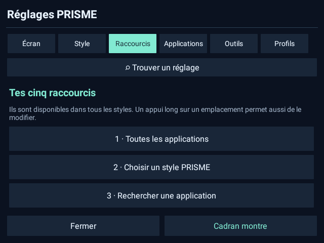

## Applications

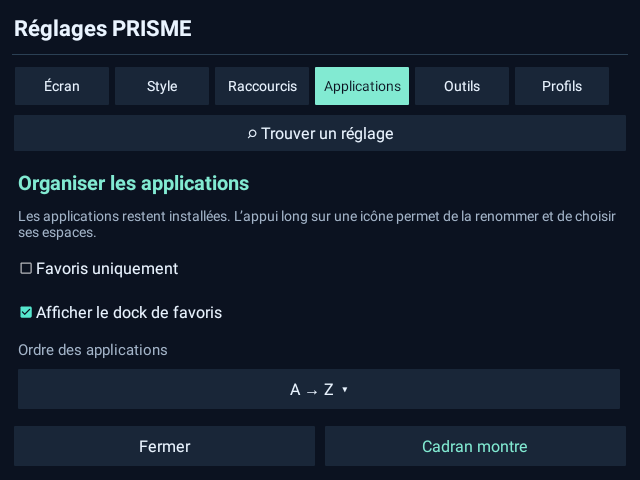

## Outils / Tools

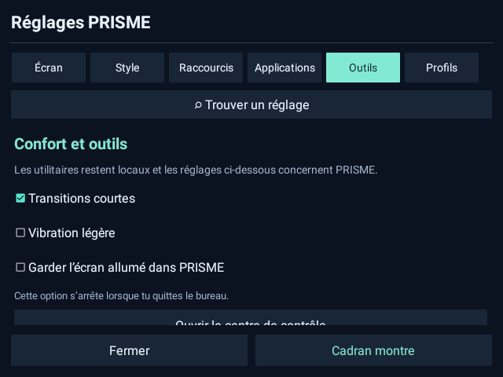

## Profils / Profiles

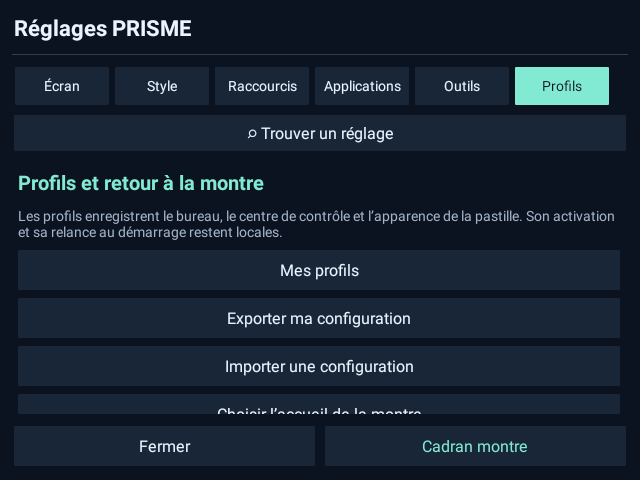

## Choisir un style / Style picker

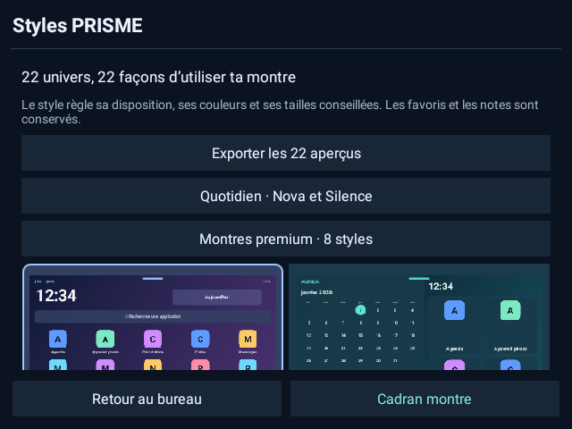

## Aujourd’hui / Today

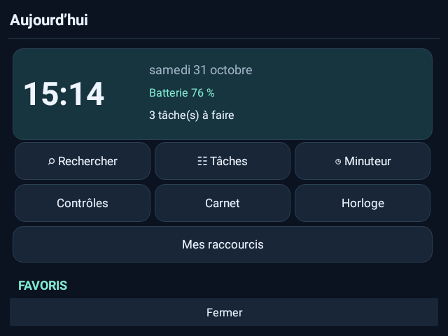

## Carnet / Notes

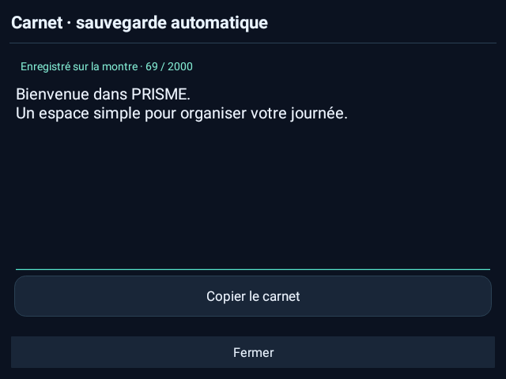

## Tâches / Checklist

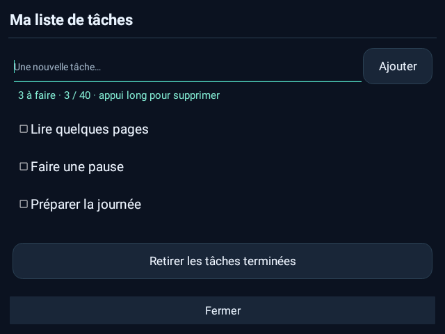

## Minuteur / Timer

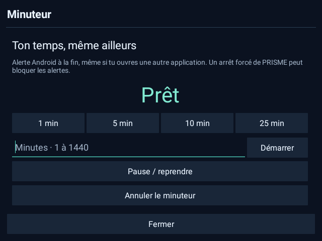

## Chronomètre / Stopwatch

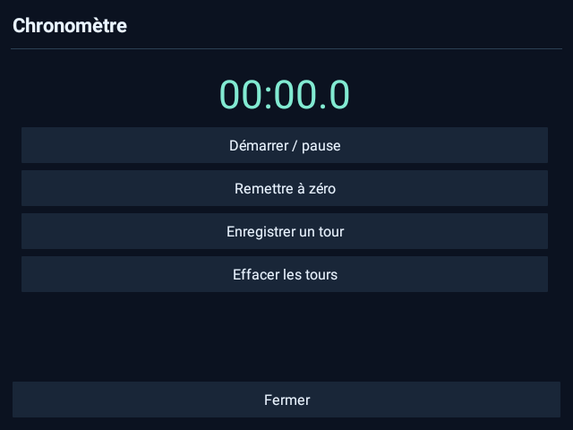

## Orientation

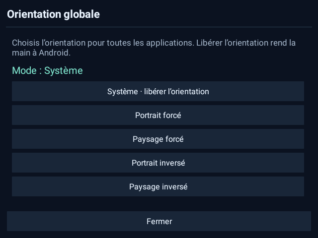

## Personnaliser le centre / Control Center settings

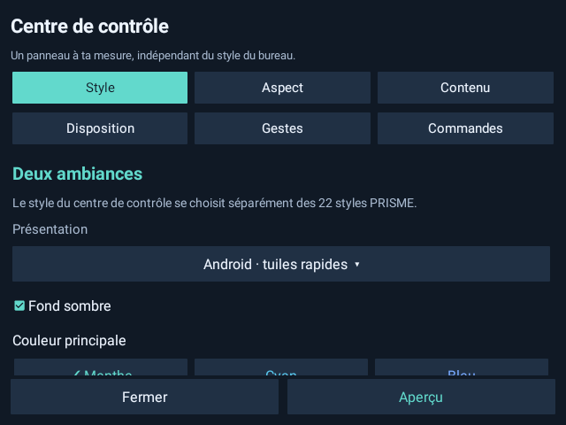

## Choisir la langue / Language picker

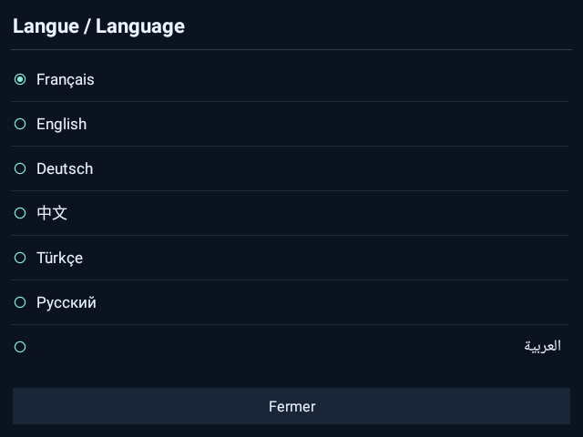

## Langues / Languages

### Français

### English

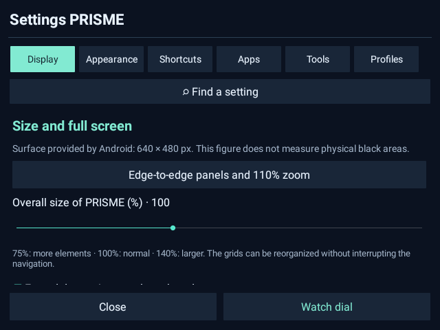

### Deutsch

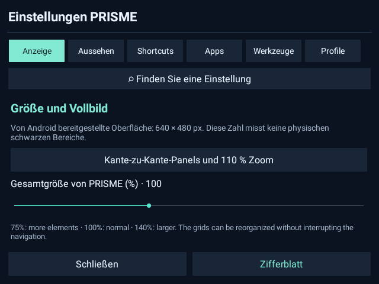

### 简体中文

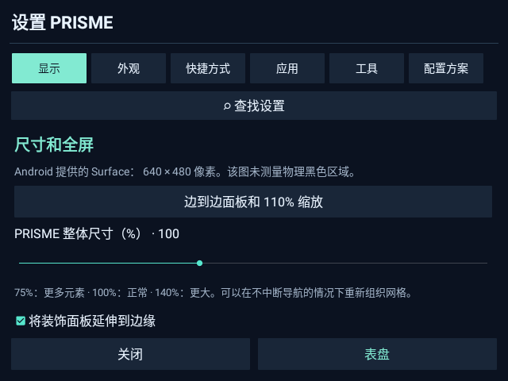

### Türkçe

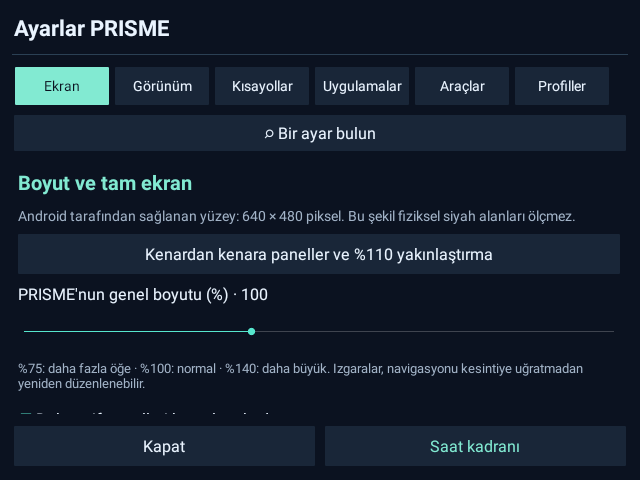

### Русский

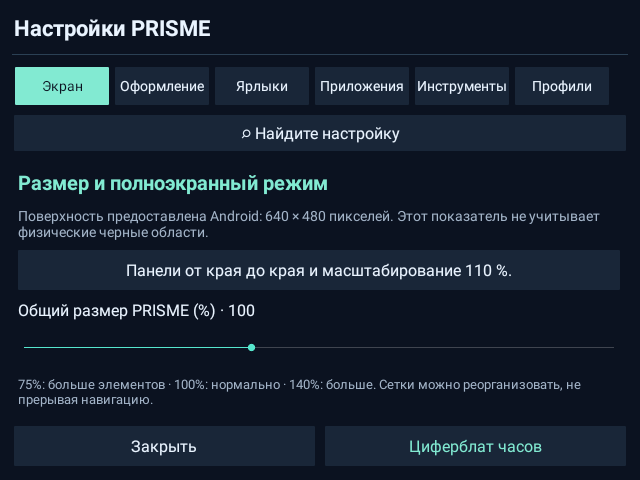

### العربية

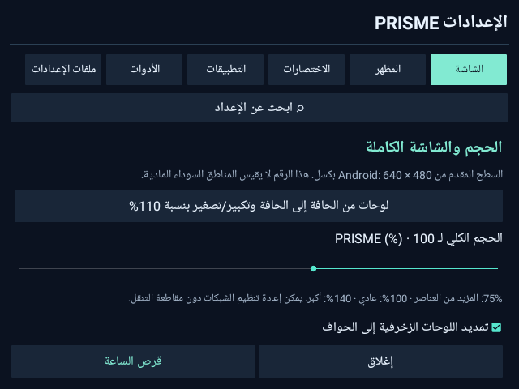
