# Les 22 styles / All 22 styles

[Français](README.fr.md) · [English](README.en.md) · [Deutsch](README.de.md) · [中文](README.zh.md) · [Türkçe](README.tr.md) · [Русский](README.ru.md) · [العربية](README.ar.md)

Aperçus produits par le moteur PRISME sur Android, avec un catalogue fictif. / Rendered on Android with PRISME’s actual layout engine and a fictional app catalog.

## Prisme Touch

Téléphone · widgets et grille tactile

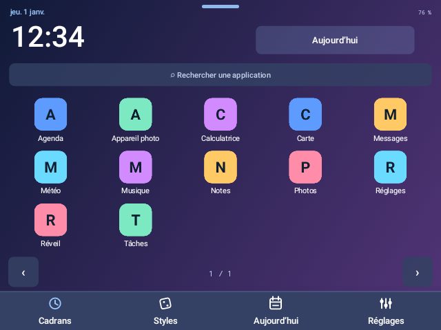

## Tablette

Agenda mensuel · applications en panneau latéral

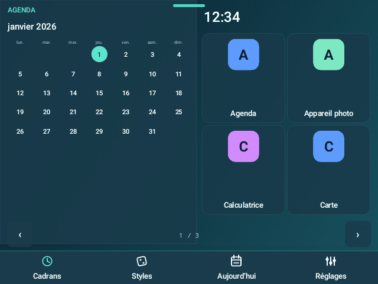

## Bureau Windows

Bureau · icônes libres et fenêtre explorateur

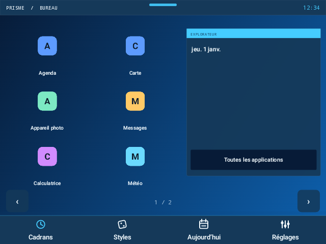

## Dock macOS

Dock · galerie de grandes applications

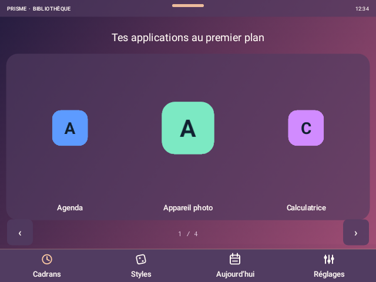

## Kali Workbench

Inspecteur · sélectionner, inspecter, ouvrir

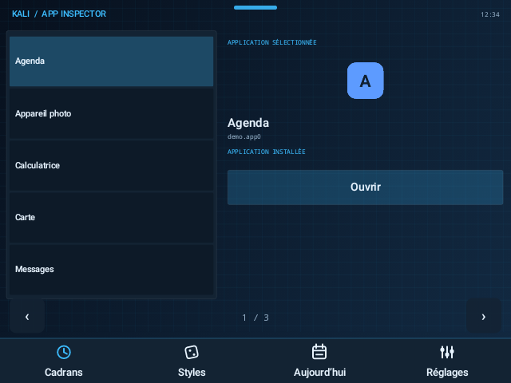

## Ghost Terminal

Console · répertoire des applications installées

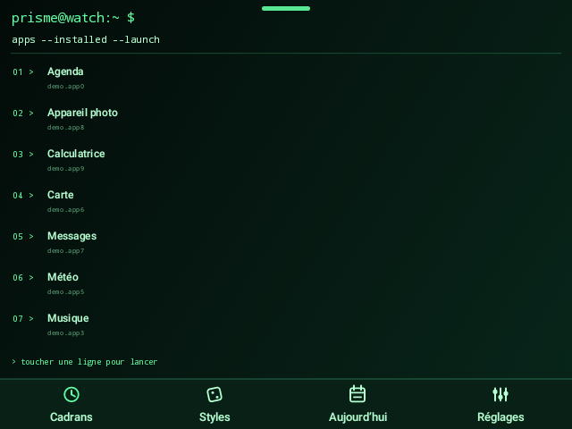

## Arcade 1986

Arcade · une application et bouton START

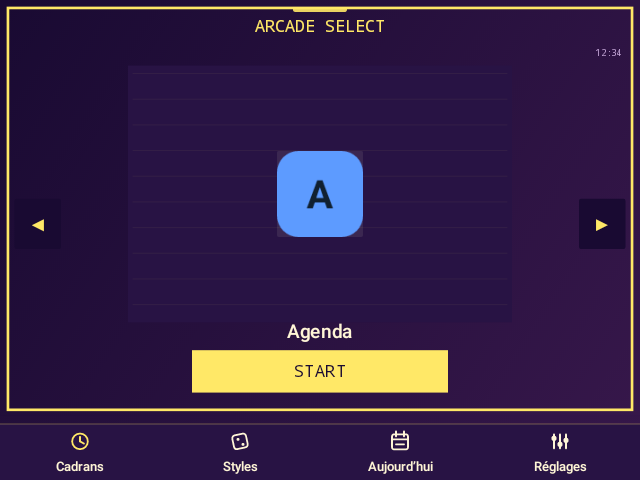

## Meca Cockpit

Cockpit · trois instruments de lancement

## Orbit

Constellation · six applications en orbite

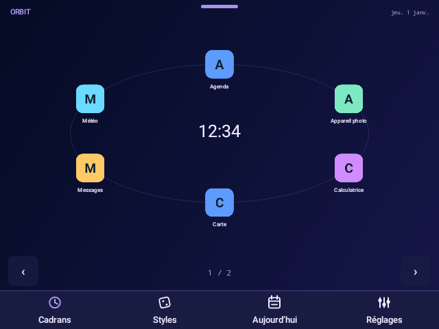

## Papier

Répertoire éditorial · index typographique

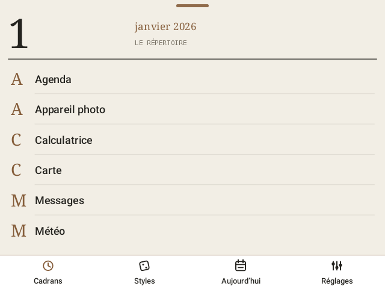

## Aurora

Mosaïque asymétrique · grandes et petites cartes

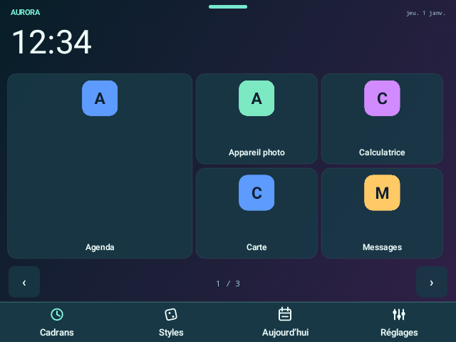

## LCD Studio

Clavier LCD · touches sans icônes

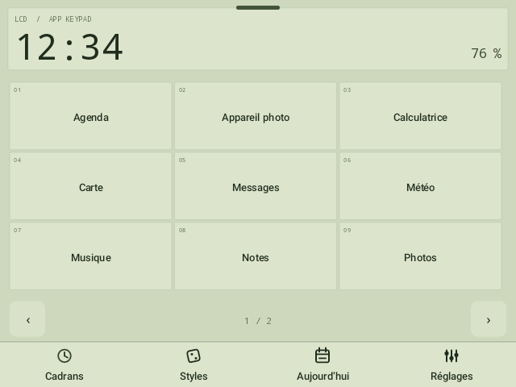

## Apple Ultra

Action · grandes commandes verticales

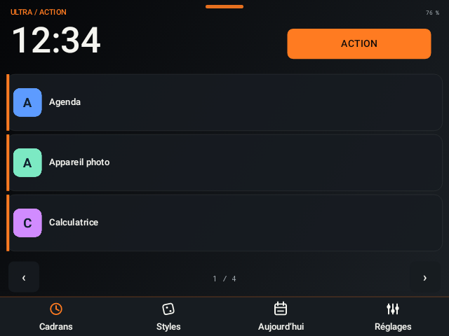

## Samsung Galaxy

Nuage de bulles · nid d’abeille

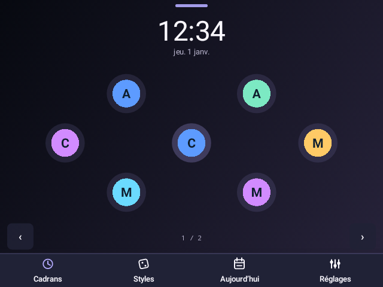

## Garmin MARQ

Instruments · quatre champs de données

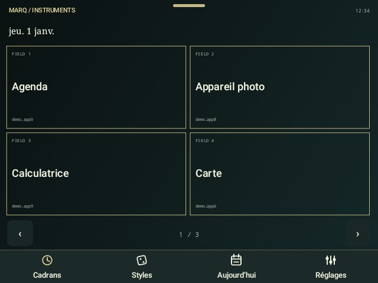

## TAG Racing

Grille de départ · applications en diagonale

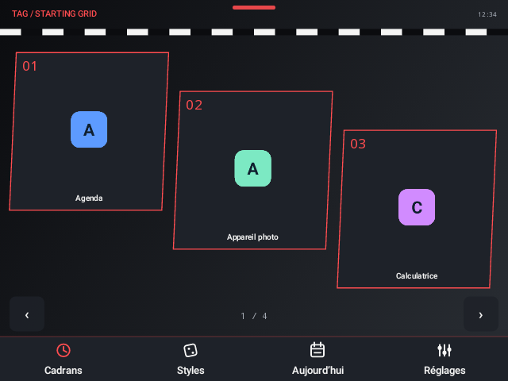

## Hublot Fusion

Triade · trois cellules hexagonales

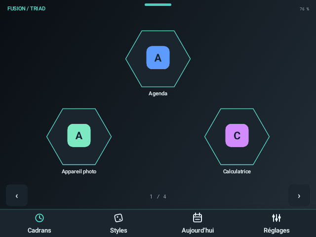

## Tambour Light

Voyage · étiquettes et références

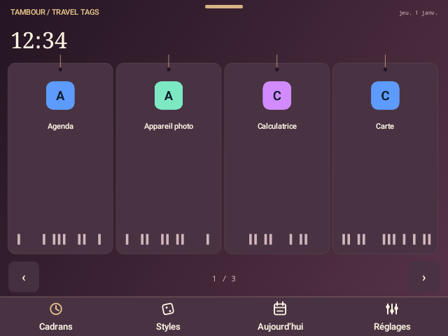

## Montblanc Summit

Carnet personnel · note et marque-pages

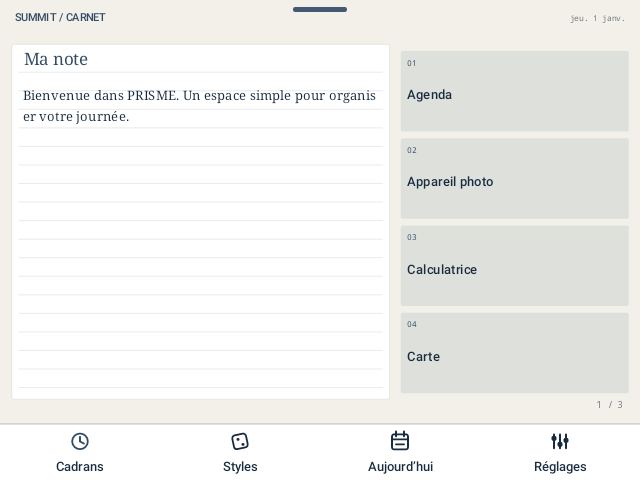

## Ultimate Design

Sélecteur vertical · glisser de haut en bas

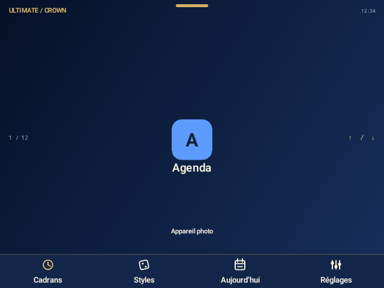

## Nova

Quotidien · tâches, minuteur et carnet

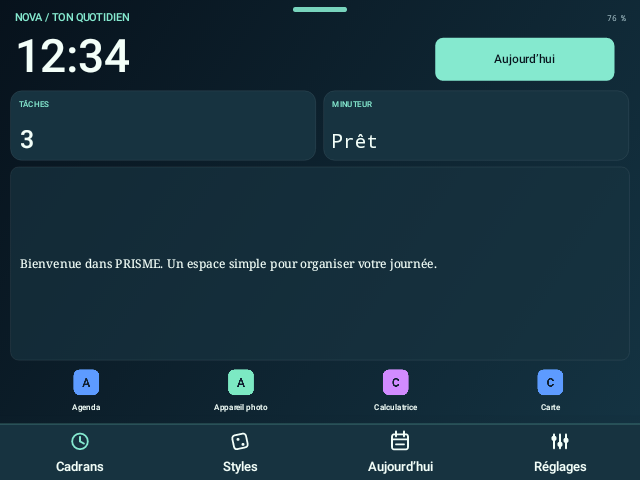

## Silence

Minimal · une application, sans icône

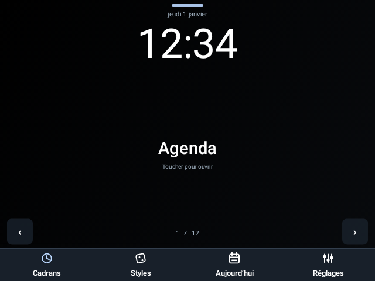
