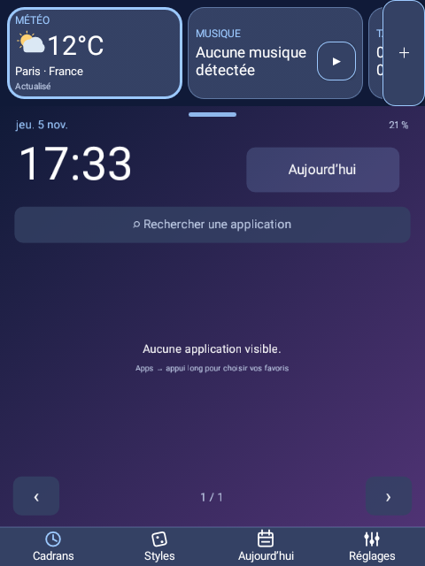
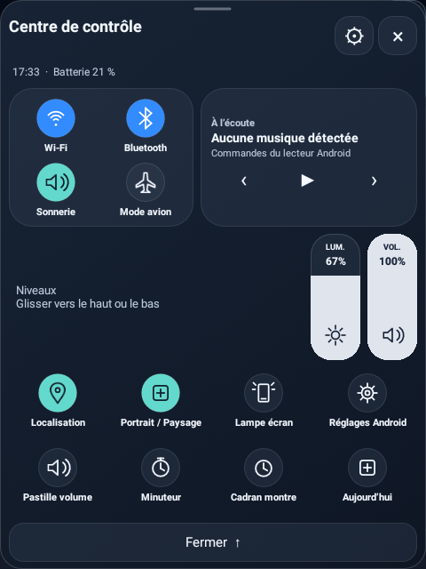
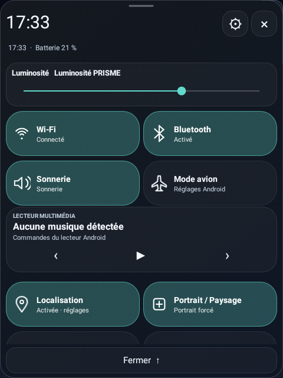

# PRISME 6.0.1 — Guide

PRISME 6 cible la DM100 rectangulaire sous Android complet 7.1.1 / API 25, en 640 × 480. La version stable publiée utilise le **versionCode 25**. Aucun root ni remplacement de firmware n’est nécessaire.

## Installer et migrer

1. Exporter la configuration existante et conserver l’APK précédent.
2. Installer l’APK signé `PRISME-6.0.1.apk` par-dessus PRISME, sans désinstallation. La signature d’origine et les données existantes sont conservées.
3. Le **bureau classique sélectionné reste affiché par défaut**. Les cartes sont facultatives. Les premières configurations V6 qui ouvraient automatiquement les cartes sont ramenées une fois au bureau choisi sans perdre leurs pages.
4. Ouvrir **Styles** sur le bureau ou le bouton permanent **22 styles** des réglages pour choisir une composition. Dans les cartes, **Bureau**, **22 styles** ou Retour Android ramènent au bureau choisi.

Les profils JSON antérieurs restent acceptés. Les exports V6 utilisent le **schéma 7**, qui désigne un format de fichier. Garder un export V5 pour le retour arrière : une ancienne application peut refuser un profil V6 et Android peut refuser un numéro de version inférieur. La [Release stable v6.0.1](https://github.com/s00r1/PRISME/releases/tag/v6.0.1) est disponible avec l’APK signé, l’éditeur PC, les sources validées et leurs sommes de contrôle.

## Choisir parmi les 22 bureaux

Le sélecteur compact comporte une recherche, un indicateur de style actif et un accès aux aperçus. Choisir un style l’affiche immédiatement et ferme les cartes. Le choix manuel suspend les règles Sense de changement automatique pour conserver le bureau choisi. Les compositions historiques restent disponibles, avec leur identité, leur catalogue d’applications et leurs commandes.

## Widgets communs aux 22 styles

**Réglages → Widgets** ou **Outils → Widgets des 22 styles** ouvre le catalogue. Un appui long sur un widget ouvre directement sa personnalisation ; un appui court ouvre sa fonction. La zone dédiée garde les commandes du bureau dégagées : gauche ou droite en paysage, bande horizontale en portrait. Elle défile si nécessaire et peut être entièrement masquée.

Treize types sont disponibles : **Météo, Horloge, Musique, Batterie, Tâches, Carnet, Minuteurs, Calendrier, Horloge mondiale, Système, Concentration, Raccourcis et Chronomètre**. Jusqu’à seize instances peuvent être ajoutées. Météo, Musique et Tâches sont activés dans la configuration initiale ; le chronomètre est ajoutable depuis le catalogue. Ajouter, retirer, désactiver ou réordonner un widget ne supprime pas les données de l’outil.

Chaque instance possède ses propres réglages :

- **Six apparences** : Signature du bureau, Verre, Carte pleine, Contour, Minimal, Néon.
- **Trois densités**, quatre présentations, sept choix d’accent dont la couleur du bureau, opacité du fond de 30 à 100 %, arrondis de 0 à 28 et texte de 80 à 140 %.
- Titre personnalisé, titre visible ou masqué, détails visibles ou masqués.
- Affichage dans tous les styles ou seulement certains des 22 bureaux.
- Horloges digitale, analogique, grands chiffres ou date/heure ; secondes, format 12/24 h et fuseau de l’horloge mondiale.
- Déplacement dans la liste et annulation/rétablissement de la dernière modification.

Les couleurs suivent le bureau lorsque l’accent « Selon le bureau » est choisi. Le carnet ne révèle pas son texte privé dans le widget. Les informations musicales et commandes disponibles dépendent du lecteur Android.

## Configurer la météo

1. Toucher le widget Météo ou ouvrir **Outils → Météo et prévisions**.
2. Ouvrir **Ville, unités et météo connectée**. Lire l’explication puis activer explicitement Open-Meteo.
3. Rechercher manuellement la ville et sélectionner le résultat correspondant. Aucun accès GPS n’est demandé.
4. Régler les °C/°F et la fréquence d’actualisation en premier plan : 15, 30, 45, 60, 120 ou 180 minutes.
5. Personnaliser le widget : actuelle et tendance, compacte, cinq jours ou prochaines heures.

Le panneau détaillé affiche conditions, température, ressenti, humidité, vent, douze prochaines heures et cinq jours, selon la réponse du fournisseur. **Actualiser** demande une mise à jour manuelle avec limitation de fréquence. La date du relevé, les erreurs et l’ancienneté du cache restent visibles ; une absence de connexion conserve le dernier relevé sans le présenter comme une nouvelle mesure.

La météo exige Internet et la disponibilité du fournisseur. La permission Internet figure dans le manifeste ; les requêtes restent désactivées avant le consentement local. Open-Meteo reçoit l’adresse IP et la ville recherchée ou les coordonnées de la ville sélectionnée. La désactivation stoppe les nouvelles requêtes et conserve le cache local. Aucun compte PRISME, télémétrie ou suivi de position n’est ajouté.

Les paramètres portables ne comprennent que l’unité et l’intervalle. Ville, coordonnées, fuseau météo, cache et consentement ne sont jamais importés/exportés dans un profil. Les données portent l’attribution **Weather data by Open-Meteo.com** ; l’API gratuite est destinée aux usages non commerciaux. [Confidentialité et fournisseur](PRIVACY.md).

## Deux centres de contrôle distincts

Le style **iOS** utilise des modules séparés, des commandes circulaires et des curseurs verticaux de luminosité et de volume. Le style **Android** adopte des tuiles de réglages rapides plus larges, des états textuels et des curseurs horizontaux. La musique conserve des commandes adaptées à chaque composition.

Les mêmes fonctions restent disponibles selon les préférences : choix et ordre des raccourcis, couleurs, taille, position, gestes d’ouverture, rotation et fonctions flottantes. Certains boutons ouvrent les réglages Android lorsque le système interdit un basculement direct. Ces interfaces s’inspirent des plateformes ; elles ne remplacent pas leur panneau système.

## Cartes facultatives

Ouvrir **Outils → Bureau et cartes → Ouvrir les cartes**. Les flèches changent de page et **Bureau** revient au style choisi. Les sept cartes sont Horloge, Tâches, Minuteur, Musique, Carnet, Favoris et Montre. Appui court : ouvrir ; appui long : coordonnées et dimensions. **Modifier → Déplacer les blocs au doigt** active le déplacement ; **Terminer** le quitte.

Jusqu’à cinq pages et huit cartes par page, sur une grille de quatre colonnes et quatre lignes. Coordonnées de 0 à 3 et dimensions de 1 à 4. Chevauchements et sorties d’écran refusés ; une page au moins doit rester présente. Une étape d’annulation/rétablissement est disponible. Les six palettes Graphite, Verre, Papier, Instrument, Néon et Minimal et les grands textes sont indépendants du style du bureau. Les notes et tâches sont partagées entre pages.

## Minuteurs et outils

**Outils → Minuteurs nommés** propose huit minuteurs, de 1 à 1 440 minutes initialement, avec pause, reprise, redémarrage et suppression indépendants. Les alarmes sont reprogrammées après redémarrage, sous réserve des restrictions du firmware ; les panneaux vérifient aussi les expirations à leur ouverture. Les exécutions actives ne sont pas importées depuis un profil.

Calculatrice décimale bornée, convertisseur hors ligne (longueur, masse, température, durée), carnet, tâches, chronomètre avec tours, concentration, horloge de table et diagnostic Doctor restent disponibles. Les 24 présentations de batterie, douze palettes, volume flottant, Studio historique, Sense et dock facultatif sont conservés.

## Musique et autorisations

Le **correctif musique 6.0.1** ajoute la pochette réelle et l’actualisation continue des informations musicales. Le mode simple utilise les touches multimédias Android et ne peut pas lire les titres ou pochettes d’un autre lecteur.

Pour le mode enrichi :

1. Ouvrir **Outils → Musique → Activer titres et pochettes**, ou les réglages du widget Musique.
2. Accepter le choix local de PRISME et ouvrir le réglage Android.
3. Activer **PRISME · Sessions multimédias** dans les accès aux notifications, puis revenir dans PRISME. Cet accès Android est sensible : PRISME utilise les sessions multimédias et ne lit ni ne conserve les corps des messages.
4. Lancer un morceau dans le lecteur souhaité. Si plusieurs sessions sont présentes, choisir le lecteur dans le panneau musical.

Le panneau distingue accès PRISME désactivé, autorisation Android manquante et absence de session. Le titre, l’artiste et la pochette se mettent à jour sans refermer le panneau, y compris après un retour des réglages. Les champs alternatifs du lecteur sont utilisés lorsqu’un champ principal est vide. Les couvertures intégrées, ou accessibles par une URI locale autorisée, sont réduites en mémoire à une taille adaptée à la montre ; une ancienne couverture n’est pas conservée pour un nouveau titre qui n’en fournit pas.

La pochette n’est jamais inventée. Une image absente, interdite par son fournisseur ou proposée uniquement sous forme de lien HTTP/HTTPS reste indisponible : PRISME ne télécharge pas ces liens musicaux. Le réseau facultatif de la météo ne sert pas à récupérer les pochettes. Les métadonnées et images ne sont pas incluses dans les profils exportés.

Le mode simple reste utilisable sans cet accès. Le désactiver dans PRISME arrête l’utilisation des sessions et retire la pochette en mémoire ; l’autorisation système peut être révoquée séparément dans Android. Le test d’une session locale ne certifie pas tous les lecteurs tiers. Les essais réellement exécutés sont distingués des scénarios de modèle dans les rapports de validation.

## Sauvegardes et récupération

L’export contient les réglages portables, notes, tâches, centre de contrôle, volume, batterie, musique, pages et apparences des widgets. Les autorisations système, consentements, ville météo, cache, activation du dock et exécutions de minuteurs restent locaux. La banque de profils nommés n’est pas exportée récursivement.

Un point de récupération privé est créé à l’entrée en V6 puis au lancement après 24 heures ; dix points automatiques sont conservés. **Outils → Sauvegardes chiffrées** crée un coffre AES-256-GCM avec phrase de passe d’au moins dix caractères. Importer depuis Réglages → Profils. Aucune récupération de mot de passe à distance ; les JSON ordinaires restent en clair.

Les imports sont validés avant écriture et protégés par un journal de récupération. Après trois exceptions non traitées consécutives, le mode de secours offre reprise ou bureau classique avec fonctions flottantes désactivées. Il ne répare ni le firmware ni un stockage défectueux.

## Éditeur PC et énergie

[PC Studio](https://s00r1.github.io/PRISME/home-studio.html) prépare les 13 widgets et les cartes à partir d’un export JSON complet, sans envoyer son contenu. Le ZIP officiel fonctionne hors ligne en ouvrant `index.html`. Le Studio classique reste inclus. [Guide détaillé](PC-STUDIO.md).

Importer une disposition conserve le mode bureau/cartes et l’activation Sense actuels. Les superpositions PRISME sont masquées dans le panneau de cartes ; **Outils → Suspendre tous les éléments flottants** propose une pause générale. Les rafraîchissements d’interface s’arrêtent à l’extinction de l’écran ; la météo ne programme pas de service périodique en arrière-plan. Aucun gain chiffré d’autonomie n’est revendiqué sans essai prolongé.

Les interfaces historiques restent disponibles en sept langues ; certains messages détaillés nouveaux restent en français. Les validations et limites matérielles figurent dans le [rapport V6](V6-VALIDATION.md).

## Affichage portrait sur la DM100

La zone widgets devient un ruban horizontal défilant, avec son bouton d’ajout accessible. Les centres de contrôle changent leur disposition selon la place disponible et gardent leur fermeture permanente.

| Widgets en portrait | Centre iOS | Centre Android |
| --- | --- | --- |
|  |  |  |

Captures DM100 ; une sélection d’applications vide a été utilisée pendant la préparation visuelle pour préserver le catalogue personnel.
